# ST185 CAD index

The ONE list of every custom-part CAD model (DECISIONS R77). **A new CAD model gets a row here in the same PR that adds it.**

- **Summary page** = tracked HTML in git (renders, drawings). Open it from the repo or the research hub.
- **Model files** (STEP, STL, Fusion `.f3d`, busbar drawing PDFs) are **gitignored and local only**. They sit in the same `cad/` folder of the main checkout, `C:\projects\active\st185-link-ecu-config\cad\...` (a worktree has only the tracked files).
- **Selected for build** (DECISIONS R77): **yes** on exactly the ONE version of each item that is being built (one bus bar, the current fuse box rev, the enclosures, the DRB102 plate, the newest fuel hanger rev); **no** on every superseded or alternative version. This column is the only place the choice is recorded: the research hub shows the **yes** rows first, highlighted, and folds every **no** row into a greyed "Superseded / alternatives - not used" section. When a new rev or a different design is picked, flip the flags here in the same PR.
- **Trimetric** (DECISIONS R83) = one PNG per model, same camera and style for all, rendered headless from the model's STEP by `cad/render_trimetric.py` (never a Fusion document, R74) and tracked beside the model (`cad/<model>/trimetric*.png`; the fuel hanger's sits in the reference-only `cad/fuel-hanger/`). `cad/trimetrics.json` records which STEP files each picture came from and their dates; the research hub warns when a STEP is newer than its picture or a row has no picture. **A new or changed CAD model re-renders its trimetric in the same PR.**
- **Fusion cloud link**: none recorded for any model. Fusion links were not available when this index was made (no Fusion read access in that session); add the link to a row when it is known. Fusion allows 10 editable documents (R74): reuse a part's existing document, never make throwaway ones.

| Model | Selected for build | What it is | Status / rev | Summary page | Local model files | Fusion cloud | Trimetric |
|---|---|---|---|---|---|---|---|
| Bus bar, design A | no | Printed ASA body + Al 6061 bars, first design | Superseded by A rev3 (kept for comparison) | [ST185-busbar-designs.html](busbar/ST185-busbar-designs.html) | `cad/busbar/design-A/` (`ST185_busbar_A.f3d`, `A_ASSEMBLY.step`, parts `.step`/`.stl`, `A_drawing.pdf`) | none recorded | 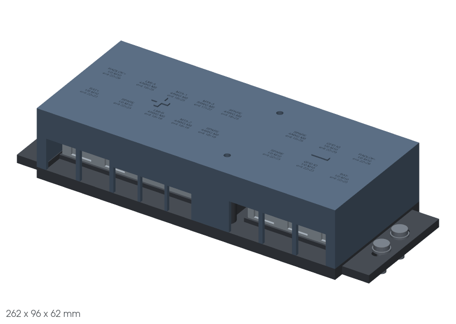 |
| Bus bar, design A rev3 | no | Design A, third revision | Saved design | same page | `cad/busbar/design-A-rev3/` (`ST185_busbar_A_rev3.f3d`, `A_rev3_ASSEMBLY.step`, ...) | none recorded |  |
| Bus bar, design B | no | Printed body, locators, Al bars, first B design | Superseded by B rev2/rev3 | same page | `cad/busbar/design-B/` (`ST185_busbar_B.f3d`, `B_ASSEMBLY.step`, ...) | none recorded | 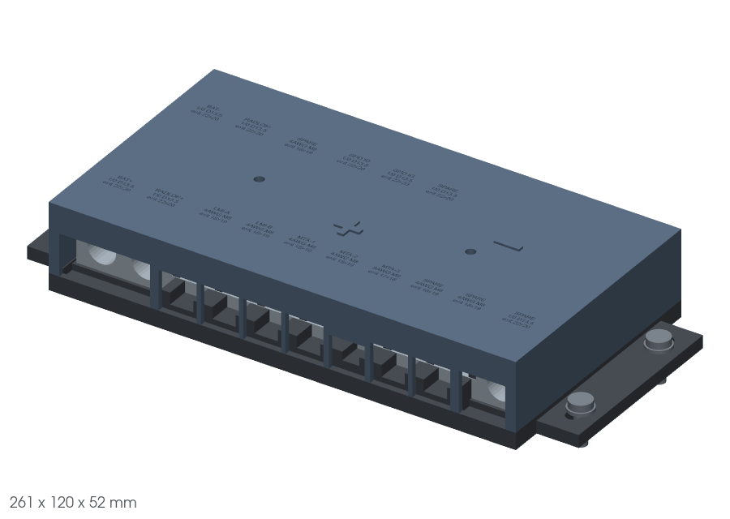 |
| Bus bar, design B rev2 | no | Design B, second revision (adds link strap, notch plugs) | Saved design | same page | `cad/busbar/design-B-rev2/` (`ST185_busbar_B_rev2.f3d`, `B_rev2_ASSEMBLY.step`, ...) | none recorded | 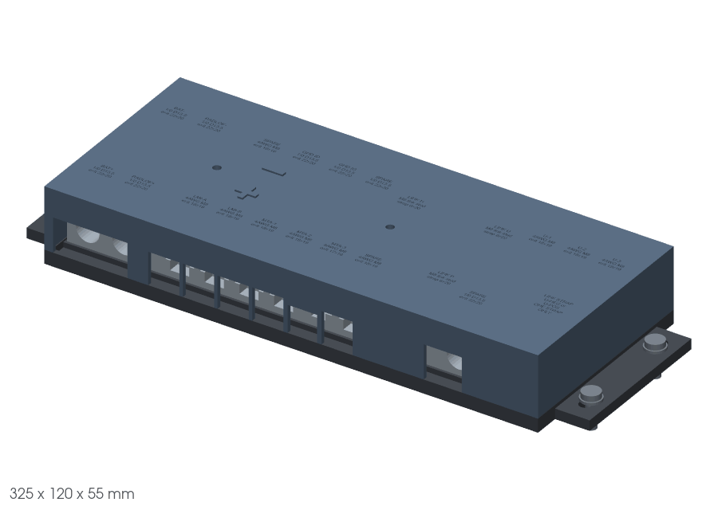 |
| Bus bar, design B rev3 | no | Design B, third revision | Dan's pick E1, **superseded by the rev 7 POWER box** (P7 = A, 2026-10-14): its + bar is now the AMI bar inside that box; kept as the reference for the bar geometry | same page | `cad/busbar/design-B-rev3/` (`ST185_busbar_B_rev3.f3d`, `B_rev3_ASSEMBLY.step`, ...) | none recorded | 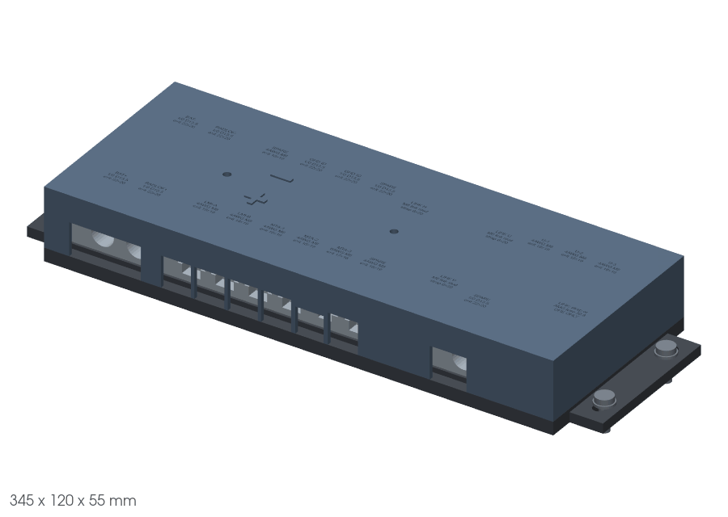 |
| VRC enclosure | **yes** | VR-conditioner box (body, lid, O-ring, LP16 connectors) | Model + drawing done | [ST185-enclosures.html](enclosures/ST185-enclosures.html) | `cad/enclosures/vrc/` (`ST185-VRC-Enclosure.f3d`, `VRC_assembly.step`, `VRC_part_*.step`, drawing PDF) | none recorded | 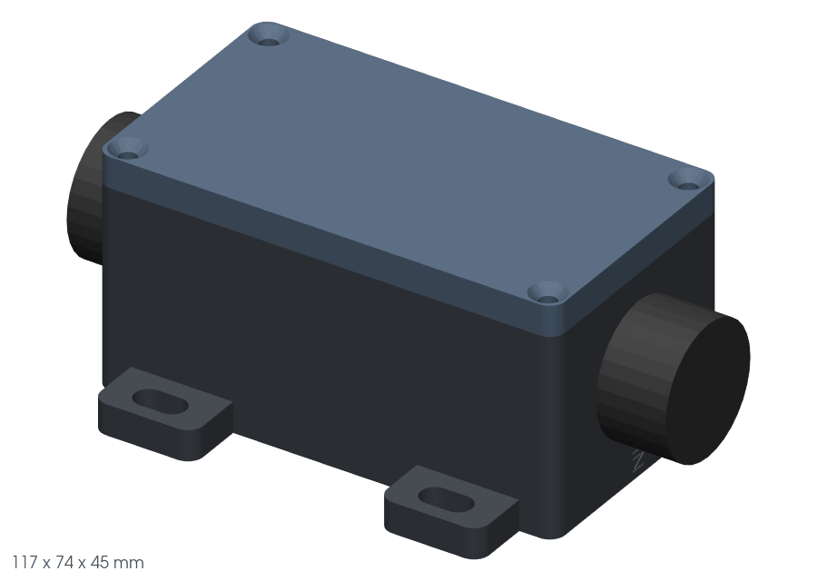 |
| CSB3 enclosure | **yes** | ECUMaster CSB3 switchboard box (body, lid, HD34 connector) | Model + drawing done | same page | `cad/enclosures/csb3/` (`ST185-CSB3-Enclosure.f3d`, `CSB3_assembly.step`, `CSB3_part_*.step`, drawing PDF) | none recorded | 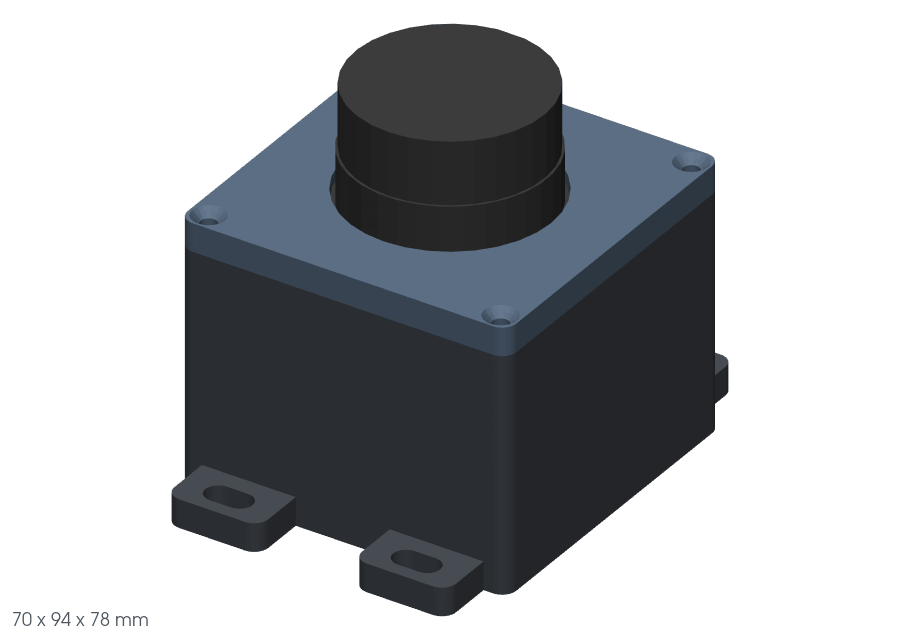 |
| DRB102 firewall plate | **yes** | Firewall mounting plate for the DRB102 | Model done | [DRB102-FIREWALL-PLATE.html](drb102-plate/DRB102-FIREWALL-PLATE.html) (build script `build_DRB102_plate.py` beside it) | `cad/drb102-plate/` (`DRB102-firewall-plate.step`, `DRB102-firewall-plate-assembly.step`; no `.f3d`) | none recorded | 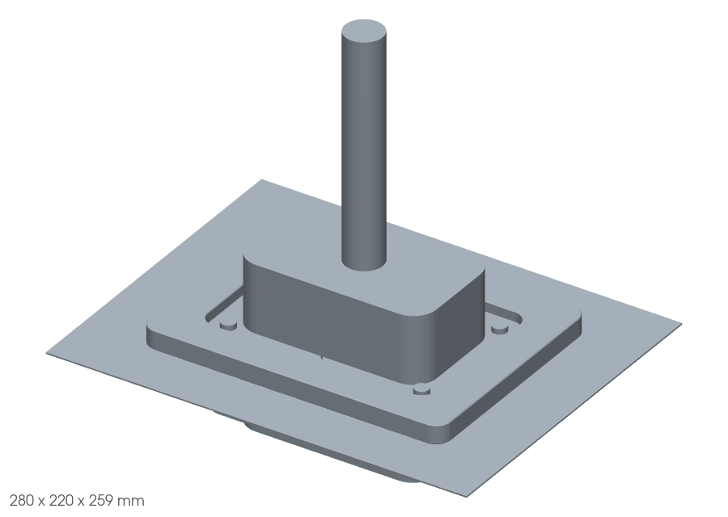 |
| Fuse boxes, rev 2 | no | ONE glove-box fuse + relay box (R70) | **Superseded by rev 3** (R75); plan page kept | [ST185-fusebox-cad-PLAN.html](fusebox/ST185-fusebox-cad-PLAN.html) | none kept (replaced by rev 3) | none recorded | none (no model kept) |
| Fuse boxes, rev 6 - POWER box + LOGIC box | no | TWO printed PA12 boxes (power, logic) + battery relay block; each a base (deck on angular legs, open underneath) + snap-on cover (vents, rev 4 etched names) + snap-on belly pan over the live parts underneath; every cable drawn to the box edge; battery block tabs on the short ends; rev 6: M6 limiters at every mount point, one 40 mm standoff, LOGIC mini-fuse inputs on 14 AWG jumpers to bus strips on edge (R73, R75, R76, R79, R81, R85) | Superseded by rev 7 (Dan's P7 = A, 2026-10-14; kept for comparison). Was: rev 6 ( every part real, R82 - waiting for Dan's approval, OPEN-ITEMS row 107; rev 3 / 3.1 / 4 / 5 superseded, in the Fusion version history) | [ST185-fusebox-summary.html](fusebox/ST185-fusebox-summary.html) | `cad/fusebox/` (parts lists `fusebox-parts-power.csv` / `-logic.csv` / `-battrelay.csv`, tracked; `ST185_fusebox_rev6.f3d`, `ST185_fusebox_rev6_assembly.step`, `Power_*`, `Logic_*`, `BattRelay_*` `Base` / `Cover` / `Pan` `.step`/`.stl`, copper `.step`) | none recorded (Fusion document `ST185_fusebox_rev6`, Default Project) | 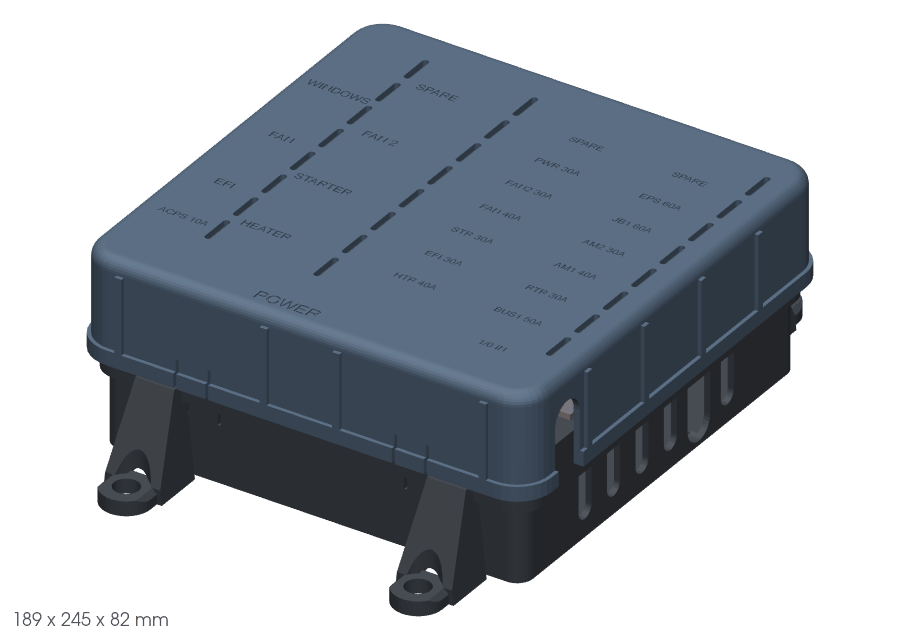 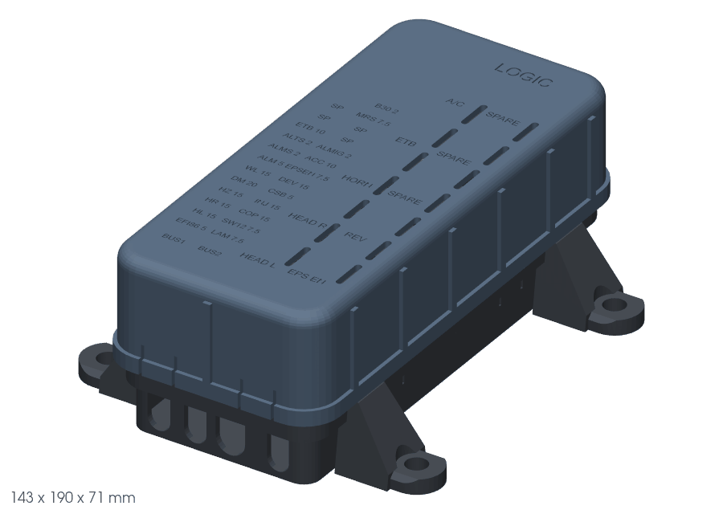 |
| Fuse boxes, rev 6 - battery relay block | **yes** | TWO printed PA12 boxes (power, logic) + battery relay block; each a base (deck on angular legs, open underneath) + snap-on cover (vents, rev 4 etched names) + snap-on belly pan over the live parts underneath; every cable drawn to the box edge; battery block tabs on the short ends; rev 6: M6 limiters at every mount point, one 40 mm standoff, LOGIC mini-fuse inputs on 14 AWG jumpers to bus strips on edge (R73, R75, R76, R79, R81, R85) | Current (rev 6; every part real, R82 - waiting for Dan's approval, OPEN-ITEMS row 107; Dan's P7 = A, 2026-10-14: the POWER box of this rev is superseded by rev 7; 2026-10-14 the LOGIC box too (rev 7 3 mm clearance fix, R93); the battery relay block stays rev 6 and selected; rev 3 / 3.1 / 4 / 5 superseded, in the Fusion version history) | [ST185-fusebox-summary.html](fusebox/ST185-fusebox-summary.html) | `cad/fusebox/` (parts lists `fusebox-parts-power.csv` / `-logic.csv` / `-battrelay.csv`, tracked; `ST185_fusebox_rev6.f3d`, `ST185_fusebox_rev6_assembly.step`, `Power_*`, `Logic_*`, `BattRelay_*` `Base` / `Cover` / `Pan` `.step`/`.stl`, copper `.step`) | none recorded (Fusion document `ST185_fusebox_rev6`, Default Project) | 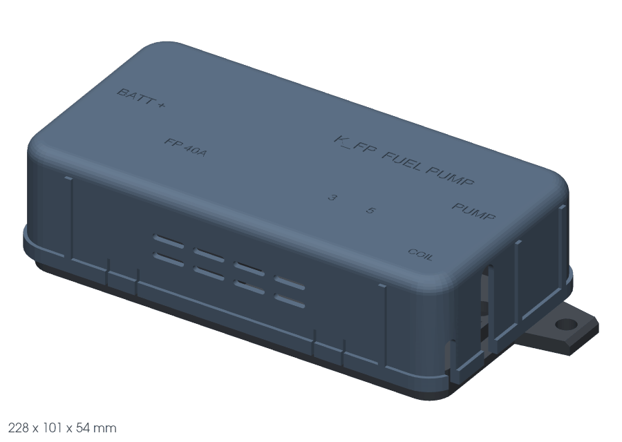 |
| Fuse boxes, rev 7 - POWER box with the bus bar in it + LOGIC box | **yes** | Dan's E2 = A (2026-10-14), selected by P7 = A: the glove-box bus bar and the POWER box are ONE box - the bus bar's + bar (B rev3 re-made in 1" x 1/4" tinned copper, cut + drilled only, R76) IS the AMI bar, the AMI fuses bolt straight onto it, a 62 mm bus zone at the rear carries BAT+ IN / RADLOK+ / spare on the + bar and BAT- / RADLOK- / GND ID / GND IG / relay grounds on a NEG bar, printed wall between; no POWER bar of its own, no separate bus bar box, no 1/0 link cable (1 heavy cable + 2 lugs fewer). Battery relay block = rev 6, unchanged. B rev3's universal bar U is left out (U1 = A). LOGIC box rebuilt here for Dan's 3 mm rule (R93, 2026-10-14): Bus 2 column and both micro relay columns 2.5 mm outboard, box 79 -> 81.5 wide, same parts; Bus 1 to Bus 2 3.18 mm (was 0.68), gate `fusebox/src/check_clearance.py`; every harness wire simulated in all 3 boxes (`fusebox/src/wiring_sim.py`, `render_wired_rev7.py`; questions J1-J4) | **Dan's pick (P7 = A, 2026-10-14)** - the POWER box + bus bar of the build; waiting for approval (OPEN-ITEMS row 107); every part real (R82, `fusebox/rev7/fusebox-parts-power.csv`) | [ST185-fusebox-rev7-summary.html](fusebox/rev7/ST185-fusebox-rev7-summary.html) | `cad/fusebox/rev7/` (`ST185_fusebox_rev7.f3d`, `ST185_fusebox_rev7_assembly.step`, `Power_*` `Base` / `Cover` / `Pan` `.step`/`.stl`, POS + NEG bar `.step`, `Logic_*` `Base` / `Cover` / `Pan` `.step`/`.stl` + strip `.step`; battery block files: the rev 6 row) | none recorded (Fusion document `ST185_fusebox_rev7`, Default Project) | 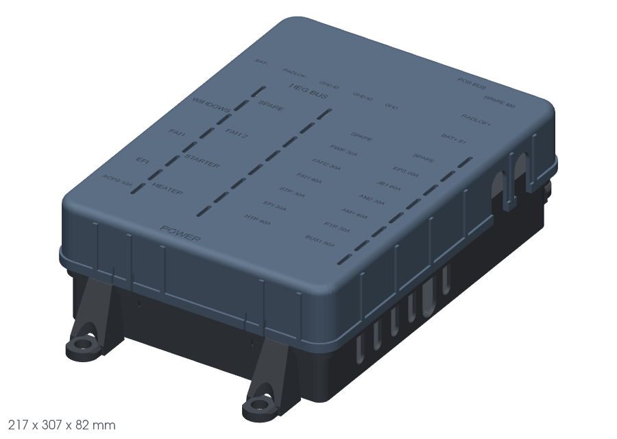 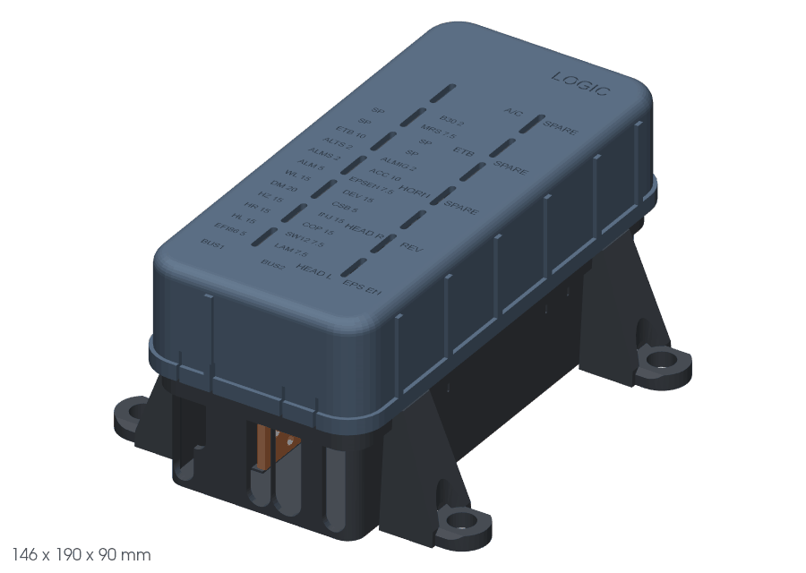  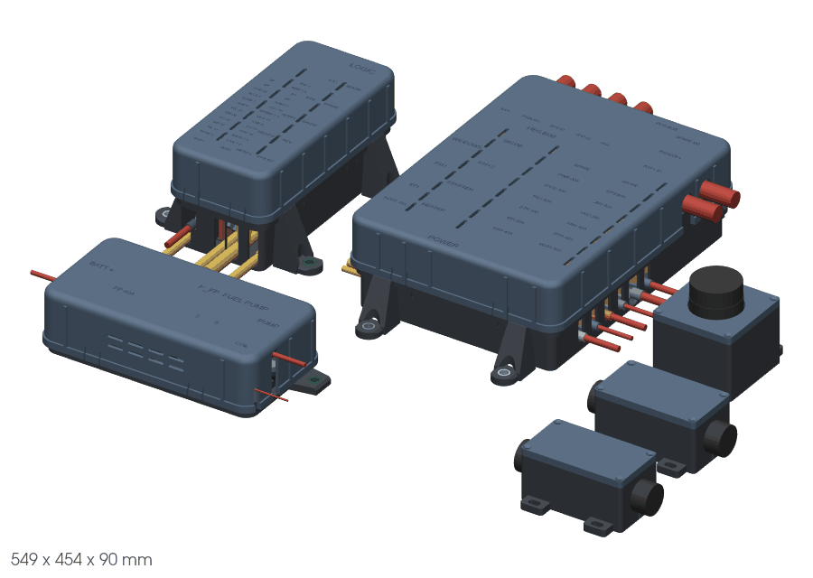 |
| Billet fuel hanger | **yes** | In-tank pump hanger in billet 6061, Walbro F90000295; **outside this repo** (Fairsolid run) | **Rev 7 is the newest** (2026-10-14: blind pockets only, bolted-on mounting block); `rev2/` to `rev6/` are earlier passes; no Fusion used (build123d script) | `C:\projects\active\fairsolid\runs\fuel_hanger_billet_1014\rev7\SUMMARY.md` (each rev folder has its own `SUMMARY.md`) | `C:\projects\active\fairsolid\runs\fuel_hanger_billet_1014\rev7\` (`hanger_billet_assembly.step`/`.stl`, per-part files, `hanger_billet.py`) | none (no Fusion document) | 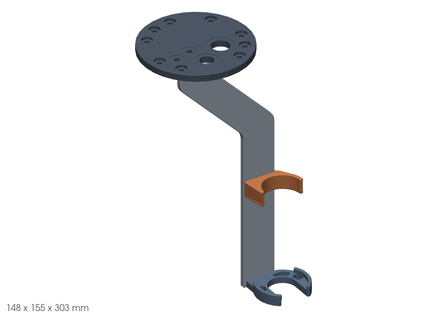 |

## Power distribution package

Always shown together, as one package (DECISIONS R84): the research hub's "Power distribution package" section reads this table and adds up the parts. Every member must be a model marked **yes** under "Selected for build" above; the hub drops (and warns about) any member that is not. A member's parts come from its parts list CSV (pieces = `qty_need`) or, with no BOM yet, from the solids in its assembly STEP (`model:<id>` = the entry in `cad/trimetrics.json`), times the number per car.

| Member | Trimetric | Per car | Parts from |
|---|---|---|---|
| POWER box with the bus bar in it (rev 7) | `fusebox/rev7/trimetric-power.png` | 1 | `fusebox/rev7/fusebox-parts-power.csv` |
| LOGIC fuse + relay box (rev 7, 3 mm fix; same parts as rev 6) | `fusebox/rev7/trimetric-logic.png` | 1 | `fusebox/fusebox-parts-logic.csv` |
| Battery relay block (rev 6) | `fusebox/trimetric-battrelay.png` | 1 | `fusebox/fusebox-parts-battrelay.csv` |
| VRC enclosure | `enclosures/vrc/trimetric.png` | 2 | `model:enclosure-vrc` |
| CSB3 enclosure | `enclosures/csb3/trimetric.png` | 1 | `model:enclosure-csb3` |

**Package renders** (every member together, `cad/render_trimetric.py`): `fusebox/rev7/package-rev7.png` (the selected set above); `fusebox/package-rev6.png` is the superseded rev 6 set (separate B rev3 bus bar + rev 6 POWER box), kept for comparison. Dan picked rev 7 on 2026-10-14 (P7 = A, DECISIONS R91); the universal bar U stays out (U1 = A).

## Power package views

Extra renders of the selected fuse boxes, shown under the package on the research hub ("Views"; the hub warns if a picture is missing). Every harness wire that lands in a box is in place (real gauge, colour, ident bands, the CAD exit lanes and the bend rule): `cad/fusebox/src/wiring_sim.py` (plan, no Fusion) + `render_wired_rev7.py` (Fusion, render and checks only) + `label_views_rev7.py`. All of them, with the check results, are on the [rev 7 summary page](fusebox/rev7/ST185-fusebox-rev7-summary.html#views).

| View | Picture |
|---|---|
| POWER box (rev 7), wired, long side | `fusebox/rev7/fusebox_power_wired_side_long.png` |
| POWER box (rev 7), wired, short end | `fusebox/rev7/fusebox_power_wired_side_end.png` |
| POWER box (rev 7), wired, exploded | `fusebox/rev7/fusebox_power_wired_explode.png` |
| POWER box (rev 7), wired, underneath | `fusebox/rev7/fusebox_power_wired_under.png` |
| POWER box (rev 7), wire routing from below | `fusebox/rev7/fusebox_power_wired_routing.png` |
| LOGIC box (rev 7), wired, long side | `fusebox/rev7/fusebox_logic_wired_side_long.png` |
| LOGIC box (rev 7), wired, short end | `fusebox/rev7/fusebox_logic_wired_side_end.png` |
| LOGIC box (rev 7), wired, exploded | `fusebox/rev7/fusebox_logic_wired_explode.png` |
| LOGIC box (rev 7), wired, underneath | `fusebox/rev7/fusebox_logic_wired_under.png` |
| LOGIC box (rev 7), wire routing from below | `fusebox/rev7/fusebox_logic_wired_routing.png` |
| Battery relay block, wired, long side | `fusebox/rev7/battrelay_wired_side_long.png` |
| Battery relay block, wired, short end | `fusebox/rev7/battrelay_wired_side_end.png` |
| Battery relay block, wired, exploded | `fusebox/rev7/battrelay_wired_explode.png` |
| Battery relay block, wired, underneath | `fusebox/rev7/battrelay_wired_under.png` |
| Typical arrangement, glove box, cabled together | `fusebox/rev7/fusebox_arrangement_wired_glovebox.png` |
| Typical arrangement, glove box from the rear | `fusebox/rev7/fusebox_arrangement_wired_glovebox_rear.png` |
| Typical arrangement, covers off | `fusebox/rev7/fusebox_arrangement_wired_glovebox_open.png` |
| Typical arrangement, top view | `fusebox/rev7/fusebox_arrangement_wired_glovebox_top.png` |
| Typical arrangement, trunk (battery relay block) | `fusebox/rev7/fusebox_arrangement_wired_trunk.png` |

**File lists on the research hub's Project status page** come from `cad/model-files.json`, which `python docs/build-research-hub.py` rewrites whenever it is run on a PC that has the model files (commit the refreshed file with the change). The builder warns on the page and on stderr if a model file sits in a folder with no row here, an `.f3d` is not named here, or the hanger row is not the newest `revN` folder.

External rows point at a local path only; that run folder is not in this repo and not in git here.
