# Engine-room power redistribution — 1993 ST185 All-Trac

**Decision (Dan, 2026-10-10, binding; supersedes the 2026-09-29 "keep the OEM engine-room loom + J/B2 dummy header" plan):** no factory engine-bay wire or connector is reused. J/B No.2, R/B No.2 / No.3 / No.4 / No.5, F11 and the engine-room main wire (with every factory plug and wire that ran to them) are **removed from the car**. Every engine-bay load gets new wire from the glove-box fuse box (`ST185-CabinPower`) straight to its device plug (the OEM device plug where one is recorded, DT where Dan chose DT). Cabin reuse is unchanged: J/B No.1, J/B No.3, the cowl / dash looms and the cabin side of IE1 stay, and new feeds splice into their factory cabin leads.

This is the living splice table. Pin facts come from the 1990 ST185 All-Trac EWD (the All-Trac-specific book) cross-checked against the 1992 Celica EWD132U (covers ST185, year-adjacent to 1993). The 1993 bound book is EWD160U; the freely available PDF of that number is the FWD AT180/ST184 book, so it is **not** used as All-Trac pin authority.

Factory snips live in `docs/electrical/ewd-snips/`. The drawing is `docs/harness/rebuild/ST185-EngineRoom-C.harness`. The fuse box is in `docs/harness/rebuild/ST185-CabinPower.harness`. Cabin ECU power stays in `docs/harness/rebuild/ST185-A-cabin.harness` (A-triggered relays) and `ST185-B-cabin.harness` (condenser fan relay).

---

## 1. Recommendation

Settled by the decision above; the old "keep the OEM looms + splice table" comparison (2026-09-29) is retired - git history keeps it.

1. Battery moves to the **trunk**. Cables run forward to a glove-box PDB (`ST185-HeavyDC`).
2. The fuse box (two custom boxes, POWER + LOGIC, DECISIONS R75 / cad/fusebox rev 5, drawn only in `ST185-CabinPower`) and every relay sit in the **passenger glove box** - except the fuel pump relay, which has its own small block at the battery in the trunk (R75, drawn in `ST185-HeavyDC`). No fuse or relay in the engine bay (DECISIONS 9.1). (No PMU - plan 6.48.)
3. EPS power uses the vacated **passenger-side ABS actuator** path. `bh_c` stays deleted. Large cables (battery / starter / alternator charge) cross the firewall on **RADLOK**.
4. Harness C (`ST185-EngineRoom-C`) carries every new bay circuit along the approved route `docs/harness/routes/ROUTE-2-HARNESS-C.html` (rev 9).

---

## 2. How factory power works today

*Factory layout, kept for reference. J/B No.2, R/B No.2-5 and the F11 fusible-link box are removed (DECISIONS R12); nothing lands on them. Every ex-J/B2 / R/B load lands per §5.4.*

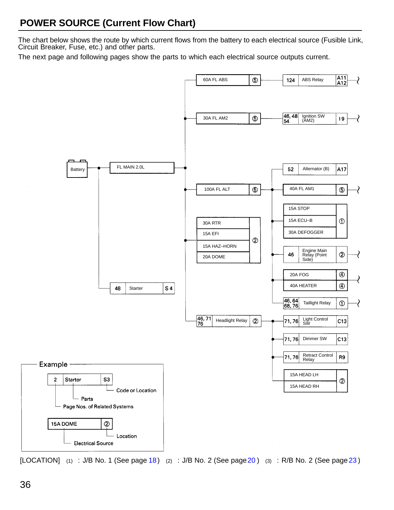

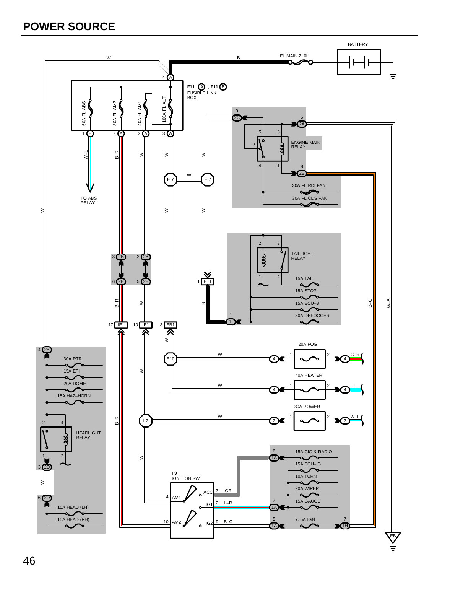

Battery (engine bay, near J/B No.2) → fusible-link box **F11** → J/B No.2 (engine bay, **driver side** — corrected 2026-09-29, see cross-check below) → engine-room main wire, out both fenders:

**J/B No.2 side, corrected 2026-09-29.** This section previously said J/B No.2 was on the passenger side; that was backwards. Cross-check: EWD p.16 (`ewd-snips/1990-st185-locations-engine-bay.png`, reproduced below at §3) draws R/B No.5 and the ABS relays on one side of the bay and J/B No.2 on the other. EWD p.24 (`ewd-snips/1990-st185-rb4-right-rb5-bay.png`) independently captions R/B No.5 as **"Engine Compartment Front Right"** — a plain-text location, not an inference from the drawing. Since R/B No.5 sits on the side of the p.16 drawing opposite J/B No.2, and R/B No.5 is confirmed front-right (passenger, LHD) by its own page, J/B No.2 is on the **driver side**. This also lines up with the ABS actuator already being called out passenger-side elsewhere in this doc (§1) — the ABS relays are drawn on the same side as R/B No.5 in the p.16 image, so that claim stands unchanged.

Moot since 2026-10-10: J/B No.2 is removed and harness C follows Route 2.

| Code | What it joins | Where |
|---|---|---|
| **EA1** | Cowl ↔ engine-room main | Front of **right** front fender (passenger) |
| **IE1** | Engine-room main ↔ cowl | **Left** kick panel (driver) |
| **ID1** | Engine-room main ↔ floor | Left kick panel |
| **ET1** | Engine-room main ↔ engine wire | Near J/B No.2 |
| **EB1 / EB2** | Engine wire ↔ cowl | Rear of right front fender |
| **1H / 1I** | Engine-room main ↔ **J/B No.1** | Left kick panel |
| **2A / 2D / 2E** | Engine-room main ↔ **J/B No.2** | At the battery fuse box |
| **2B / 2C** | Engine wire ↔ J/B No.2 | Same place |

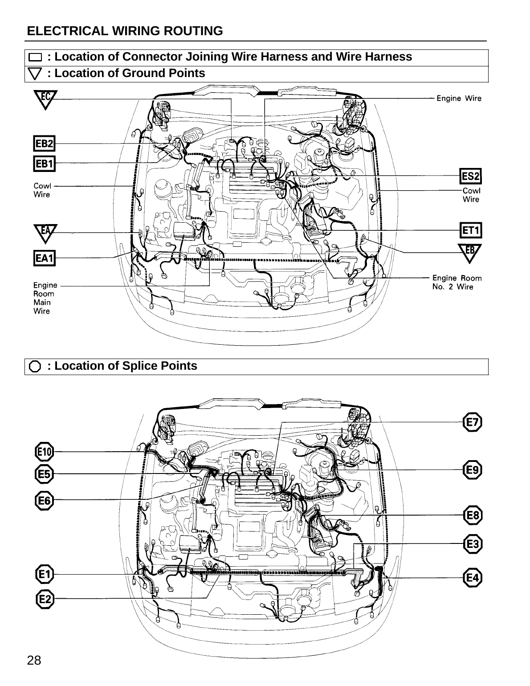

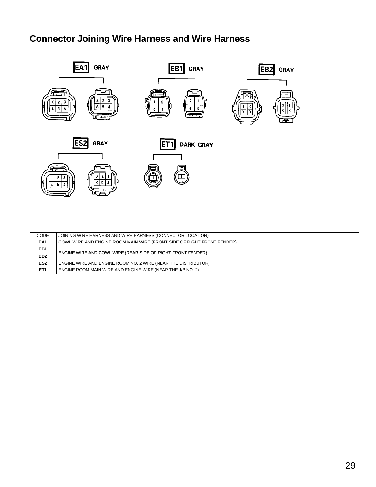

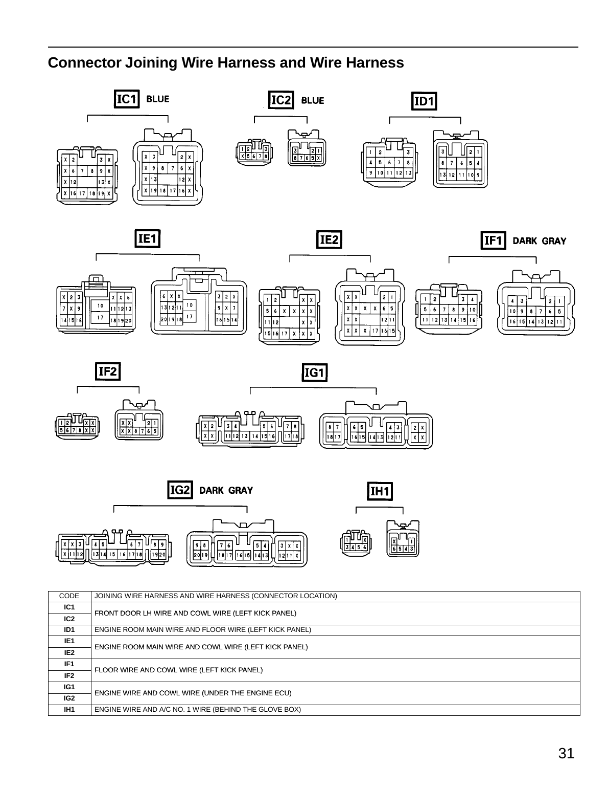

J/B No.2 is removed with its plugs and the engine-room main wire. Everything it fed — lights, horn, hazard, dome, retract, AM1/AM2, the always-hot feed into J/B No.1 — gets a new wire from the glove-box fuse box: to the device itself in the bay, or to the cabin end of the old wire (IE1 cowl side, J/B No.1). §5.4 is the landing table.

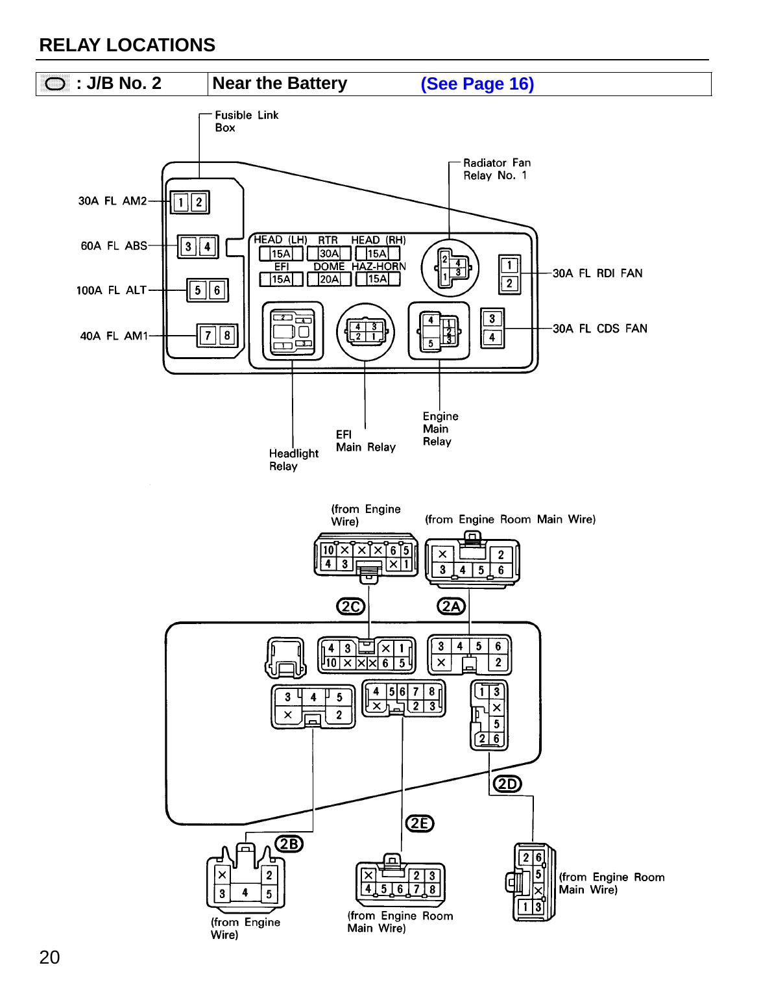

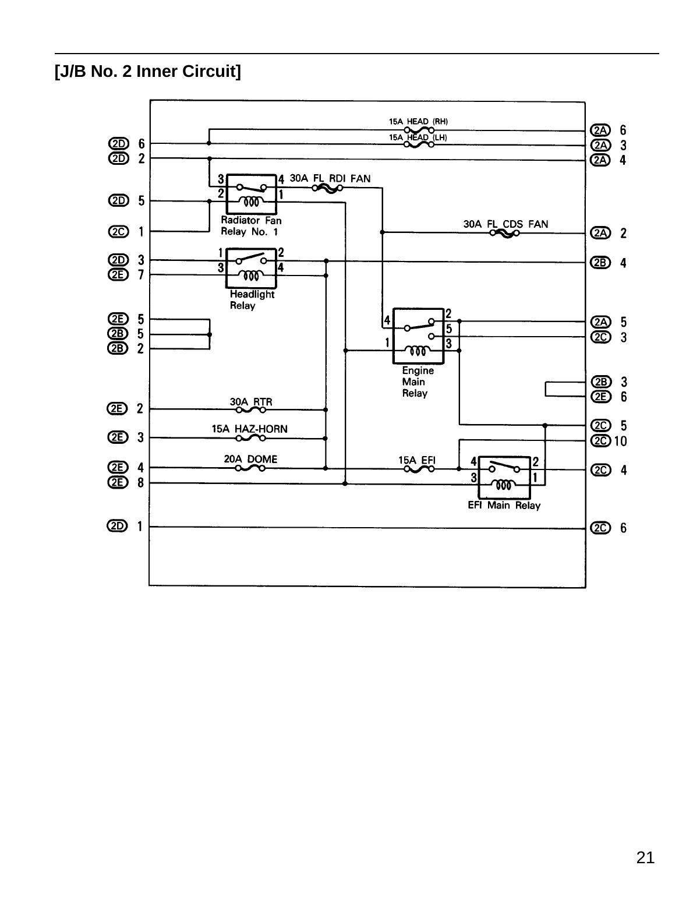

---

## 3. Target architecture

```
TRUNK battery +  ──2 AWG / 1/0──►  GLOVE BOX PDB  ─┬─► POWER + LOGIC fuse boxes (ECU / EPS / fans / body, ex-J/B2)
                     jump lug                     │   (ST185-CabinPower, Option B)
TRUNK battery −  ──2 AWG / 1/0──►  PDB ground     ├─► always-hot + AM1 + AM2 to kick-panel J/Bs
                                                  └─► RADLOK +  ──firewall──► starter B+ ◄── 160 A alt B+
                                                     RADLOK −  ──firewall──► engine block
                                                     engine-bay jump post on the starter B+ net
```

Glove box is passenger side, next to the blower (B4). J/B No.1, IE1 and the old R/B No.2 spot are the driver kick — a dash-cross of fused feeds, not a second battery cable.

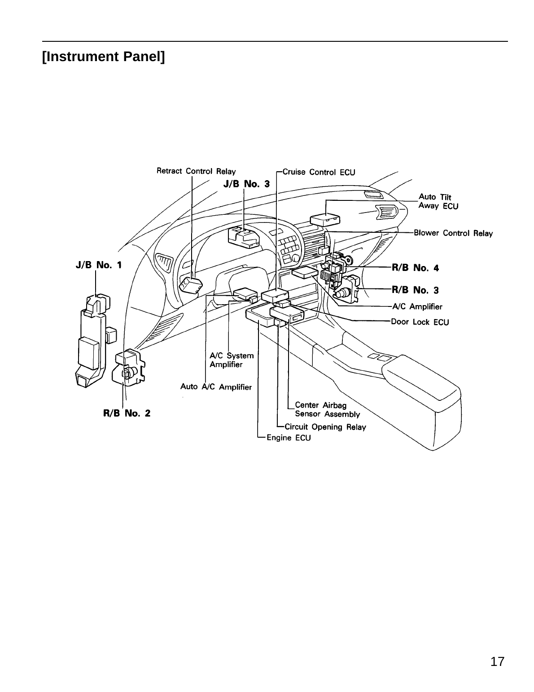

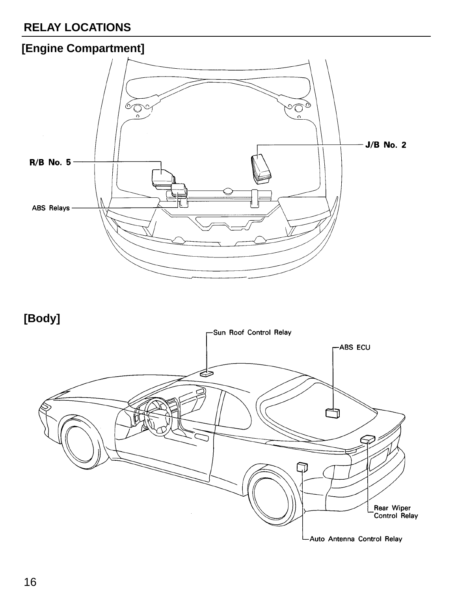

### 3.1 Where each load gets its power

No PMU/PDM — dropped 2026-09-22 (plan 6.46 / 6.47 / 6.48). The 40 A blower exceeds
every PDM channel on the market, so it gets a Mini ISO relay + AMI fuse in the POWER box. Logic that was
going to live in a PMU — device hold, kill relay, alternator excite — is
**withdrawn** (plan 6.48): the only logic is the ECU's own hold power. The RealDash Pi
runs on a switched ignition fuse only, on and off with the car (2026-09-28). Every relay and fuse is in the cabin.

Rule: **one source per load** — never two paths feeding the same circuit.

| Load | Path | Why |
|---|---|---|
| Starter motor | Battery cable + RADLOK + existing `k_str` for solenoid | Cranking amps |
| 160 A alternator B+ | 4 AWG (or 2 AWG) to starter B+, does not recross | Heavy cable. Protected by a fusible link or inline fuse / breaker at the trunk battery or near the cabin fuse box, never at the starter (Daniel 2026-09-28) |
| MRS EPS pump | `k_eps` HCR 150 in the glove box beside the fuse box (moved from the engine bay 2026-09-28; drawn on `ST185-CabinPower` since 2026-10-11), POWER AMI OUT-6 Bussmann AMI-60 (was LMI L7, HCFB H4 before that), 8 AWG feed (sized 2026-09-28, `sot/channels.csv` k_eps c1) | Too big for a micro relay |
| Uprated rad / condenser fans | `k_fan` / `k_fan2`, fuse sized to the fan's peak | Coils from Aux 5 / Ign 5 |
| EFI main, ETB, fuel pump | Relays seated in the glove-box fuse box, `ST185-CabinPower.harness` (coil wires on `ST185-A-cabin.harness`) | Hold-power and Link's published ETB circuit |
| HEAD LH / HEAD RH | Relay + fuse, LOGIC HL / HR, new wire to headlight H1 / H2 pin 3 | Replaces 15 A HEAD fuses + headlight relay in J/B2 |
| HAZ-HORN | LOGIC HZ fuse: hazard feed to IE1-12 (cowl side); horn relay (LOGIC M13) to a DT 2-way at each horn H3 / H4 | Replaces 15 A HAZ-HORN and the R/B5 horn relay |
| DOME | LOGIC DM fuse only, always-hot, to J/B1 1H-2 (cabin) | Replaces 20 A DOME |
| Retract motors | POWER RTR (AMI OUT-2) fuse only, to IE1-3 → OEM retract control relay R8 | Replaces 30 A RTR (DECISIONS 38) |
| Wiper / washer | J/B No.1 WIPER 20A (R61), no relay of ours | The park switch is in the motor F9 (pins 3-4) and the wiper relay is inside the switch C16 (1993 p.148); no fuse-box position (the Option B `wp` spare is gone) |
| Heater blower | POWER HTR 40 A AMI + heater relay (R1), to blower motor B4 pin 2 | R/B No.4 removed (DECISIONS 26.2) |
| Power windows | POWER PWR 30 A AMI + power relay (R6), to the W-G window feed (old R/B2 power main relay terminal 1) | R/B No.2 removed (DECISIONS 26.2). The always-hot W-L net (door lock ECU, tilt-away) is open - `docs/OPEN-ITEMS.md` |
| Wiper, gauge, turn, CIG, ECU-IG, IGN, STOP, TAIL, ECU-B, DEFOGGER | Stay as **J/B No.1** fuses (rule R61, 2026-10-13: anything in a kept cabin J/B stays fed from it) | That is why the J/B stays. We only restore its upstream B+ and IG; their bay legs (wiper motor, front turn / clearance) are new harness C wire; the rear lamps are the new `ST185-RearLights` (J/B No.1 1F-1 / 1F-3 / 1F-2 and S9 pin 1; reverse relay `k_rev` contact on the GAUGE fuse via J/B3 3B-9) |
| A/C compressor | Engine harness A/B (already drawn) | Not engine-room C |
| ABS actuator / ABS relays / 60 A FL ABS | **Deleted** | Solenoid module removed |
| Crash / SRS sensors | **Deleted** | Do not refeed the airbag IGN circuit |

The glove-box fuse box (`ST185-CabinPower`) is fed from the PDB stud. Fuse and relay
ratings not written above are `TBD` until sized against the load.

---

## 4. Method

1. Remove J/B No.2 (2A-2E), F11, R/B No.2 / No.3 / No.4 / No.5, the engine-room main wire and every factory engine-bay wire, plus the ABS actuator, ABS relays and crash sensors. Keep J/B No.1, J/B No.3 and the cowl / dash looms; depin and plug the engine-room-main half of IE1, 1H and 1I and keep the cabin half as the splice point.
2. Build the trunk battery, glove-box PDB and POWER + LOGIC fuse boxes with their relays, and the battery relay block in the trunk.
3. Restore always-hot at J/B1 1I-1, AM1 / AM2 at IE1-10 / IE1-17 (cowl side).
4. Land every other ex-J/B2 / R/B load per §5.4: bay loads on new wire to the device plug, cabin loads on their factory cabin lead.
5. Do **not** refeed EFI, engine-main-relay or circuit-opening-relay circuits. Link owns those (`k_efi`, `k_fp`).
6. Continuity-check every row in §5 on the car before first power-up.

---

## 5. Splice / feed table

### 5.1 Heavy DC (trunk → glove box → bay)

| # | Net | AWG | From | To | Hardware | Notes |
|---|---|---|---|---|---|---|
| H1 | Battery + | **1/0** | Trunk battery + post, jump lug | Glove-box PDB BAT+ stud, jump lug | Cable along cabin floor / tunnel | Replaces engine-bay battery + F11 FL MAIN 2.0L |
| H2 | Battery − | **1/0** | Trunk battery − , jump lug | PDB ground + body | Bond to the cargo floor | Separate from sensor Gnd Out |
| H3 | Charge / start + | **1/0** | PDB ALT/STR stud | RADLOK + firewall, cabin side (`RL00801-50RE`) | Feed-through is `RL9080-301-F1RE` | |
| H4 | Charge / start + | **1/0** | RADLOK + firewall, engine side (`RL00801-50RE`) | Starter B+ post, jump lug | | |
| H5 | Alternator B+ | 2 AWG | Alternator B+ (rear of block, under intake) | Starter B+ | Does **not** recross the firewall | Short bay jumper; factory A17 pin B, we replace that cable |
| H6 | Engine ground | **1/0** | RADLOK − firewall, engine side (`RL00801-50BK`) | Engine block stud, jump lug | Feed-through is `RL9080-301-F1` | OEM grounds EA / EB / EC stay |
| H7 | Cabin ground | **1/0** | PDB ground | Kick-panel ground **ID** (left) and a new glove-box ground at IG (old R/B4 set bolt) | | |
| H8 | Jump post | 2 AWG | Starter B+ | Engine-bay jump post | So you can still jump-start from the bay | |

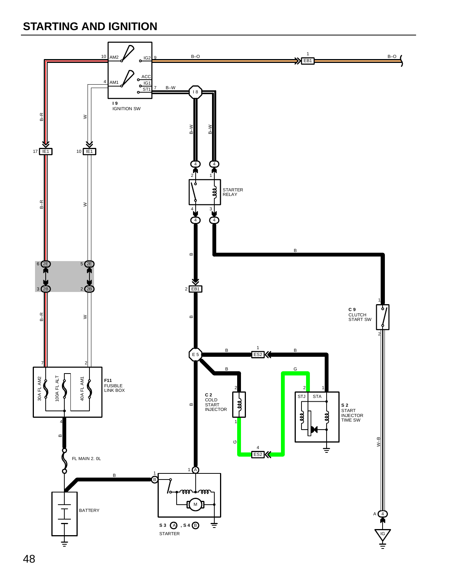

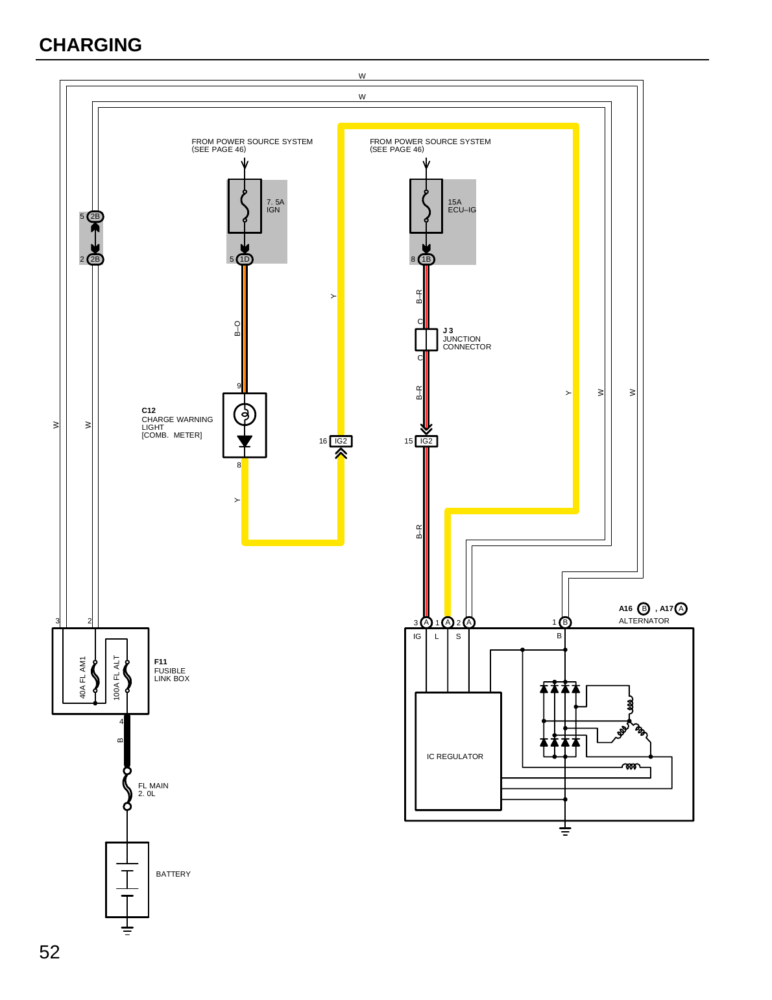

**SETTLED 2026-09-22 — 1/0 and RADLOK 8.0.** The old `RL00571-35` spec was wrong twice
over: Amphenol's catalogue has no `-35` (the trailing number is cable mm², and only
`-16` and `-25` exist for 5.7 mm), and 5.7 mm RADSOK is rated **120 A** — under the
160 A the alternator can push back through this crossing.

Sizing, done properly:

| Case | Current | 2 AWG drop | **1/0 drop** | 2/0 drop |
|---|---|---|---|---|
| Alternator at rating, continuous | 160 A | 0.90 V | **0.57 V (4%)** | 0.45 V |
| Cranking, a few seconds | ~300 A | 1.69 V (13%) | **1.06 V (8.4%)** | 0.84 V |

Round trip is about **36 ft** — roughly 18 ft each way, trunk → PDB → firewall →
starter, with a dedicated negative of similar length. 2 AWG blows past the 10%
a starter circuit is normally held to. 2/0 buys 0.2 V for a lot more money and a
much worse bend radius. **1/0 (50 mm²)** it is, which is exactly the RADLOK 8.0
cable size.

| Piece | Part | Qty |
|---|---|---|
| Firewall feed-through, positive | `RL9080-301-F1RE` — 8.0 mm RADLOK, panel mount, pin both sides, 200 A / 1 kV, IP40 mated, red | 1 |
| Firewall feed-through, negative | `RL9080-301-F1` — same, black | 1 |
| Cable connector, positive | `RL00801-50RE` — female, 200 A, 50 mm², red | 2 (one each side) |
| Cable connector, negative | `RL00801-50BK` — same, black | 2 (one each side) |

Each polarity is three pieces: the feed-through lives in the firewall, a cable
connector plugs onto each side. 200 A continuous gives 25% headroom over the
alternator case, and a connector of this class shrugs off a few seconds of
cranking. The `-303` nickel variant is discontinued; RS names `-301` as its
replacement.

The alternator still lands on the starter post (H5), so it never needs a second
crossing.

### 5.2 Left kick panel — J/B No.1 (keep)

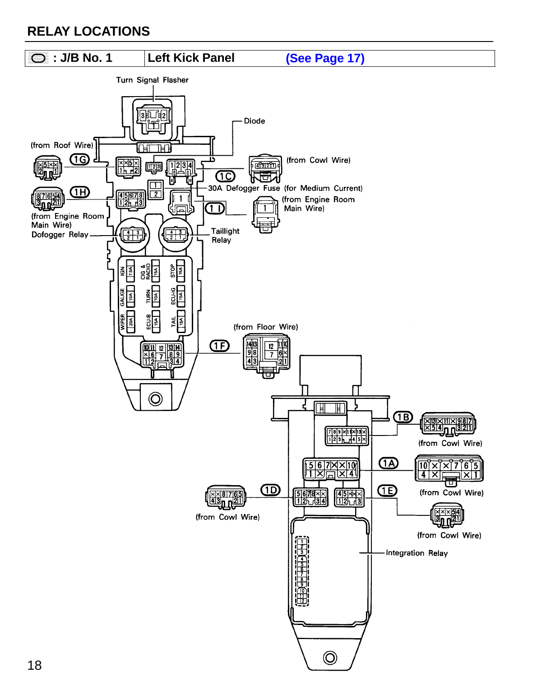

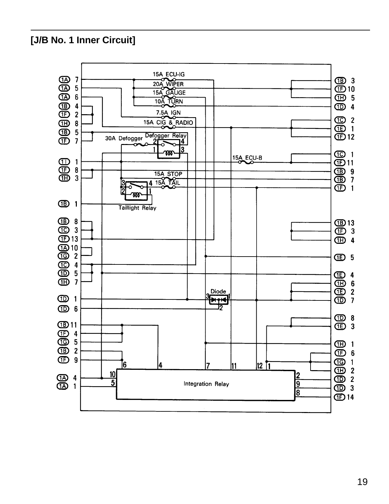

J/B No.1 already contains: 15A ECU-IG, 20A WIPER, 15A GAUGE, 10A TURN, 7.5A IGN, 15A CIG & RADIO, 15A STOP, 15A ECU-B, 15A TAIL, 30A DEFOGGER, taillight relay, defogger relay, turn flasher, integration relay.

| # | Inject? | Connector | Pin | Signal | New source | Action |
|---|---|---|---|---|---|---|
| L1 | **YES** | **1I** (engine-room main) | **1** | Always-hot into J/B1 (STOP / ECU-B / DEFOGGER / tail-relay B+) | PDB OEM HOT, fused 40–60 A upstream of the J/B fuses | Primary left-kick B+. Probe 1I-1 to battery + on the stock car to confirm before cutting |
| L2 | no | **1H** | **7** | IG2 from ignition switch I13-9 | I13 still feeds it via cowl | Do not overlay. Comes alive once AM2 is restored |
| L3 | maybe | **1H** | **8** | Tied to 1I-1 / 1F-8 / 1I-3 on the inner circuit | Follows L1 if the inner bus is intact | Only add a second feed if L1 does not light 1H-8 |
| L4 | no | **1A** | **7** | ACC from I13-3 | Ignition switch | Restored by AM1 (L6) |
| L5 | no | **1A** | **5** | IG1 from I13-2 | Ignition switch | Restored by AM1 (L6) |
| L6 | **YES** | **IE1** (ER main ↔ cowl, left kick) | **10** | AM1 to ignition I13-4 | PDB AM1, **40 A** fuse (replaces F11 40A FL AM1) | Feeds the switch (the engine-room AM1 run is removed) |
| L7 | **YES** | **IE1** | **17** | AM2 to ignition I13-10 | PDB AM2, **30 A** fuse (replaces F11 30A FL AM2) | Same |
| L8 | **YES** | Ground **ID** | stud | Left kick body ground | PDB ground strap | See grounds, EWD p.169 |

Do not land new wires on 1A/1B/1C/1D/1E/1F/1G unless a circuit is dead after L1/L6/L7. Exception (2026-10-13, Route 15): the rear floor wire is missing, so `ST185-RearLights` takes its tail / turn feeds from the 1F-1 / 1F-3 / 1F-2 leads at J/B No.1 (R61). Those cavities are cowl / floor / roof, still OEM. The 1H / 1I / IE1 landings are cabin-side splices into the factory lead (the engine-room main wire that used to mate there is removed).

### 5.3 Right kick panel — R/B No.3 / No.4 removed

R/B No.3 (fog relay; fog lights deleted) and R/B No.4 are removed (Dan, 2026-10-10, DECISIONS 26.2). Their jobs move to the glove-box box: 40 A HEATER + heater relay → POWER box R1 (blower B4 pin 2, §5.4), 10 A A/C → MTA-3 ACPS, OEM starter relay → Link `k_str`, B30 start request → MTA-3. The right-kick body ground **IG** (old R/B4 set bolt) stays and gets a PDB ground strap (EWD ground index p.171).

J/B No.3 (behind the combination meter) is a **cowl junction only**. It does not need a new battery feed. Do not splice it.

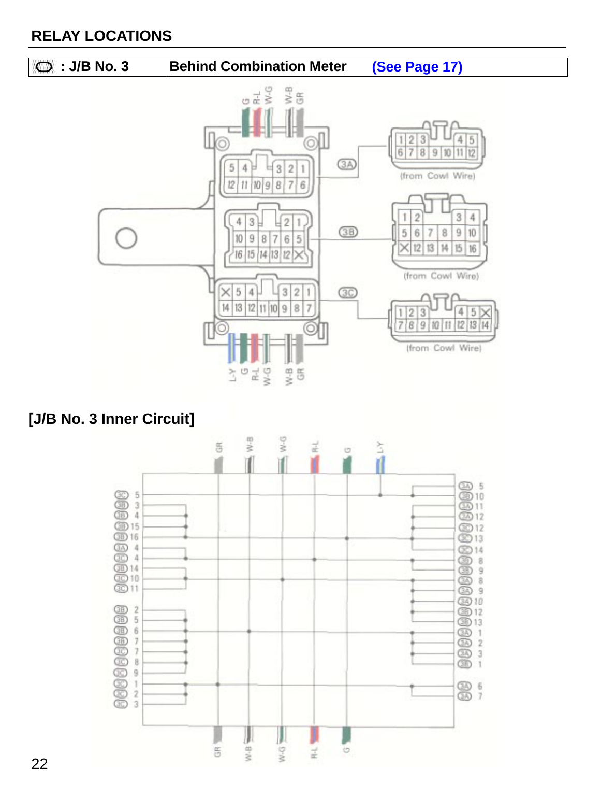

### 5.4 Where each ex-J/B2 / R/B load lands (2026-10-12)

Drawn in `ST185-EngineRoom-C` (cabin and bay ends) and `ST185-CabinPower` (fuse / relay). Pins from the 1993 TIS EWD in `st185-celica-repair-manual\electrical\circuits\`. Bay ends are new wire to the device's own plug; cabin ends splice into the factory cabin lead.

| Load | From (box) | AWG | To | Where | EWD 1993 |
|---|---|---|---|---|---|
| HEAD LH | LOGIC HL 15 A + relay | 14 | H1 pin 3 (headlamp plug) | Bay, LH corner | p.116 |
| HEAD RH | LOGIC HR 15 A + relay | 14 | H2 pin 3 (headlamp plug) | Bay, RH corner | p.116 |
| Horns | LOGIC M13 (horn relay 87, HAZ-HORN 15 A) | 14 → splice → 16 each | DT 2-way at H3 and H4, c1 +; c2 16 AWG ground to EA | Bay, front centre | p.185 |
| Hazard | LOGIC HZ 15 A (before the horn relay) | 14 | IE1-12 W | Cabin, left kick | p.130 |
| DOME | LOGIC DM 20 A | 12 | J/B1 1H-2 | Cabin, left kick | p.132 |
| RTR | POWER RTR 30 A | 10 | IE1-3 W → R8 pin 3 | Cabin, left kick | p.116 |
| AM1 / AM2 | POWER AM1 40 A / AM2 30 A | 8 / 10 | IE1-10 / IE1-17 | Cabin, left kick | p.62 |
| J/B1 always-hot | POWER JB1 60 A | 6 | J/B1 1I-1 | Cabin, left kick | p.62 |
| Blower | POWER HTR 40 A + heater relay | 8 | Blower motor B4 pin 2 | Cabin, behind the glove box | p.215-216 |
| Power windows | POWER PWR 30 A + power relay | 10 | W-G window feed (old R/B2 power main relay terminal 1) | Cabin, left kick | p.137 |
| Door lock / tilt-away always-hot | LOGIC WL 15 A (R58, drawn 2026-10-12) | 14 | W-L lead at old R/B2 pin 2 → splice I1 → door lock ECU D8-8 / tilt-away ECU | Cabin, left kick | p.137 / p.170 |

Bay lighting and wipers (2026-10-13, Route 2 rev 10; no side markers, R62) - not a box output, fed from J/B No.1 per R61:

| Load | From (cabin landing) | AWG | To | Where | EWD 1993 |
|---|---|---|---|---|---|
| Front clearance | J/B1 1H-6 (TAIL 15A) | 16 | F7 / F8 pin 1 | Bay, both corners | p.112 |
| Front turn LH / RH | J/B1 1H-4 / 1H-8 (TURN 10A via flasher) | 18 | F7 / F8 pin 3 | Bay, both corners | p.130 |
| Headlamp returns | IE1-18 low (R-W), IE1-11 high (R-L) | 16 per lamp, 14 to IE1 | H1 / H2 pins 2 / 1 | Bay, both corners | p.116 |
| Retract motors | IE1-14 / 15 (R2), IE1-8 / 7 (R3), IE1-9 / 16 limits (OEM R8, RTR 30 A) | pin 4 feed and pin 5 ground 12 -> splice -> 16 pigtail (150 mm max); pin 2 16, limits 18 (DECISIONS S20) | R2 / R3 pins 1-4, ground pin 5 to EB | Bay, both corners | p.117 |
| Front wiper | J/B1 1H-5 (WIPER 20A), IE1-20 / 13 / 6 | 14 | F9 pins 4 / 1 / 2 / 3 | Bay, under the windshield cowl, driver side; feed via the driver (LH) fender pass-through (S19) | p.148 |
| Washer | cowl leads to W1 (L from splice I2, L-R from C16-8) | 14 | W1 pins 2 / 1 | Bay, passenger front corner, lower front fender (S19) | p.148 |

Relay coil wires of the box non-ECU relays: drawn 2026-10-14 in `ST185-CabinPower.harness` (`k_hl` / `k_hr` coil- to IE1-2, `k_horn` to IE1-19, `k_htr` from the old R/B4 R-L / L-W leads, `k_pwr` coil+ from the old R/B2 L-Y lead; `docs/OPEN-ITEMS.md` rows 46, 106).

### 5.5 Engine-room grounds (keep the OEM rings)

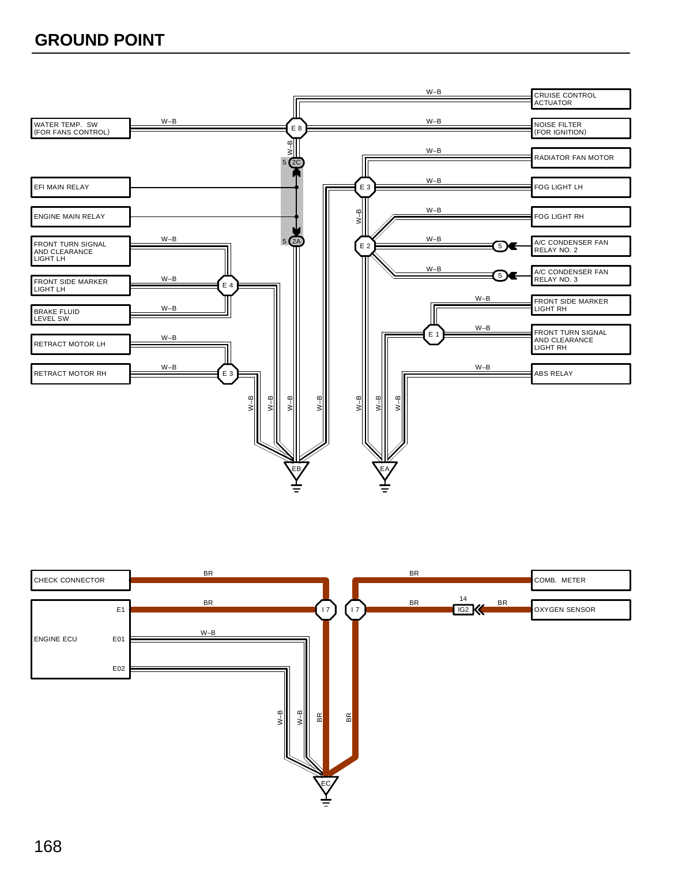

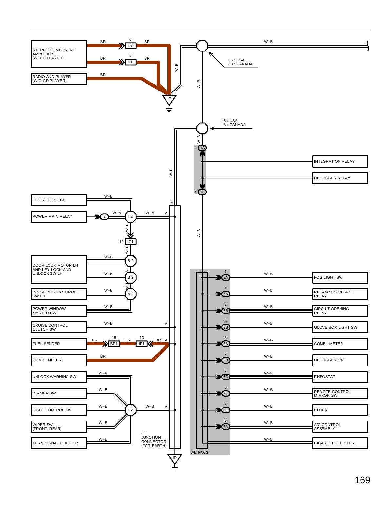

| Code | Where | Keep? | Add? |
|---|---|---|---|
| **EA** | Right front fender | Yes — lights / fans on that side | Bond uprated fan grounds here |
| **EB** | Left front fender | Yes | Bond EPS pump ground **or** use the engine-block stud (preferred for 60 A) |
| **EC** | Intake manifold | Yes, leftover OEM engine-wire grounds | Do not put EPS / fan current on EC |
| **ID** | Left kick panel | Yes | Strap from PDB (L8) |
| **IE / IF** | Dash braces | Yes | Untouched |
| **IG** | ex-R/B No.4 set bolt (the body bolt stays; the box is removed, R12) | Yes | Strap from PDB |

### 5.6 Deleted OEM circuits — do not restore

| Circuit | Connectors / feeds | Why |
|---|---|---|
| ABS actuator | A7, A8; 60A FL ABS; ABS relays A11/A12 | Module removed; space reused for EPS cables |
| ABS ECU / rear sensors (body) | A38, A39, A40, A41 | Wheel-speed, if kept, goes to the Link VR conditioners on A/B, not the OEM ABS ECU |
| ABS deceleration sensor | A37 | Deleted with ABS |
| SRS airbag / crash sensors | Center airbag sensor (dash, EWD p.17); yellow cowl airbag harness | Deleted. Do not refeed 7.5A IGN into the airbag ECU |
| OEM EFI main / circuit opening / OEM ECU | J/B2 EFI fuse, R/B5 fuel-pump relay, C7 | Replaced by Link `k_efi` / `k_fp` |
| OEM radiator / condenser fan relays in J/B2 and R/B5 | R/B5 fan relays 2 and 3; J/B2 RDI FAN relay | Replaced by `k_fan` / `k_fan2` |
| Rear windshield wiper and washer | Rear wiper motor, rear washer pump, their switch outputs, fuse and relay | Deleted (DECISIONS R54, Daniel 2026-10-12). The FRONT wipers / washer stay (R53) |

### 5.7 New Engine Room C runs (the only new bay wiring)

Routed with the OEM engine-room main. Passenger fender / ABS trough for EPS; core support for fans.

| # | Circuit | AWG | Path | Connector |
|---|---|---|---|---|
| C1 | EPS pump 12 V | 8 AWG (sized 2026-09-28 against the AMI-60, `sot/channels.csv` k_eps c1) | `k_eps` 87 (glove box) → passenger kick / EA1 → ABS trough → pump | `90980-12068` pin 1 (OWNED) |
| C2 | EPS pump GND | 8 AWG | Pump pin 2 → engine-block stud (not EA) | `90980-12068` pin 2 |
| C3 | EPS enable | 18 AWG | F13 7.5 A IG-switched → same trough | `90980-10942` pin 1 (OWNED) |
| C4 | EPS relay coil- (R22) | 20 AWG | Pump connector B pin 5 → bulkhead A c27 → `k_eps` coil- | `w_eps_rly_e` / `w_eps_rly_ae` / `w_eps_rly` / `w_eps_rly_cp` (2026-10-12) |
| C5 | EPS speed | 18 AWG shielded | Pump connector B pin 2 → Aux 7 / A27 | Signal file, engine harness A — **not** C |
| C6 | Rad fan 12 V | 8 AWG (size to the fan; OEM was 30 A FL) | `k_fan` 87 → core support | New DT 2-way at the fan |
| C7 | Rad fan GND | 8 AWG | Fan → EA | |
| C8 | Condenser fan 12 V | 8 AWG | `k_fan2` 87 → core support | New DT 2-way |
| C9 | Condenser fan GND | 8 AWG | Fan → EA | |
| C10 | A/C compressor VC control coil (not fitted; the clutch is A4 pin 4 from `k_acc`) | — | **ST185-EngineRoom-C** flying lead `fl_a4_3` (device side; A18-5 amplifier side is on ST185-A-cabin, `br_ac_mg` break), not a numbered loom-C circuit | Not on A/B; `docs/harness/ACAMP-SPUR-LABELS.md` |

Wiper, washer, headlights, turn, park and horns are new harness C wire too (§5.4 and Route 2); none of the OEM engine-room loom stays.

---

## 6. What lives in which drawing

Updated 2026-09-22. The two-file Power/Signal split this table used to name is gone;
see `docs/harness/README.md` for the current file map.

| File | Owns |
|---|---|
| `docs/harness/rebuild/ST185-CabinPower.harness` | Glove-box POWER + LOGIC fuse boxes (DECISIONS R75, CAD rev 5) with every ECU-switched relay seated in them except `k_fp` - the boxes live only here |
| `docs/harness/rebuild/ST185-A-cabin.harness` | EFI / ETB / FP / start / rad fan relay coil wires (relays in the box), ECU 12 V, ECU-A pins, CSB3 plug and switch inputs (ECU loom letter rule, 2026-09-28) |
| `docs/harness/rebuild/ST185-B-cabin.harness` | ECU-B pins, condenser fan / EPS / A/C clutch relay coil wires (relays in the box), CAN-Lambda cabin leg (bulkhead B c3/c4, c13/c14) |
| `docs/harness/rebuild/ST185-A-engine.harness` | A-letter engine devices: MRS speed / enable cavities (bulkhead A c36 / c35), ETB sensors, injectors, coils |
| `docs/harness/rebuild/ST185-B-engine.harness` | B-letter engine devices, ETB motor, injector / coil 12 V engine leg (Q-RAIL open) |
| `docs/harness/rebuild/ST185-EngineRoom-C.harness` | **Loom C:** trunk → PDB (battery / RADLOK / ground studs), RADLOK, the ex-J/B2 / R/B landings (§5.4), EPS power, uprated fans. The old glove-box body block `gbx_body` and the PDB's fused outputs moved to `ST185-CabinPower` 2026-10-11; the OEM ends stay here, broken off |
| This document | Splice table and factory citations. No second current-flow diagram of the OEM loom |

`bh_c` (HDP20 9-way) **is deleted** — confirmed 2026-09-22, zero references in any
harness file. Fans and EPS do not cross a signal bulkhead.

---

## 7. Sources

| Manual | Pub. | Why it is here |
|---|---|---|
| 1990 Celica All-Trac/4WD Electrical Wiring Diagram | ST185-only EWD (168 p.) | All-Trac J/B, F11, ABS, grounds, IE1/EA1. Snips above. |
| 1992 Celica Electrical Wiring Diagram | EWD132U | Covers ST185; year-adjacent to 1993. Same J/B No.1 / No.2 / kick-panel layout with All-Trac callouts. |
| 1993 Celica EWD160U | Dealer 265 p. book | The All-Trac pages of this book are the year-exact match. The public PDF labelled EWD160U is the **FWD** AT180/ST184 book — do not mix its J/B2 pin numbers into this table. |

On-car check before first power-up: with the battery isolated, ohmmeter from each §5.4 cabin landing to its named load (dome, R8, hazard switch, ignition I13-4 / I13-10, J/B1 1I-1, window switches, blower).

---

## 8. Glove-box fuse / feed schedule (replaces F11 + J/B2 mains)

Since 2026-10-14 (DECISIONS R75, CAD rev 5 approved by Daniel 2026-10-14) the cabin fuse box is two custom printed boxes in the glove box - a **POWER** box (copper bar, AMI bolt-in fuses, Mini ISO relays) and a **LOGIC** box (mini fuse strips Bus 1 / Bus 2, micro relays) - plus a **battery relay block** in the trunk for the fuel pump relay. The position-by-position slot map is owned by `cad/fusebox/ST185-fusebox-summary.html` ("Slot map"); the wiring is drawn in `ST185-CabinPower.harness` (both glove-box boxes) and `ST185-HeavyDC.harness` (battery relay block). Option B (Bussmann LMI + Eaton RFRM + 3x MTA, R18) is retired. The PDB next to the boxes supplies the **body** feeds this document restores:

| Fuse / device | Rating | Replaces | Lands on |
|---|---|---|---|
| AM1 | 40 A (POWER AMI OUT-3) | F11 40A FL AM1 | IE1-10 (L6) |
| AM2 | 30 A (POWER AMI OUT-4) | F11 30A FL AM2 | IE1-17 (L7) |
| OEM HOT | 60 A (POWER AMI OUT-5, 6 AWG `w_pdb_jb1`) | FL ALT feed into J/B1 | 1I-1 (L1) |
| HEATER feed | 40 A AMI (POWER AMI IN-1) + heater relay POWER R1 (R/B No.4 removed, 2026-10-10) | FL ALT → E13 → R/B4 | Blower motor B4 pin 2 (§5.4) |
| POWER feed | 30 A AMI (POWER AMI IN-6) + power relay POWER R6 (R/B No.2 removed, 2026-10-10) | FL ALT → I2 → R/B2 | W-G window feed (§5.4) |
| ACPS (A/C pressure switch +12V) | 10 A mini fuse in the POWER box, from heater relay 87 | OEM A/C circuit feed to A5 pin 1, EWD p.152 | CabinPower → flying lead A5 pin 1 (`w_acp_1`); switched return A5 pin 4 (`fl_a5_4`) breaks off to A/C amplifier A18 pin 13 (`fl_acamp_psw`) on `ST185-A-cabin` via `BR_AC_PSW` |
| Fuel pump | 40 A AMI in the battery relay block (trunk), fed from the kill switch LOAD side | old cabin pump fuse | HCR150 `k_fp` → pump (`ST185-RearFuel`) |
| Charge / start | none at PDB, or ANL 200 A | F11 100A FL ALT | RADLOK + → starter B+ |
| ABS | **omit** | F11 60A FL ABS | deleted |

R/B No.2, No.3 and No.4 are removed (Daniel, 2026-10-10): heater and POWER get their fuse and relay in the POWER box (circuit map below).

### 8.1 Circuit map - fuse box rev 5 (2026-10-14)

Which circuit sits where, and why. Positions are the CAD slot map's names (POWER AMI IN-n / OUT-n / R1-R7, LOGIC BUS1-n / BUS2-n / M11-M25, battery block F1 / K1); the CAD page owns the positions, this table owns the circuit facts. Relays from `docs/sourcing/te-on-hand-bom.csv`. Gauges are the drawings' (the CAD page's gauges are placeholders by fuse rating). The "Was" column names the retired Option B position (history).

| # | Circuit | Was (Option B) | Box | Position | Fuse (A) | Relay | Relay part | AWG | Note |
|---|---|---|---|---|---|---|---|---|---|
| 1 | Bus 1 feed (permanent) | LMI L1 | POWER | AMI OUT-1 BUS1 | 50 AMI | — | — | 8 | → LOGIC Bus 1 strip feed (M5 lug) |
| 2 | Radiator fan | MTA-1 MaxiVal + Maxi R1 | POWER | AMI IN-4 + R4 | 40 AMI | k_fan | TE 1-1414147-0 (own) | 8 | Link Aux 5 A29 |
| 3 | k_efi EFI main (→ Bus 2) | MTA-1 MiniVal 1 + Maxi R2 | POWER | AMI IN-2 + R2 | 30 AMI | k_efi | TE 1-1414147-0 (own) | 12 in / 10 out | Aux 6 A28 hold; 87 → LOGIC Bus 2 strip feed (M5 lug) |
| 4 | Fuel pump | MTA-1 MiniVal 2 + micro | battery block (trunk) | F1 + K1 | 40 AMI | k_fp | TE HCR150 1416010-1 (own, the spare) | 10 | Aux 3 A19 (coil -), coil + SW12, both broken off to `ST185-HeavyDC`; fed from the kill switch LOAD side so the switch also stops the pump (R75) |
| 5 | Blower / heater | MTA-2 MaxiVal + Maxi R1 | POWER | AMI IN-1 + R1 | 40 AMI | heater | TE 1-1904020-2 Power Relay B, 1 form C (BUY) | 8 | coil: auto amp HR path; 87a grounds the blower + when off, as the OEM relay did (p.215; 14 AWG to the PDB ground bus - the cavity is a 6.35 FASTON). 40 A AMI vs the relay's 35 A: Daniel's call (OPEN-ITEMS row 107) |
| 6 | Starter S | MTA-2 MiniVal 1 + Maxi R2 | POWER | AMI IN-3 + R3 | 30 AMI | k_str | TE 1-1414147-0 (own) | 12 in / 10 out | Aux 8 A26 |
| 7 | ETB power | MTA-2 MiniVal 2 + micro | LOGIC | BUS1-10 + M14 | 10 | k_etb | TE 4-1904124-2 (own) | 16 | Aux 2 A20 → B5 |
| 8 | MR-S EPS enable logic (F13) | MTA-2 MiniVal 3 | LOGIC | BUS2-12 | 7.5 | — | — | 18 in / 20 out | fed from k_eps_en 87 - this position must NOT pick up the Bus 2 strip |
| 9 | Condenser fan | MTA-3 MaxiVal + Maxi R1 | POWER | AMI IN-5 + R5 | 30 AMI | k_fan2 | TE 1-1393304-0 (own; bracket not used) | 8 | Ign 5 B13; plain relay, no diode |
| 10 | Power windows (ex-R/B2 POWER) | LMI L2 + MTA-3 Maxi R2 | POWER | AMI IN-6 + R6 | 30 AMI | power | TE 1-1393304-0 (own; bracket not used) | 10 | coil: key IG; door lock / tilt-away W-L is LOGIC WL 15 A (R58), not a tap |
| 11 | A/C (ACPS) from heater-relay 87 | MTA-3 MiniVal 1 | POWER | ACPS mini fuse | 10 | — | — | 14 in / 18 out | the 14 AWG feed shares heater relay 87 with the 8 AWG blower wire |
| 12 | B30 start request (ST1 tap) | MTA-3 MiniVal 2 | LOGIC | BUS2-13 | 2 | — | — | 20 | B-W from old R/B4 spot → DI7 B30; this position must NOT pick up the Bus 2 strip |
| 13 | RTR pop-up headlights (OEM R8 relay) | LMI L3 | POWER | AMI OUT-2 | 30 AMI | — | no relay (OEM R8) | 10 |  |
| 14 | AM1 → IE1-10 / I13-4 | LMI L4 | POWER | AMI OUT-3 | 40 AMI | — | — | 8 |  |
| 15 | AM2 → IE1-17 / I13-10 | LMI L5 | POWER | AMI OUT-4 | 30 AMI | — | — | 10 |  |
| 16 | OEM HOT → J/B1 1I-1 | LMI L6 | POWER | AMI OUT-5 | 60 AMI | — | — | 6 |  |
| 17 | EPS pump → HCR150 30 | LMI L7 | POWER | AMI OUT-6 | 60 AMI | k_eps | TE HCR150 1416010-1 (own) | 8 | coil+ SW12, coil- ← pump B5 (R22); HCR150 beside the POWER box |
| 18 | Relay-coil perm feed k_efi 86 (F12) | RFRM Bus 1 | LOGIC | BUS1-1 | 5 | — | — | 18 |  |
| 19 | HEAD LH | RFRM Bus 1 + micro | LOGIC | BUS1-2 + M11 | 15 | HEAD LH | TE 5-1393292-8 (own, diode) | 14 | coil − IE1-2 |
| 20 | HEAD RH | RFRM Bus 1 + micro | LOGIC | BUS1-3 + M12 | 15 | HEAD RH | TE 5-1393292-8 (own, diode) | 14 |  |
| 21 | HAZ-HORN (+ horn relay) | RFRM Bus 1 + micro | LOGIC | BUS1-4 + M13 | 15 | horn | TE 4-1904124-3 (own) | 14 | coil − IE1-19 |
| 22 | DOME | RFRM Bus 1 | LOGIC | BUS1-5 | 20 | — | — | 12 |  |
| 23 | Door lock / tilt-away always-hot W-L (R58) | RFRM Bus 1 | LOGIC | BUS1-6 | 15 | — | — | 14 | flying lead into the factory W-L at old R/B2 pin 2 (EngineRoom-C `fl_oem_rb2_wl`) |
| 24 | Alarm +12V constant | RFRM Bus 1 | LOGIC | BUS1-7 | 5 | — | — | 20 | `ST185-AntiTheft` |
| 25 | Alarm shock sensor | RFRM Bus 1 | LOGIC | BUS1-8 | 2 | — | — | 20 |  |
| 26 | Alt S sense | RFRM Bus 1 | LOGIC | BUS1-9 | 2 | — | — | 20 | alternator G2-1 (S18) |
| 27 | CAN-Lambda +12V (F5) | RFRM Bus 2 | LOGIC | BUS2-1 | 7.5 | — | — | 14 | → bulkhead B c3 |
| 28 | Switched sensor rail / relay coils sp_sw12 (F9) | RFRM Bus 2 | LOGIC | BUS2-2 | 7.5 | — | — | 16 in / 18-20 out | also k_fp coil + in the trunk |
| 29 | COP coil bank (F10) | RFRM Bus 2 | LOGIC | BUS2-3 | 15 | — | — | 14 trunk / 16 branches |  |
| 30 | Injector bank (F11) | RFRM Bus 2 | LOGIC | BUS2-4 | 15 | — | — | 14 trunk / 16 branches |  |
| 31 | CSB3 | RFRM Bus 2 | LOGIC | BUS2-5 | 5 | — | — | 20 | k_efi rail |
| 32 | DEV: cluster + RealDash Pi | RFRM Bus 2 | LOGIC | BUS2-6 | 15 | — | — | 16 |  |
| 33 | k_eps_en contact feed | RFRM Bus 2 + micro | LOGIC | BUS2-7 + M21 | 7.5 | k_eps_en | TE 6-1419137-4 (own) | 18 | Ign 6 B12; 87 → LOGIC MRS IN (row 8) |
| 34 | k_acc A/C clutch | RFRM Bus 2 + micro | LOGIC | BUS2-8 + M15 | 10 (verify) | k_acc | TE 6-1419137-4 (own) | 16 | Ign 8 B10; A5 in series |
| 35 | Alarm ignition sense | RFRM Bus 2 | LOGIC | BUS2-9 | 2 | — | — | 20 |  |
| 36 | Reverse lamps (Route 15) | RFRM micro (no fuse) | LOGIC | M22 (no fuse) | — (J/B No.1 GAUGE 15A, R61) | k_rev | TE 6-1419137-4 (BUY) | 16 | 30 from the factory R-L lead at J/B3 3B-9; coil 86 from back-up switch B1 pin 1 (bulkhead B c12), 85 to the PDB ground bus; 87 -> `ST185-RearLights` R11 / R12 pin 4 |

Retired with Option B: the ECU permanent +12V (F8, removed 2026-10-12) and the wiper park slot (not used, 2026-10-13: the wiper stays on J/B No.1 WIPER 20A, R61).

**Feeds**

- Trunk MEGA 300 A → 1/0 → one combined power + ground bus bar (glove box; part being picked, DECISIONS R57 / `docs/OPEN-ITEMS.md` row 88). That bus feeds the POWER box bar (1/0 on its M8 bolt) and nothing else on the fuse side.
- LOGIC Bus 1 = permanent, from POWER AMI OUT-1 BUS1 50 A (8 AWG). LOGIC Bus 2 = switched, from k_efi 87 (POWER R2, 10 AWG). Both land on M5 strip-feed bolts.
- LOGIC wire size (Daniel 2026-10-12, F2, carried over from the RFRM): mini fuse and micro relay cavities take 12-22 AWG; only the two strip feeds are heavier. Every circuit drawn at 10 AWG or heavier sits in the POWER box. Gate: `docs/harness/audit_logic_gauge.py`.
- Battery relay block (trunk, passenger side between the rear wall and the battery, Z4): kill switch MAIN 2 (LOAD) → 10 AWG → M6 stud → AMI-40 → straight jumper → HCR150 terminal 3; terminal 5 → pump.

**Fuse and wire sizing check (calculated 2026-10-11, Claude Code; the 2026-09-17 gauge rule)**

Each fuse must protect the thinnest wire downstream of it, through splices, bulkheads and
broken-off pairs. Basis: M22759/16 ETFE (150 C) in a bundle, conservative maximum fuse per
gauge: 20 AWG 7.5 A, 18 AWG 10 A, 16 AWG 15 A, 14 AWG 20 A, 12 AWG 30 A, 10 AWG 40 A,
8 AWG 60 A, 6 AWG 80 A. Six nets failed on the drawings and were fixed:

| Net | Was | Now | Why |
|---|---|---|---|
| LMI L1 50 A → RFRM Bus 1 | 10 AWG | **8 AWG** | 10 AWG is good for 40 A |
| MTA-2 HTR 40 A → MTA-3 ACPS IN jumper | 18 AWG | **10 AWG** | the jumper sits behind the 40 A heater fuse, ahead of the 10 A MiniVal |
| RFRM SW12 | 10 A | **7.5 A** | 20 AWG rail branches (boost solenoid, flex, VSS, B-side rail); load is under 3 A (ECU +14V, relay coils, sensors) |
| RFRM LAM | 10 A | **7.5 A** | 20 AWG feed to the CAN-Lambda; heater peak about 4 A |
| RFRM COP | 20 A | **15 A**, branches **16 AWG** | 4 smart coils average well under 10 A; coil contacts take 20-16 AWG |
| RFRM INJ 15 A | 18 AWG branches | **16 AWG** branches | injector contacts take 18-16 AWG |

Voltage drop (copper about 6.2 mOhm/m for 12 AWG and 3.9 mOhm/m for 10 AWG at 105 C): the fuel
pump feed (14.4 A, about 4.5 m to the trunk) drops about 0.40 V (3.3 %) on 12 AWG and about
0.25 V (2.1 %) on 10 AWG; the starter S feed (solenoid pull-in about 35 A, about 3 m) drops
about 0.65 V on 12 AWG and about 0.41 V on 10 AWG. Both go up to **10 AWG** (take the larger
size). Fans (8 AWG, about 3 m): radiator fan 40 A drops about 0.31 V (2.6 %). EPS pump
(8 AWG, about 3 m, 60 A peak): about 0.47 V at peak, about 0.25 V at a typical 30 A; stays
8 AWG because the MR-S pump plug's Toyota terminals do not take 6 AWG. H5 alternator B+ is
DECISIONS S6. Run lengths are estimates from the routes; re-check if a run grows.

**Spare capacity** (CAD rev 5 slot map)

- POWER: 1 spare AMI IN + relay position (R7), 1 spare AMI OUT.
- LOGIC: Bus 1 12 positions (10 used, 2 spare), Bus 2 13 positions (11 used incl. the isolated MRS / B30, 2 spare); micro relays 7 of 10 (M23-M25 spare).
- Battery block: none (one fuse, one relay).

---

## 9. Execution order

1. Photograph and label every J/B2 / R/B / F11 / ABS / crash-sensor connector, and the cabin side of IE1 / 1H / 1I, **before** removing anything.
2. While the factory battery is still in the bay: probe 1I-1 to battery + and **clamp-meter AM1 and AM2** with the ignition on and the dash loaded (sizes the feed, §10). Then disconnect it.
3. Remove J/B2, F11, R/B2-5, the engine-room main wire and every factory bay wire (§4 step 1). Depin and plug the bay half of IE1 / 1H / 1I.
4. Trunk battery, cabin-floor 1/0, glove-box PDB, POWER + LOGIC fuse boxes, relays; battery relay block in the trunk. RADLOK through the firewall. Jump lugs at trunk, PDB, starter, block, bay post.
5. Cabin landings (§5.2, §5.4): L1, L6, L7, L8, IG ground, dome, RTR, hazard, power windows, blower.
6. Harness C bay runs along Route 2: corner branches (headlamps), horn branch, fans, EPS, A/C leads.
7. Power-up: PDB only → 1I-1 lights J/B1 STOP/ECU-B/DEFOGGER → AM1/AM2 crank the ignition switch → fuse box live → headlights / dome. Starter last.

Loom C is `docs/harness/rebuild/ST185-EngineRoom-C.harness`, live on harness.design.
Cabin ECU power is in `rebuild/ST185-A-cabin.harness` and `rebuild/ST185-B-cabin.harness`.

**Closed 2026-09-22:** the leftover `bh_c` bulkhead and the ETB / injector / coil
12 V wires that were still drawn on it have been reassigned to A/B pins and `bh_c`
is gone from every harness file. Nothing here is blocked on it any more.

---

## 10. How much does the PDU own? — RESOLVED, option B

**Settled 2026-09-22. Option B. The full working is in plan 6.44; the summary is:**

The PDU feeds **bus injection points**, never individual dash circuits, because
inside a junction block the fuses share internal buses and a single fuse input
cannot be reached without cutting into the block.

**Amended 2026-09-22: no PDU at all.** See plan 6.48. AM1 and AM2 stay plain fused
feeds, as this document always had them.

| Bus | Owner |
|---|---|
| AM1 → `IE1-10` | plain fused feed from the PDB, 40 A |
| AM2 → `IE1-17` | plain fused feed from the PDB, 30 A |
| Always-hot → `1I-1` | plain fused feed from the PDB |
| Power windows, blower | Fuse + relay in the glove-box box (R/B No.2 / No.4 removed 2026-10-10, §5.4) |
| Everything inside J/B No.1 | **untouched** — §3.1 stands as written |
| Ex-J/B2 body circuits | LOGIC / POWER box fuses + relays in the glove box (`ST185-CabinPower`) |

No dash rewiring, no new harness file. The net effect of the whole PDU question is
that **nothing in the cabin changes from what §3.1 already described** — only the
five ex-J/B2 circuits get a home, and they get relays and fuses rather than a
$1,499 module.

**Still worth measuring: clamp-meter AM1 and AM2 on the stock car.** The 40 A and
30 A figures are fusible-link ratings, not loads, and they size the PDB fuse and
the feed wire. Step 2 of §9.

**Historic below.** Everything after this line (PMU-16 channel arithmetic, options
A/B/C) predates the no-PDU decision in plan 6.48 and is kept only for the reasoning.
It does not describe the current design.

---

### Original statement of the conflict (2026-09-22)

Plan 6.43 says the PDU "owns most internal low-power and accessory circuits."
Section 3.1 of this document says the opposite for a specific list: wiper, gauge,
turn, CIG, ECU-IG, IGN, STOP, TAIL, ECU-B and DEFOGGER all **stay as J/B No.1
fuses**, and heater blower and power windows/locks stay in R/B No.4 and R/B No.2.

Those are exactly the circuits 6.43 describes. Both cannot be right.

### The channel arithmetic decides it

PMU-16 has **16 outputs** — 10 × 25 A and 6 × 15 A.

| Committed | Channels |
|---|---|
| HEAD LH, HEAD RH, HAZ-HORN, DOME, RTR (§3.1) | 5 |
| TrackCluster, CSB3, RealDash Pi (plan 6.38) | 3 |
| Battery-kill relay coil (plan 6.43) | 1 |
| **Used** | **9** |
| **Free** | **7** |

J/B No.1 alone carries about ten circuits. **They do not fit in seven channels**,
before anything is left spare. So 6.43's "most" cannot mean all of them, and this
document's list cannot survive untouched either.

### The options

- **A. Keep 3.1 as written.** J/B No.1 and both R/Bs stay on OEM fusing; the PDU
  owns only the five body channels plus the three CAN devices and the kill coil.
  Cheapest, keeps the OEM fuse layout the EWD documents, leaves 7 channels spare.
- **B. Move a chosen few.** Pick the circuits that gain something real from CAN
  control or soft-start — headlight dimming, defogger timeout, wiper park — and
  leave the rest on OEM fuses. Needs a named list and a channel budget.
- **C. Delete J/B No.1.** Everything to the PDU. Does not fit in one PMU-16 and
  would need a second unit or a fused sub-block, so this is a buy decision, not a
  wiring one.

**Picked: B.** §3.1 stands for everything inside J/B No.1 and both R/Bs; the PDU
takes AM1 and AM2 at the two IE1 cavities. See the top of this section.
