# ST185 factory wiring install map

**What comes out, and where every new wire splices into a factory wire.** 1993 ST185 EWD (EWD160U TIS) pages only. Interactive page: [`index.html`](index.html) (also published as a Claude artifact).

> **Install reference only.** A snapshot built on 2026-11-20 from `docs/harness/MASTER-wirelist.csv` (main @ b83efd3e) and `docs/harness/circuit-plan.md`. It is not a source of truth: nothing is built or generated from it, and no tool reads it. If anything here disagrees with the master, the master wins.

94 splice points: 16 where the rest of the factory wire stays, 76 onto a cut-down pigtail / stub, 2 at one cut, plus 12 factory wires that only come out.

## Legend

- **Which side:** a box or receptacle never has a wire to splice into. Every tap is on the **plug side** (the harness plug that sits in the box or on the device), on the **old plug half** of an inline joint (IE1, IG2: cut to 6 in pigtails and left plugged in), or on a **device's 6 in pigtail** in the bay.
- 🟢 **Rest stays:** tap or butt splice; the factory wire beyond it is live and stays in place.
- 🔴 **Pigtail / stub:** cut the factory wire back to a 6 in pigtail on the plug; splice the new wire onto it; the rest of that factory wire comes out.
- 🟠 **Cut, both sides used:** one cut; both ends stay and get a new wire each (pop-up diode).

## Contents

- [J/B No.1](#jb1): Junction block No.1, LH kick panel
- [IE1](#ie1): Cowl plug IE1, LH kick panel (Cowl Wire to Engine Room Main)
- [IG2](#ig2): Cowl plug IG2, under the ECU (Cowl Wire to Engine Wire)
- [R/B No.4](#rb4): Relay block No.4, RH kick panel
- [R8 / I2](#r8): Pop-up relay R8 and cowl splice I2, behind the LH dash
- [A15 / A32](#ac): A/C amplifiers, behind the glove box
- [II1](#ii1): Cowl plug II1, instrument panel centre
- [C13 / C14](#meter): Old combination meter plugs, behind the cluster
- [C16 / C17 / S9 / R10](#col): Steering column and pedals
- [W1 cowl lead](#wash): Washer motor cowl lead, firewall (cabin side)
- [Bay pigtails](#bay): Engine bay and front: 6 in OEM pigtails (rule B9)
- Cut list only: [EB2 / ES2](#eb2), [J/B No.2](#jb2), [R/B No.2](#rb2), [R/B No.3](#rb3), [R/B No.5](#rb5), [Removed parts](#parts), [ER Main](#ermain), [Groups 1-8](#cutgroups)
- [Not splices](#nosplice) · [Removed only](#removed) · [Flags](#flags)

## Junction block No.1, LH kick panel

**Block:** J/B No.1 · **Where:** LH kick panel · **Connector:** Plugs 1H, 1I (Engine Room Main wire) and 1B (Cowl Wire)

The Engine Room Main wire is removed. Its plugs 1H and 1I stay clicked into J/B No.1 with 6 in stubs; each new wire splices onto its stub. The three 1H-7 wires each get their own splice on the same B-O stub.

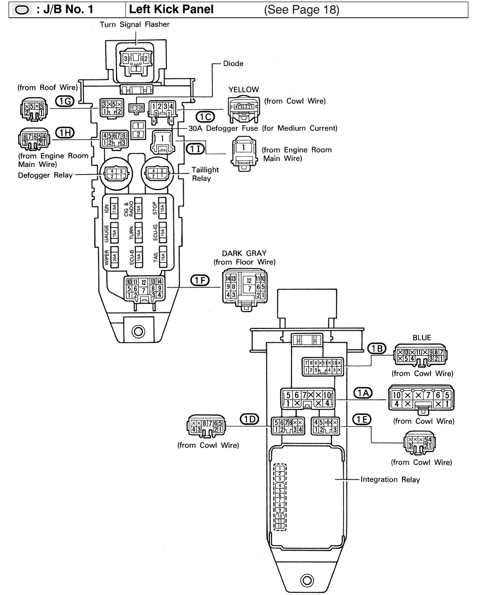
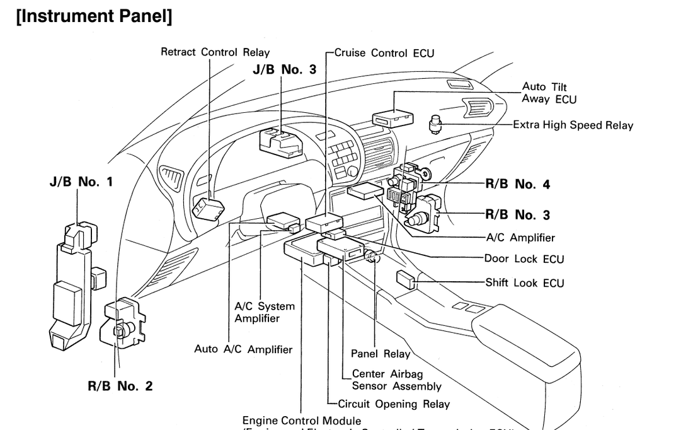

J/B No.1 face (plugs 1H, 1I from the Engine Room Main wire; 1B from the Cowl Wire) 1993 p.20 · Where the cabin boxes sit 1993 p.18

| Part · pin | OEM wire | Which side | Rest of OEM wire | New wire | How · EWD |
|---|---|---|---|---|---|
| **J/B No.1** pin **1I-1** | B | Plug side: the 1I plug stays seated in J/B No.1 | 🔴 Pigtail / stub: Cut to a 6 in stub on the 1I plug; the rest of the Engine Room Main lead comes out | **J/B No.1 main feed** (`w_pdb_jb1`, 6 AWG Red, CabinPower); other end: POWER box AMI OUT-5 fuse, output stud | heavy crimp butt splice into the factory 1I-1 lead (6 in stub; new feed is 6 AWG for the 60 A JB1 fuse); 1993 p.62 (ET1-1 B -> J/B No.1 1I-1; was cited p.18-19 / p.46, 1990 pages); J/B No.1 pin written as plug-pin 1I-1 (fault C3) |
| **J/B No.1** pin **1H-2** | L-Y | Plug side: the 1H plug stays seated in J/B No.1 | 🔴 Pigtail / stub: Cut to a 6 in stub on the 1H plug; the rest of the Engine Room Main lead comes out | **Dome feed to J/B No.1** (`w_pmu_dome`, 14 AWG Red, CabinPower); other end: LOGIC fuse and relay box (glove box) pin BUS1-5 | crimp butt splice into the factory 1H-2 lead at J/B1 (cabin side; engine-room main removed); 1993 p.132 |
| **J/B No.1** pin **1H-4** | G-B | Plug side: the 1H plug stays seated in J/B No.1 | 🔴 Pigtail / stub: Cut to a 6 in stub on the 1H plug; the rest of the Engine Room Main lead comes out | **LH front turn +** (`w_turn_f7`, 18 AWG Red, EngineRoom-C); other end: LH front turn / clearance lamp F7 pin 3 | crimp butt splice into the factory 1H-4 lead at J/B1 (cabin side; engine-room main removed); 1993 p.130 |
| **J/B No.1** pin **1H-5** | L | Plug side: the 1H plug stays seated in J/B No.1 | 🔴 Pigtail / stub: Cut to a 6 in stub on the 1H plug; the rest of the Engine Room Main lead comes out | **Wiper +12 V** (`w_wip_b`, 14 AWG Red, EngineRoom-C); other end: Front wiper motor F9 (cowl, driver side) pin 4 | crimp butt splice into the factory 1H-5 lead at J/B1 (cabin side; engine-room main removed); 1993 p.148 |
| **J/B No.1** pin **1H-6** | G | Plug side: the 1H plug stays seated in J/B No.1 | 🔴 Pigtail / stub: Cut to a 6 in stub on the 1H plug; the rest of the Engine Room Main lead comes out | **Clearance lamp feed** (`w_clr`, 16 AWG Red, EngineRoom-C); other end: Clearance lamp feed splice | crimp butt splice into the factory 1H-6 lead at J/B1 (cabin side; engine-room main removed); 1993 p.112 |
| **J/B No.1** pin **1H-7** | B-O | Plug side: the 1H plug stays seated in J/B No.1 | 🔴 Pigtail / stub: Cut to a 6 in stub on the 1H plug; the rest of the Engine Room Main lead comes out | **Ignition +12 V that wakes the ECU (through the wake diode)** (`w_ig2_in`, 18 AWG Yellow, AB-cabin); other end: ECU wake diode (ignition feed) pin 1 | solder splice onto the factory lead; 1993 TIS EWD p.62 (Power Source) |
| **J/B No.1** pin **1H-7** | B-O | Plug side: the 1H plug stays seated in J/B No.1 | 🔴 Pigtail / stub: Cut to a 6 in stub on the 1H plug; the rest of the Engine Room Main lead comes out | **Ignition switch sense** (`w_ign`, 18 AWG Yellow, AB-cabin); other end: ECU plug B pin 28 | solder splice onto the factory lead; 1993 TIS EWD p.62 (Power Source) |
| **J/B No.1** pin **1H-7** | B-O | Plug side: the 1H plug stays seated in J/B No.1 | 🔴 Pigtail / stub: Cut to a 6 in stub on the 1H plug; the rest of the Engine Room Main lead comes out | **Ignition-on relay coil + (IGN fuse)** (`w_k_on_86_cp`, 18 AWG Red, CabinPower); other end: Ignition-on relay (CAN-Lambda feed) pin 86 | solder splice onto the factory lead; 1993 TIS EWD p.62 (Power Source) |
| **J/B No.1** pin **1H-8** | G-Y | Plug side: the 1H plug stays seated in J/B No.1 | 🔴 Pigtail / stub: Cut to a 6 in stub on the 1H plug; the rest of the Engine Room Main lead comes out | **RH front turn +** (`w_turn_f8`, 18 AWG Red, EngineRoom-C); other end: RH front turn / clearance lamp F8 pin 3 | crimp butt splice into the factory 1H-8 lead at J/B1 (cabin side; engine-room main removed); 1993 p.130 |
| **J/B No.1** pin **1B-11** | R-W | Plug side: Cowl Wire plug 1B, seated in J/B No.1 | 🟢 Rest stays: Tap only: the R-W door switch line stays | **Door trigger** (`w_at_door`, 20 AWG Yellow, AntiTheft); other end: Alarm door trigger point | soldered tap into the factory R-W lead at J/B No.1 1B-11 (cabin); 1993 p.132-133 (Interior Light; service hint: 1B-11 to ground 12 V doors closed, 0 V any door open) |

## Cowl plug IE1, LH kick panel (Cowl Wire to Engine Room Main)

**Block:** None (inline joint) · **Where:** LH kick panel, beside J/B No.1 · **Connector:** IE1, Engine Room Main half kept as a pigtail plug

Same idea as J/B No.1: the Engine Room Main wire is cut 6 in back from its half of IE1, and that old plug half stays clicked into the Cowl Wire half. Each new wire splices onto its 6 in pigtail. The Cowl Wire itself is never cut (Dan A4 a).

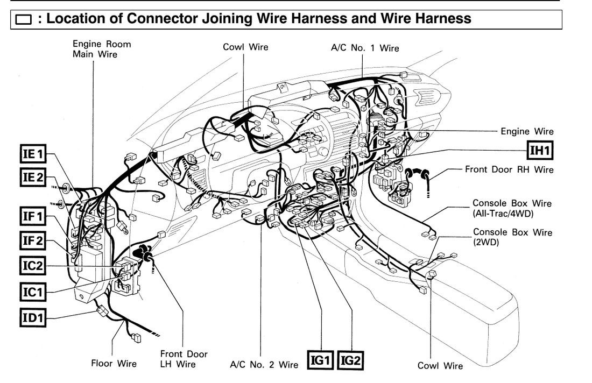
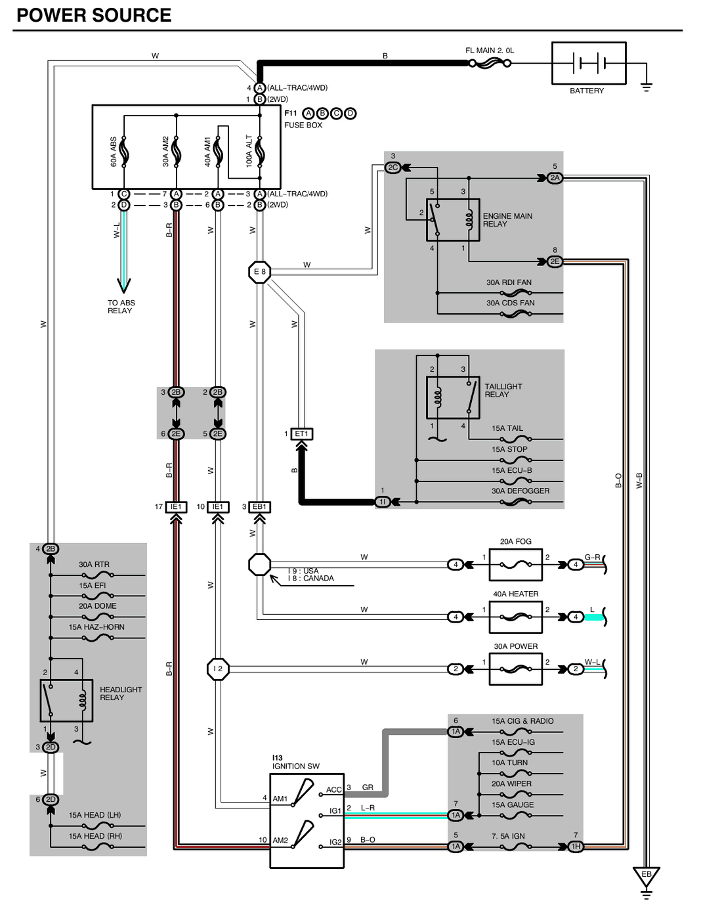

IE1 and IG1 / IG2 / IH1 locations 1993 p.42 · Power source: IE1-10 AM1, IE1-17 AM2, J/B No.1 1H-7 / 1I 1993 p.62

| Part · pin | OEM wire | Which side | Rest of OEM wire | New wire | How · EWD |
|---|---|---|---|---|---|
| **IE1** pin **2** | R-Y | Plug side: the Engine Room Main half of IE1, cut to 6 in pigtails and left clicked into the Cowl Wire half | 🔴 Pigtail / stub: Engine Room Main lead cut 6 in back from its IE1 half; the rest of it comes out. The Cowl Wire is not cut and keeps running to light control SW (C15) and pop-up relay R8 pin 8 via cowl splice I2 | **Headlamp relay coils (-) to the R-Y line** (`w_head_coil_cp`, 18 AWG White, CabinPower); other end: Headlamp relay coil splice | butt splice onto the 6 in pigtail on the old plug half (Dan A4 a, 2026-11-20). The master method text still says "cowl-side lead"; fix pending; 1993 p.116 |
| **IE1** pin **3** | W | Plug side: the Engine Room Main half of IE1, cut to 6 in pigtails and left clicked into the Cowl Wire half | 🔴 Pigtail / stub: Engine Room Main lead cut 6 in back from its IE1 half; the rest of it comes out. The Cowl Wire is not cut and keeps running to pop-up relay R8 pin 3 | **Pop-up relay feed (RTR 30 A)** (`w_pmu_rtr`, 10 AWG Red, CabinPower); other end: POWER box AMI OUT-2 fuse, output stud | butt splice onto the 6 in pigtail on the old plug half (Dan A4 a, 2026-11-20). The master method text still says "cowl-side lead"; fix pending; 1993 p.116 |
| **IE1** pin **6** | L-W | Plug side: the Engine Room Main half of IE1, cut to 6 in pigtails and left clicked into the Cowl Wire half | 🔴 Pigtail / stub: Engine Room Main lead cut 6 in back from its IE1 half; the rest of it comes out. The Cowl Wire is not cut and keeps running to wiper SW | **Wiper park switch** (`w_wip_park`, 14 AWG Yellow, EngineRoom-C); other end: Front wiper motor F9 (cowl, driver side) pin 3 | butt splice onto the 6 in pigtail on the old plug half (Dan A4 a, 2026-11-20). The master method text still says "cowl-side lead"; fix pending; 1993 p.148 |
| **IE1** pin **7** | G-Y | Plug side: the Engine Room Main half of IE1, cut to 6 in pigtails and left clicked into the Cowl Wire half | 🔴 Pigtail / stub: Engine Room Main lead cut 6 in back from its IE1 half; the rest of it comes out. The Cowl Wire is not cut and keeps running to pop-up relay R8 | **RH pop-up motor drive (relay R8 pin 4 to motor pin 4)** (`w_rtr_r3_4`, 12 AWG Red, EngineRoom-C); other end: RH pop-up motor feed splice | butt splice onto the 6 in pigtail on the old plug half (Dan A4 a, 2026-11-20). The master method text still says "cowl-side lead"; fix pending; 1993 p.117 |
| **IE1** pin **8** | G-B | Plug side: the Engine Room Main half of IE1, cut to 6 in pigtails and left clicked into the Cowl Wire half | 🔴 Pigtail / stub: Engine Room Main lead cut 6 in back from its IE1 half; the rest of it comes out. The Cowl Wire is not cut and keeps running to pop-up relay R8 | **RH pop-up motor drive (relay R8 pin 5 to motor pin 2)** (`w_rtr_r3_2`, 16 AWG Red, EngineRoom-C); other end: RH pop-up motor R3 pin 2 | butt splice onto the 6 in pigtail on the old plug half (Dan A4 a, 2026-11-20). The master method text still says "cowl-side lead"; fix pending; 1993 p.117 |
| **IE1** pin **9** | G-Y | Plug side: the Engine Room Main half of IE1, cut to 6 in pigtails and left clicked into the Cowl Wire half | 🔴 Pigtail / stub: Engine Room Main lead cut 6 in back from its IE1 half; the rest of it comes out. The Cowl Wire is not cut and keeps running to pop-up relay R8 | **Pop-up down (close) limit switches to relay R8 pin 11** (`w_rtr_close`, 18 AWG Yellow, EngineRoom-C); other end: Pop-up close limit splice | butt splice onto the 6 in pigtail on the old plug half (Dan A4 a, 2026-11-20). The master method text still says "cowl-side lead"; fix pending; 1993 p.117 |
| **IE1** pin **10** | W | Plug side: the Engine Room Main half of IE1, cut to 6 in pigtails and left clicked into the Cowl Wire half | 🔴 Pigtail / stub: Engine Room Main lead cut 6 in back from its IE1 half; the rest of it comes out. The Cowl Wire is not cut and keeps running to ignition SW I13 pin 4 and the R/B No.2 30 A POWER fuse via cowl splice I2 | **AM1 feed to IE1** (`w_pdb_am1`, 8 AWG Red, CabinPower); other end: POWER box AMI OUT-3 fuse, output stud | butt splice onto the 6 in pigtail on the old plug half (Dan A4 a, 2026-11-20). The master method text still says "cowl-side lead"; fix pending; 1993 p.62 (IE1-10 W -> cowl splice I2 -> ignition switch I13-4 AM1 and R/B No.2 30 A POWER fuse pin 1; was cited p.31, a 1990 page) |
| **IE1** pin **12** | W | Plug side: the Engine Room Main half of IE1, cut to 6 in pigtails and left clicked into the Cowl Wire half | 🔴 Pigtail / stub: Engine Room Main lead cut 6 in back from its IE1 half; the rest of it comes out. The Cowl Wire is not cut and keeps running to hazard SW | **Hazard feed** (`w_haz_cp`, 14 AWG Red, CabinPower); other end: Hazard and horn fuse splice | butt splice onto the 6 in pigtail on the old plug half (Dan A4 a, 2026-11-20). The master method text still says "cowl-side lead"; fix pending; 1993 p.130 |
| **IE1** pin **13** | L-B | Plug side: the Engine Room Main half of IE1, cut to 6 in pigtails and left clicked into the Cowl Wire half | 🔴 Pigtail / stub: Engine Room Main lead cut 6 in back from its IE1 half; the rest of it comes out. The Cowl Wire is not cut and keeps running to wiper SW | **Wiper LOW** (`w_wip_lo`, 14 AWG Red, EngineRoom-C); other end: Front wiper motor F9 (cowl, driver side) pin 2 | butt splice onto the 6 in pigtail on the old plug half (Dan A4 a, 2026-11-20). The master method text still says "cowl-side lead"; fix pending; 1993 p.148 |
| **IE1** pin **14** | G | Plug side: the Engine Room Main half of IE1, cut to 6 in pigtails and left clicked into the Cowl Wire half | 🔴 Pigtail / stub: Engine Room Main lead cut 6 in back from its IE1 half; the rest of it comes out. The Cowl Wire is not cut and keeps running to pop-up relay R8 | **LH pop-up motor drive (relay R8 pin 1 to motor pin 4)** (`w_rtr_r2_4`, 12 AWG Red, EngineRoom-C); other end: LH pop-up motor feed splice | butt splice onto the 6 in pigtail on the old plug half (Dan A4 a, 2026-11-20). The master method text still says "cowl-side lead"; fix pending; 1993 p.117 |
| **IE1** pin **15** | G-O | Plug side: the Engine Room Main half of IE1, cut to 6 in pigtails and left clicked into the Cowl Wire half | 🔴 Pigtail / stub: Engine Room Main lead cut 6 in back from its IE1 half; the rest of it comes out. The Cowl Wire is not cut and keeps running to pop-up relay R8 | **LH pop-up motor drive (relay R8 pin 2 to motor pin 2)** (`w_rtr_r2_2`, 16 AWG Red, EngineRoom-C); other end: LH pop-up motor R2 pin 2 | butt splice onto the 6 in pigtail on the old plug half (Dan A4 a, 2026-11-20). The master method text still says "cowl-side lead"; fix pending; 1993 p.117 |
| **IE1** pin **16** | G-W | Plug side: the Engine Room Main half of IE1, cut to 6 in pigtails and left clicked into the Cowl Wire half | 🔴 Pigtail / stub: Engine Room Main lead cut 6 in back from its IE1 half; the rest of it comes out. The Cowl Wire is not cut and keeps running to pop-up relay R8 | **Pop-up up (open) limit switches to relay R8 pin 7** (`w_rtr_open`, 18 AWG Yellow, EngineRoom-C); other end: Pop-up open limit splice | butt splice onto the 6 in pigtail on the old plug half (Dan A4 a, 2026-11-20). The master method text still says "cowl-side lead"; fix pending; 1993 p.117 |
| **IE1** pin **17** | B-R | Plug side: the Engine Room Main half of IE1, cut to 6 in pigtails and left clicked into the Cowl Wire half | 🔴 Pigtail / stub: Engine Room Main lead cut 6 in back from its IE1 half; the rest of it comes out. The Cowl Wire is not cut and keeps running to ignition SW I13 pin 10 | **AM2 feed to IE1** (`w_pdb_am2`, 10 AWG Red, CabinPower); other end: POWER box AMI OUT-4 fuse, output stud | butt splice onto the 6 in pigtail on the old plug half (Dan A4 a, 2026-11-20). The master method text still says "cowl-side lead"; fix pending; 1993 p.62 (IE1-17 B-R -> ignition switch I13-10 AM2; was cited p.31, a 1990 page) |
| **IE1** pin **18** | R-W | Plug side: the Engine Room Main half of IE1, cut to 6 in pigtails and left clicked into the Cowl Wire half | 🔴 Pigtail / stub: Engine Room Main lead cut 6 in back from its IE1 half; the rest of it comes out. The Cowl Wire is not cut and keeps running to dimmer SW C15 pin 12 | **High-beam relay coil (-) to the dimmer** (`w_hl_low`, 18 AWG White, CabinPower); other end: High-beam relay pin 85 | butt splice onto the 6 in pigtail on the old plug half (Dan A4 a, 2026-11-20). The master method text still says "cowl-side lead"; fix pending; 1993 p.116 |
| **IE1** pin **19** | G | Plug side: the Engine Room Main half of IE1, cut to 6 in pigtails and left clicked into the Cowl Wire half | 🔴 Pigtail / stub: Engine Room Main lead cut 6 in back from its IE1 half; the rest of it comes out. The Cowl Wire is not cut and keeps running to horn SW (C15) | **Horn relay coil (-)** (`w_horn_85_cp`, 18 AWG White, CabinPower); other end: Horn relay pin 85 | butt splice onto the 6 in pigtail on the old plug half (Dan A4 a, 2026-11-20). The master method text still says "cowl-side lead"; fix pending; 1993 p.185 |
| **IE1** pin **20** | L-O | Plug side: the Engine Room Main half of IE1, cut to 6 in pigtails and left clicked into the Cowl Wire half | 🔴 Pigtail / stub: Engine Room Main lead cut 6 in back from its IE1 half; the rest of it comes out. The Cowl Wire is not cut and keeps running to wiper SW | **Wiper HIGH** (`w_wip_hi`, 14 AWG Red, EngineRoom-C); other end: Front wiper motor F9 (cowl, driver side) pin 1 | butt splice onto the 6 in pigtail on the old plug half (Dan A4 a, 2026-11-20). The master method text still says "cowl-side lead"; fix pending; 1993 p.148 |

## Cowl plug IG2, under the ECU (Cowl Wire to Engine Wire)

**Block:** None (inline joint) · **Where:** Under the ECU · **Connector:** IG2, Engine Wire half kept as a pigtail plug

The Engine Wire is cut 6 in back from its half of IG2, and that old plug half stays clicked into the Cowl Wire half. Each new wire splices onto its 6 in pigtail. The Cowl Wire itself is never cut (Dan A4 a).

IG2 location (under the ECU) 1993 p.42

| Part · pin | OEM wire | Which side | Rest of OEM wire | New wire | How · EWD |
|---|---|---|---|---|---|
| **IG2** pin **4** | R-L | Plug side: the Engine Wire half of IG2, cut to 6 in pigtails and left clicked into the Cowl Wire half | 🔴 Pigtail / stub: Engine Wire lead cut 6 in back from its IG2 half; the rest of it comes out. The Cowl Wire is not cut: J/B No.3 3B-9 (GAUGE 15 A) feed | **+12 V to reverse switch** (`w_rev_feed_c`, 16 AWG Red, AB-cabin); other end: Firewall bulkhead connector (cabin side) pin 77 | butt splice onto the 6 in pigtail on the old plug half (Dan A4 a, 2026-11-20). The master method text still says "cowl-side lead"; fix pending; 1992 p.132 / 1990 p.82 (IG2 pin); Mitchell 1993 Fig. 16 grid 63 (colour) |
| **IG2** pin **13** | R-B | Plug side: the Engine Wire half of IG2, cut to 6 in pigtails and left clicked into the Cowl Wire half | 🔴 Pigtail / stub: Engine Wire lead cut 6 in back from its IG2 half; the rest of it comes out. The Cowl Wire is not cut: rear back-up lamps (IF1-7) | **+12 V to reverse lamps** (`w_rev_lamps`, 16 AWG Yellow, AB-cabin); other end: Reverse signal splice | butt splice onto the 6 in pigtail on the old plug half (Dan A4 a, 2026-11-20). The master method text still says "cowl-side lead"; fix pending; 1992 p.132 (IG2 pin); Mitchell 1993 Fig. 16 grid 63 (colour) |
| **IG2** pin **15** | B-R | Plug side: the Engine Wire half of IG2, cut to 6 in pigtails and left clicked into the Cowl Wire half | 🔴 Pigtail / stub: Engine Wire lead cut 6 in back from its IG2 half; the rest of it comes out. The Cowl Wire is not cut: J/B No.1 ECU-IG 15 A feed | **Alternator IG to the kill switch** (`w_ig_ks_in`, 16 AWG Red, AB-cabin); other end: Battery kill switch (trunk) pin ALT1 | butt splice onto the 6 in pigtail on the old plug half (Dan A4 a, 2026-11-20). The master method text still says "cowl-side lead"; fix pending; 1993 p.74-75 |
| **IG2** pin **16** | Y | Plug side: the Engine Wire half of IG2, cut to 6 in pigtails and left clicked into the Cowl Wire half | 🔴 Pigtail / stub: Engine Wire lead cut 6 in back from its IG2 half; the rest of it comes out. The Cowl Wire is not cut: cowl splice I5 to meter plug C14 (C) pin 8 | **Alternator charge lamp (L)** (`w_alt_l_c`, 20 AWG White, EngineRoom-C); other end: Alternator plug pin 2 | butt splice onto the 6 in pigtail on the old plug half (Dan A4 a, 2026-11-20). The master method text still says "cowl-side lead"; fix pending; 1993 p.74-75 |

<b>What comes out here (cut list)</b>

From `docs/harness/circuit-plan.md` (plan file; the master wins). **remove** = dead, out back to its last live point; **keep** = factory wire stays; **re-fed by** = the named new wire takes over.

#### IG1 / IG2 (Engine Wire <-> Cowl Wire, under the ECU)

Decided 2026-10-21. Every wire is dead and comes out back to its last live point, except IG2-15 B-R (6 in pigtail: kill switch, then alternator IG), IG2-16 Y (charge lamp, stays) and IG1-11 (branch only; splice I2 and ground IE stay).

Rows tagged **[90/92]** are not 1993-verified (row 156).

| Joint | Pin | Wire colour | Signal | Cabin end | Engine end (removed with Engine Wire) | EWD page | Action |
|---|---|---|---|---|---|---|---|
| IG1 | 1 | - | not used (vacuum-type cruise only) | - | - | 1992 p.186 | none |
| IG1 | 2 | P | IDL to cruise ECU | Cruise ECU plug B pin 9 IDL | ECU plug C pin 12 IDL / splice I7 -> TPS T1-2 | [90/92] 1990 p.119, 1992 p.181; 1993 p.80 | remove (dead) |
| IG1 | 3 | L | Cruise vehicle-speed sensor signal | Cruise ECU plug A pin 7 SPD (M/T) | Speed sensor for cruise (1993 V2) pin 2 | [90/92] 1990 p.118 | remove (dead) |
| IG1 | 4 | B-W | A/C clutch "on" to ECU AC | OEM ECU plug A (E9) pin 10 AC | Engine Wire E5 -> compressor A4-4, J/B2 2C-6 | 1993 p.79, 210 | remove (dead) |
| IG1 | 5 | - | ECT only (A/T) | - | - | 1992 p.171 | none |
| IG1 | 6 | GR-B | Cruise actuator VR3 | Cruise ECU A10 | Cruise actuator pin 3 | [90/92] 1990 p.119 | remove (dead) |
| IG1 | 7 | GR | Cruise actuator VR1 | Cruise ECU A12 | Actuator pin 1 | [90/92] | remove (dead) |
| IG1 | 8 | R-G | Cruise actuator MC | Cruise ECU B10 | Actuator pin 7 | [90/92] | remove (dead) |
| IG1 | 11 | BR | Cruise speed-sensor ground | Cowl splice I2 (USA) -> ground IE. Shared with the cruise control switch BR ground (combination switch plug C16 (B) pin 17, 1993 EWD grid 59; 1993 TIS Ground Points p.3) and cruise ECU GND A9. | Speed sensor pin 3 | [90/92] 1990 p.118, 1992 p.180 | remove IG1 branch back to splice I2 (I2/IE stays) |
| IG1 | 12 | Y-B | Oil-pressure warning | Comb meter C14 (C) pin 6 (removed) | ES2-3 -> ER No.2 -> oil pressure SW O2-1 | 1993 p.207 | remove (dead) |
| IG1 | 13 | Y-G | Water-temp gauge | Comb meter C12 (A) pin 6 | Water temp sender W2-1 | 1993 p.207 | remove (dead) |
| IG1 | 14 | B | Tach (igniter TAC) | Comb meter C14 (C) tacho; pin number not printed (*4) | Igniter I2-4 TAC (also feeds IH1-6 -> A15-18) | 1993 p.206 | remove (dead) |
| IG1 | 15 | L-R (cowl) / R-W (engine) | Turbo (boost) meter | Comb meter C13 (B) pin 4 | Turbo pressure sensor T2-2 PIM | 1993 p.207, p.80 | remove (dead) |
| IG1 | 16 | R-Y | Cruise actuator L through the cruise-cancel contact | Stop-light SW cruise contact -> cruise ECU B3 | Actuator pin 5 | [90/92] | remove (dead) |
| IG1 | 17 | GR-R | Cruise actuator VR2 | Cruise ECU A11 | Actuator pin 2 | [90/92] | remove (dead) |
| IG1 | 18 | P-B | Cruise actuator MO | Cruise ECU B4 | Actuator pin 6 | [90/92] | remove (dead) |
| IG2 | 1 | L-Y (cowl) / Y or L-Y (engine) | ECU ATS <-> A/C amp A15-2 | OEM ECU plug A pin 7 ATS | IH1-1 -> A15-2 | 1993 p.79, 210 | remove (dead) |
| IG2 | 2 | P | MIL (ECU W) to DLC1 "W" | Cowl splice I6 -> comb meter C12 (A) pin 3 + ECU plug A pin 5 W | DLC1 pin 2 W | 1993 p.81, 79 | remove (dead) |
| IG2 | 3 | W-L | SRS TC to DLC1 | Centre airbag sensor assy pin 12 TC (removed) | DLC1 TC (15) | [90/92] 1992 p.200 | remove (dead) |
| IG2 | 4 | R-L | Back-up SW feed (GAUGE 15A) | J/B3 3B-9 (GAUGE via 1E-5) | Back-up light SW B1 pin 2 (M/T) | [90/92] 1990 p.82, 1992 p.132 | remove (dead); new switch feed splices to the IG2-4 pigtail |
| IG2 | 5 | G | FC (fuel-pump control) | Circuit opening relay C9-4 (removed) | ECU A14 FC | 1993 p.78, 79 | remove (dead) |
| IG2 | 6 | W-L | TC diagnostic (cruise + ABS) | Cruise ECU B7 TC; IF1-3 -> ABS ECU TC | DLC1 TC (15) | [90/92] 1990 p.118/124 | remove (dead) |
| IG2 | 7 | P | BATT (EFI 15A) | OEM ECU plug A pin 1 BATT | J/B2 2C-4 (15A EFI) | 1993 p.79 | remove (dead) |
| IG2 | 12 | BR | SRS warning (LA) to DLC1 AB | Cowl splice I4 -> comb meter C12 (A) pin 8 + centre airbag sensor pin 9 LA | DLC1 AB (12) | 1993 p.207; 1992 p.200 | remove (dead) |
| IG2 | 13 | R-B | Back-up lamp output | IF1-7 -> Floor -> BP1-8 -> rear back-up lamps | Back-up SW B1 pin 1 | [90/92] 1992 p.132 | remove (dead); new switch output splices to the IG2-13 pigtail |
| IG2 | 14 | BR | Water-temp gauge ground | Comb meter C12 (A) pin 5 | Ground EC (intake manifold) | 1993 p.207 | remove (dead) |
| IG2 | 15 | B-R | ECU-IG 15A | J3 <- J/B1 1B-8 (15A ECU-IG) | Alternator IG (round plug G2 (B) pin 3) | 1993 p.74; 1992 p.180 | KEEP 6 in pigtail, splice (alt IG feed per master) |
| IG2 | 16 | Y | Charge lamp (alternator L) | Cowl splice I5 -> comb meter C14 (C) pin 8 | Alternator L (round plug G2 (B) pin 2) | 1993 p.74 | KEEP; Dash charge LED sinks to C14-8 |
| IG2 | 17 | W-R | ABS TS | IF1-16 -> ABS ECU TS | DLC1 TS (16) | [90/92] 1992 p.192 | remove (dead) |
| IG2 | 18 | B-Y | +B from EFI main relay | Cowl splice I6 -> ECU A12 / A13, C9-2 | J/B2 2C-10 / splice I7 (VSVs) | 1993 p.80, 78 | remove (dead) |
| IG2 | 19 | L-B | Fuel-pump + (FP check) | Cowl splice I1 -> IE2-19 and IF1-15 -> BP1-12 -> fuel pump | DLC1 FP | 1993 p.79, 78 | remove (dead) |
| IG2 | 20 | B | STA (cranking) | Cowl splice I6 -> ECU A11, C9-3, comb meter C13 (B) pin 10 | Engine Wire <- EB1-2 (starter relay out) | 1993 p.78, 206 | remove (dead) |

## Relay block No.4, RH kick panel

**Block:** R/B No.4 · **Where:** RH kick panel · **Connector:** R/B No.4 plug A (Cowl Wire)

R/B No.4 stays with its starter relay, heater relay, 40 A HEATER and 10 A A/C fuses. The master names the terminal (ST-1 = starter relay pin 1, etc.); the wire itself is in the box's plug A on the Cowl Wire.

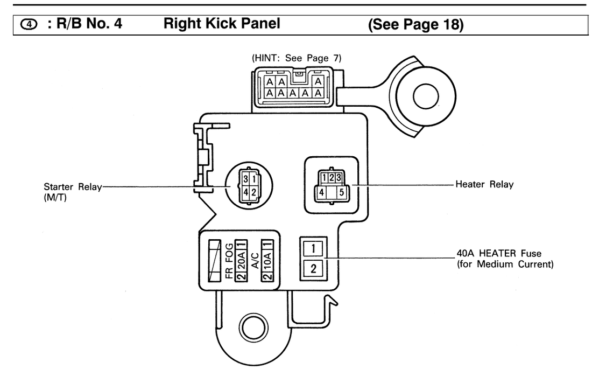

R/B No.4 face 1993 p.27 · Location 1993 p.18

| Part · pin | OEM wire | Which side | Rest of OEM wire | New wire | How · EWD |
|---|---|---|---|---|---|
| **R/B No.4** pin **HTR-1** | W | Plug side: the Cowl Wire lead in R/B No.4 plug A, at the 40 A HEATER fuse pin 1 circuit. Plug-A cavity numbers are not in the 1993 pulls: find it by colour | 🔴 Pigtail / stub: Past the tap the W lead only ran to cowl splice I9 and EB1-3 (both dead, p.62): cut to a 6 in stub. Still open: OPEN-ITEMS row 183 "splice I9" | **R/B No.4 heater fuse feed** (`w_rb4_feed`, 8 AWG Red, CabinPower); other end: POWER box AMI IN-1 fuse, output stud | heavy crimp butt splice into the factory lead; 1993 p.62 / p.215 |
| **R/B No.4** pin **ST-1** | B-W | Plug side: the Cowl Wire lead in R/B No.4 plug A, at the starter relay pin 1 circuit. Plug-A cavity numbers are not in the 1993 pulls: find it by colour | 🟢 Rest stays: B-W stays: still the key START feed to the starter relay coil | **Start switch ST1 feed** (`w_start_in_cp`, 20 AWG Yellow, CabinPower); other end: LOGIC fuse and relay box (glove box) pin BUS2-13 IN | solder splice onto the factory lead; 1993 TIS EWD p.66 (Starting and Ignition, All-Trac) |
| **R/B No.4** pin **AC-2** | V-R | Plug side: the Cowl Wire lead in R/B No.4 plug A, at the 10 A A/C fuse pin 2 circuit. Plug-A cavity numbers are not in the 1993 pulls: find it by colour | 🟢 Rest stays: V-R stays: the A/C IG bus to the A/C amps | **+12 V to A/C pressure switch** (`w_acp_1`, 18 AWG Yellow, EngineRoom-C); other end: A/C pressure switch A5 (engine bay) pin 1 | crimp butt splice into the factory V-R lead at R/B No.4; 1993 p.211-212 |
| **R/B No.4** pin **ST-4** | B | Plug side: the Cowl Wire lead in R/B No.4 plug A, at the starter relay pin 4 circuit. Plug-A cavity numbers are not in the 1993 pulls: find it by colour | 🔴 Pigtail / stub: Past the tap the B lead only ran to EB1-2 (engine bay): cut to a 6 in stub, the rest comes out | **Starter solenoid S** (`w_strl_c`, 12 AWG Red, AB-cabin); other end: Firewall bulkhead connector (cabin side) pin 3 | crimp butt splice into the factory lead at R/B No.4 pin 4; 1993 p.66 |

<b>What comes out here (cut list)</b>

From `docs/harness/circuit-plan.md` (plan file; the master wins). **remove** = dead, out back to its last live point; **keep** = factory wire stays; **re-fed by** = the named new wire takes over.

#### R/B No.4 (RH kick, cowl) - stays (circuits 2, 9, 10)

| Terminal | Pin | Colour | Signal | Kept-side end | EWD | Draft said | Action |
|---|---|---|---|---|---|---|---|
| Starter relay | 1 | B-W | coil + (ST1) | I8 / I9 <- ignition SW I13-7 | p.66, 78 | reuse as the crank signal | keep; tapped by `w_start_in_cp` (start request, LOGIC BUS2-13 -> `w_start` to Link DI 7), pin id `ST-1` (fault C3 fixed in phase 2) |
| Starter relay | 2 | B-W | contact in (ST1) | I8 / I9 <- I13-7 | p.66 | cut + cap | keep |
| Starter relay | 3 | B | coil - through clutch start SW C11 pin 1 | C11 | p.66 | C11 -> Link Aux 8 | keep: C11 completes the starter circuit in hardware, not a Link input (circuit 2) |
| Starter relay | 4 | B | starter out | cowl -> EB1-2 (Engine Wire) | p.66, 78 | cut + cap; `k_str` instead | re-fed by `w_strl_c` (R/B4 pin 4 -> DRB102 cavity 3) and `w_strl_e` (-> starter S) |
| Heater relay | 1 | L-W | coil - from A/C amp HR | IQ2-9 -> A31 / A32 HR | p.215 | `k_htr` 85 | keep (no `k_htr`) |
| Heater relay | 3 | R-L | coil + (GAUGE via J4) | cowl J4 | p.215 | `k_htr` 86 | keep |
| Heater relay | 4 | B | blower + out | J5 -> blower B4 pin 2, -> 10 A A/C fuse pin 1 | p.211, 215 | re-feed from `k_htr` 87 | keep |
| Heater relay | 5 | L | contact in | 40 A HEATER fuse pin 2 | p.215 | cut + cap | keep |
| Heater relay | 2 | W-B | 87a = ground | R/B4 plug A pin 4 -> ground IG | p.215 | cut + cap | keep |
| 40 A HEATER fuse | 1 | W | feed in (EB1-3 via I9) | cowl I9 | p.62, 215 | cut + cap | re-fed by `w_rb4_feed` (AMI IN-1), pin id `HTR-1` (fault C3 fixed in phase 2); the EB1-3 leg comes out (group 1), leaving splice I9 with one live leg (open, row 183) |
| 40 A HEATER fuse | 2 | L | out to heater relay | heater relay pin 5 | p.215 | cut + cap | keep |
| 20 A FR FOG fuse | 1 / 2 | W / G-R | feed in (I9) / out to R/B3 pin 4 | I9; R/B3 | p.62; 1992 p.128 | fog removed | the fuse comes out, its seat stays empty; pin 1 lead removed back to splice I9 (`w_fog_fuse_in`; I9 keeps the HEATER and old EB1-3 legs), pin 2 lead removed whole (`w_fog_rb3_4`) |
| 10 A A/C fuse | 1 | B | in from heater relay 4 (J5) | J5 bus | p.211, 215 | cut + cap | keep |
| 10 A A/C fuse | 2 | V-R | A/C IG out | I9 -> EB2-1 (A5) and the V-R bus to the A/C amps | p.211-212 | re-feed, slot open | keep; A5 pin 1 tapped by `w_acp_1` (group 5) |

## Pop-up relay R8 and cowl splice I2, behind the LH dash

**Block:** None (cowl splice) · **Where:** Behind the LH dash · **Connector:** per device below

Pin 12 is a plain tap. Pin 8 is cut near R8 and pop-up diode D-R8-1 bridges the cut (DRL "up" input).

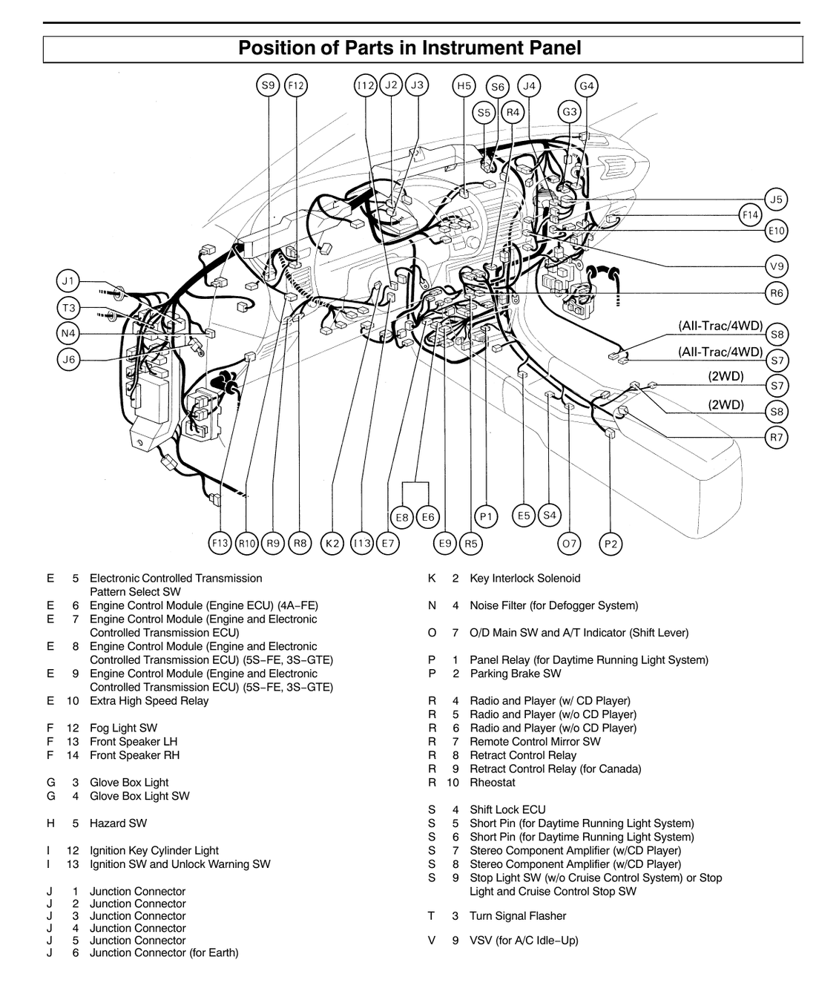
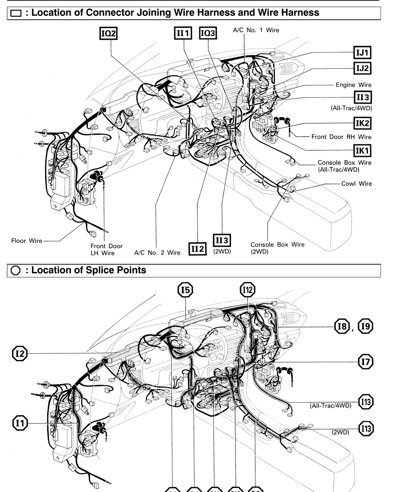

Retract control relay R8 1993 p.33 · Cowl splice I2 location 1993 p.44

| Part · pin | OEM wire | Which side | Rest of OEM wire | New wire | How · EWD |
|---|---|---|---|---|---|
| **Cowl splice I2 R-Y lead** pin **R-Y** | R-Y | I2 (stalk) side of the cut R-Y lead | 🟠 Cut, both sides used: Cut near R8: both sides stay; pop-up diode D-R8-1 bridges the cut | **Pop-up UP from the stalk (R-Y)** (`w_r8_d1_k_cp`, 20 AWG White, CabinPower); other end: Pop-up diode 1 (stalk side) pin 2 | solder splice onto the I2 side of the cut R-Y lead near R8 (B9; Dan N87 a); 1993 p.116 |
| **Pop-up relay R8** pin **8** | R-Y | R8 side of the cut R-Y lead | 🟠 Cut, both sides used: Cut near R8: both sides stay; pop-up diode D-R8-1 bridges the cut | **Pop-up UP input (ground = up)** (`w_r8_up_cp`, 20 AWG White, CabinPower); other end: Pop-up UP splice | cut the R-Y lead between cowl splice I2 and R8 pin 8 near R8 (kept cabin lead, cabin side); solder splice onto the R8 side (B9; Dan N87 a); 1993 p.116 / p.33 |
| **Pop-up relay R8** pin **12** | W-B | Plug side: R8 harness plug | 🟢 Rest stays: W-B stays: ground to J/B No.3 3B-1 / ground ID | **DRL switch ground (R8 ground lead)** (`w_drl_sw_gnd_cp`, 20 AWG Black, CabinPower); other end: DRL switch pin 2 | solder splice onto the factory lead near R8; 1993 p.116 / p.33 |

## A/C amplifiers, behind the glove box

**Block:** None (amplifier) · **Where:** Behind the glove box, under the evaporator · **Connector:** per device below

Both amps stay. Every tap is at the amp's own harness plug.

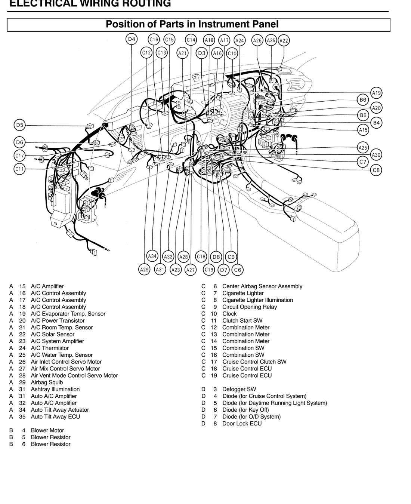

A15 A/C amplifier, A32 auto A/C amplifier 1993 p.32 · Location 1993 p.18

| Part · pin | OEM wire | Which side | Rest of OEM wire | New wire | How · EWD |
|---|---|---|---|---|---|
| **A/C amplifier A15** pin **2** | L-Y | Plug side: A15 harness plug | 🔴 Pigtail / stub: Past the tap the lead only ran to IH1-1 (Engine Wire, to the old ECU ATS): cut to a 6 in stub at A15 | **A/C coolant-OK ground** (`w_ac_cool_gnd`, 20 AWG Black, AB-cabin); other end: Ground bolt IG, RH kick panel (R/B No.4 set bolt) | solder onto the factory lead; 1993 p.210 |
| **A/C amplifier A15** pin **8** | L-Y | Plug side: A15 harness plug | 🔴 Pigtail / stub: Past the tap the lead only ran to IJ1-1, EA1-3 (old A/C clutch relay, engine bay): cut to a 6 in stub at A15 | **A/C clutch relay coil (-)** (`w_acc_trig`, 18 AWG White, AB-cabin); other end: A/C clutch relay pin 85 | solder onto the factory lead; 1993 p.210-211 |
| **A/C amplifier A15** pin **9** | W-L | Plug side: A15 harness plug | 🔴 Pigtail / stub: Past the tap the lead only ran to IH1-5 (compressor lock sensor, Engine Wire): cut to a 6 in stub at A15 | **Lock sensor signal (modified tacho)** (`w_lock_9`, 20 AWG White, AB-cabin); other end: A/C lock sensor resistor 4.7 k pin 2 | solder onto the factory lead; 1993 p.210-211 |
| **A/C amplifier A15** pin **11** | G-Y | Plug side: A15 harness plug | 🔴 Pigtail / stub: Past the tap the lead only ran to IJ1-3 (old ECU ACT): cut to a 6 in stub at A15 | **A/C cancel (ACT)** (`w_ac_kill`, 20 AWG White, AB-cabin); other end: ECU plug A pin 18 | solder splice onto the factory G-Y ACT lead at the A/C amplifier; 1993 p.210 (A15 pin 11 G-Y; checked 2026-11-02, row 156); reading aids: 1992 EWD132U p.93 and p.218 (1992 code A17 pin 11; 1990 code A18; docs/electrical/ewd-snips/1992-celica-ewd132u-a17-act-p093.png, 1992-celica-ewd132u-a17-clutch-p218.png); locator 1990 ST185 EWD p.17 Instrument Panel (ewd-snips/1990-st185-locations-dash.png); Mitchell 1993 Celica component locations |
| **A/C amplifier A15** pin **13** | Y-R | Plug side: A15 harness plug | 🔴 Pigtail / stub: Past the tap the lead only ran to IJ1-11, E10, EB2-2 (pressure switch, engine bay): cut to a 6 in stub at A15 | **A/C pressure switch signal** (`w_ac_psw_sw`, 20 AWG Yellow, AB-cabin); other end: A/C pressure switch signal splice | solder splice onto the factory Y-R lead at the A/C amplifier; 1993 p.211 (A15 pin 13 Y-R; checked 2026-11-02, row 156); reading aids: 1990 ST185 EWD p.152 (docs/electrical/ewd-snips/1990-st185-autoac-pressure-clutch-p152.png); 1992 EWD132U p.219 (A17-13; ewd-snips/1992-celica-ewd132u-a17-pressure-p219.png); locator 1990 ST185 EWD p.17 Instrument Panel (ewd-snips/1990-st185-locations-dash.png); Mitchell 1993 Celica component locations |
| **A/C amplifier A15** pin **18** | B | Plug side: A15 harness plug | 🔴 Pigtail / stub: Past the tap the lead only ran to IH1-6 (igniter TAC, Engine Wire): cut to a 6 in stub at A15 | **Engine speed (tacho)** (`w_tach_18`, 20 AWG White, AB-cabin); other end: Tacho signal splice | solder onto the factory lead; 1993 p.211 |
| **Auto A/C amplifier A32** pin **6** | Y-B | Plug side: A32 harness plug | 🔴 Pigtail / stub: Past the tap the Y-B only ran IQ2-3, EA1-4 to the old A1 lead (p.212): cut to a 6 in stub at A32 | **Ambient temp signal** (`w_amb_sig`, 20 AWG Yellow, EngineRoom-C); other end: Ambient air temp sensor A1 (front, 6 in pigtail) pin 2 | solder onto the factory lead at A32 (the master gives only the A1-end method for this wire); 1993 p.212 |
| **Auto A/C amplifier A32** pin **15** | Y | Plug side: A32 harness plug | 🟢 Rest stays: Y sensor common stays to the other A/C sensors (p.211-212) | **A/C sensor common** (`w_amb_sg`, 20 AWG Yellow, AB-cabin); other end: A/C sensor common splice | solder onto the factory lead; 1993 p.211-212 |

<b>What comes out here (cut list)</b>

From `docs/harness/circuit-plan.md` (plan file; the master wins). **remove** = dead, out back to its last live point; **keep** = factory wire stays; **re-fed by** = the named new wire takes over.

#### Group 4 - IH1 (Engine Wire <-> A/C No.1, behind the glove box)

| Pin | Colour | Signal | Kept-side end | EWD | Draft said | Action |
|---|---|---|---|---|---|---|
| 1 | L-Y | A15 -> OEM ECU ATS | A/C amp A15 pin 2 | 1993 p.79, 210 | maybe a new wire to a Link input | remove the IH1 leg; A15 pin 2 hard-grounded by `w_ac_cool_gnd` (D16) |
| 3 | Y-B | Compressor sensor coil | A15 pin 5 | 1993 p.210 | new wire IH1-3 -> A4-3 | remove; no master row: D16 uses no compressor sensor coil (the lock check is fed from the tacho, pin 9) |
| 4 | W-R | Compressor lock sensor | A15 pin 14 via cowl splice I12 (I12 also feeds the A24 thermistor pin 1) | 1993 p.210-211 | new wire IH1-4 -> A4-2 | remove the IH1 leg back to I12; I12 and A24 keep |
| 5 | W-L | Compressor lock sensor | A15 pin 9 | 1993 p.210 | new wire IH1-5 -> A4-1 | remove the IH1 leg; pin 9 re-fed by `w_lock_9` (tacho through `R-LOCK` 4.7 kΩ, N61) |
| 6 | B | Engine speed for lock detection | A15 pin 18 | 1993 p.211 | re-feed from a Link output (open) | re-fed by `w_tach_18` (Ign 8 tacho via `SP-TACH`) |

## Cowl plug II1, instrument panel centre

**Block:** None (inline joint) · **Where:** Instrument panel centre · **Connector:** II1, Cowl Wire half

Old radio ACC feed for the RealDash Pi fuse.

II1 location 1993 p.44

| Part · pin | OEM wire | Which side | Rest of OEM wire | New wire | How · EWD |
|---|---|---|---|---|---|
| **II1** pin **3** | GR | Cowl Wire lead behind its II1 half: the console box half went with the radio harness, so there is no old plug half left to keep | 🟢 Rest stays: Cowl wire stays: CIG & RADIO 15 A via J/B No.3 3C-2 | **RealDash Pi +12 V from the radio ACC feed** (`w_pi12`, 16 AWG Red, Dash); other end: RealDash Pi inline fuse 5 A pin IN | solder splice onto the factory lead (the console-box side of II1 went with the radio harness); 1993 TIS EWD p.201 (Radio and Player) |

## Old combination meter plugs, behind the cluster

**Block:** None (old meter plug) · **Where:** Behind the old cluster · **Connector:** per device below

The old meter is gone; its Cowl Wire plugs stay as tap points for the dash LEDs.

C13 / C14 location 1993 p.32

| Part · pin | OEM wire | Which side | Rest of OEM wire | New wire | How · EWD |
|---|---|---|---|---|---|
| **Meter plug C13 (B)** pin **1** | W-B | Plug side: old meter plug (meter removed, plug stays on the Cowl Wire) | 🟢 Rest stays: W-B ground to J/B No.3 / J6 / ground ID stays | **LED common ground to the cluster ground** (`w_led_gnd_c13`, 20 AWG Black, Dash); other end: Cluster LED ground splice | solder splice onto the factory lead at the combination meter; 1993 TIS EWD p.206 (Combination Meter plug C13 (B)) |
| **Meter plug C13 (B)** pin **2** | G-B | Plug side: old meter plug (meter removed, plug stays on the Cowl Wire) | 🟢 Rest stays: G-B turn LH line stays | **Turn LH LED +** (`w_tl_a`, 20 AWG Red, Dash); other end: Turn LH LED pin 1 | solder splice onto the factory lead at the combination meter; 1993 TIS EWD p.206 (Combination Meter plug C13 (B)) |
| **Meter plug C13 (B)** pin **11** | G-Y | Plug side: old meter plug (meter removed, plug stays on the Cowl Wire) | 🟢 Rest stays: G-Y turn RH line stays | **Turn RH LED +** (`w_tr_a`, 20 AWG Red, Dash); other end: Turn RH LED pin 1 | solder splice onto the factory lead at the combination meter; 1993 TIS EWD p.206 (Combination Meter plug C13 (B)) |
| **Meter plug C14 (C)** pin **1** | R-G | Plug side: old meter plug (meter removed, plug stays on the Cowl Wire) | 🟢 Rest stays: R-G park brake switch line stays | **Park brake switch (-)** (`w_pk_k`, 20 AWG Yellow, Dash); other end: Park brake LED pin 2 | solder splice onto the factory lead at the combination meter; 1993 TIS EWD p.206 (Combination Meter plug C14 (C)) |
| **Meter plug C14 (C)** pin **8** | Y | Plug side: old meter plug (meter removed, plug stays on the Cowl Wire) | 🟢 Rest stays: Y charge lamp line (cowl splice I5 to IG2-16) stays | **Charge lamp drive** (`w_chg_k`, 20 AWG White, Dash); other end: Charge LED pin 2 | solder splice onto the factory lead at the combination meter; 1993 TIS EWD p.207 (Combination Meter plug C14 (C)) |
| **Meter plug C14 (C)** pin **9** | B-O | Plug side: old meter plug (meter removed, plug stays on the Cowl Wire) | 🟢 Rest stays: B-O IGN feed (J/B No.1 1D-5) stays | **Ignition +12 V for the cluster LEDs** (`w_ig_tap`, 20 AWG Red, Dash); other end: Cluster LED +12 V splice | solder splice onto the factory lead at the combination meter; 1993 TIS EWD p.207 (Combination Meter plug C14 (C)) |

## Steering column and pedals

**Block:** None (switch) · **Where:** Under the steering column · **Connector:** per device below

C16 combination switch, C17 cruise clutch switch 1993 p.32 · S9 stop lamp switch, R10 rheostat 1993 p.33

| Part · pin | OEM wire | Which side | Rest of OEM wire | New wire | How · EWD |
|---|---|---|---|---|---|
| **Combination switch C16 (B), cruise switch** pin **5** | W | Plug side: C16 (B) plug | 🔴 Pigtail / stub: Past the tap the lead only ran to the removed cruise ECU: cut to a 6 in stub at C16 | **Cruise ladder** (`w_an2`, 20 AWG Yellow, Dash); other end: Cruise switch ladder splice | solder splice onto the factory lead; 1993 Celica overall EWD (Toyota grid, Mitchell 1993 Electrical Fig. 15, grid 59 'CRUISE CONTROL SW' in the combination switch: B5 WHT, B15 YEL-BLK, B17 BRN); 1993 TIS EWD p.HdlitUSA 'C15 (A), C16 (B) COMBINATION SW'; same pins as 1990 p.116 / 1992 p.180 |
| **Combination switch C16 (B), cruise switch** pin **15** | Y-B | Plug side: C16 (B) plug | 🔴 Pigtail / stub: Past the tap the lead only ran to the removed cruise ECU: cut to a 6 in stub at C16 | **Cruise MAIN on** (`w_sw2`, 20 AWG Yellow, Dash); other end: ECUMaster CAN switch board pin 25 | solder splice onto the factory lead; 1993 Celica overall EWD (Toyota grid, Mitchell 1993 Electrical Fig. 15, grid 59 'CRUISE CONTROL SW' in the combination switch: B5 WHT, B15 YEL-BLK, B17 BRN); 1993 TIS EWD p.HdlitUSA 'C15 (A), C16 (B) COMBINATION SW'; same pins as 1990 p.116 / 1992 p.180 |
| **Combination switch C16 (B), cruise switch** pin **17** | BR | Plug side: C16 (B) plug | 🔴 Pigtail / stub: 6 in pigtail stays at C16; the BR leg comes out back to its ground splice (removal row w_cru_gnd_cut) | **Cruise stalk return** (`w_cru_gnd`, 20 AWG Blue, Dash); other end: Switch board reference ground splice | solder splice onto the factory lead; 1993 Celica overall EWD (Toyota grid, Mitchell 1993 Electrical Fig. 15, grid 59 'CRUISE CONTROL SW' in the combination switch: B5 WHT, B15 YEL-BLK, B17 BRN); 1993 TIS EWD p.HdlitUSA 'C15 (A), C16 (B) COMBINATION SW'; same pins as 1990 p.116 / 1992 p.180 |
| **Cruise clutch switch C17** pin **2** | B | Plug side: C17 harness plug | 🔴 Pigtail / stub: Past the tap the B lead only ran to the removed cruise ECU: cut to a 6 in stub at C17 | **Clutch pedal switch** (`w_sw5`, 20 AWG Yellow, Dash); other end: ECUMaster CAN switch board pin 5 | solder splice onto the factory lead; Mitchell 1993 Celica Electrical cruise Fig. 12 (PDF p.377); 1993 EWD p.32 location |
| **Dimmer rheostat R10** pin **1** | G | Plug side: R10 harness plug | 🟢 Rest stays: G TAIL feed stays (dash lighting) | **Lights on +12 V** (`w_hl_sense_in`, 20 AWG Red, Dash); other end: 8-channel opto board pin IN3 | solder splice onto the factory pin 1 lead (green, TAIL +12 V); 1993 p.108-109 |
| **Stop lamp switch S9** pin **1** | G-W | Plug side: S9 harness plug | 🟢 Rest stays: G-W stays: still feeds the stop lamps | **Brake on +12 V** (`w_sw6`, 16 AWG Yellow, Dash); other end: 8-channel opto board pin IN1 | soldered tap into the factory G-W lead at S9 (cabin); 1993 p.126-127 |

## Washer motor cowl lead, firewall (cabin side)

**Block:** None (cowl lead) · **Where:** Firewall, cabin side · **Connector:** Cowl Wire lead to washer W1

The cabin cowl lead stays; the bay run is new wire to the washer's own plug.

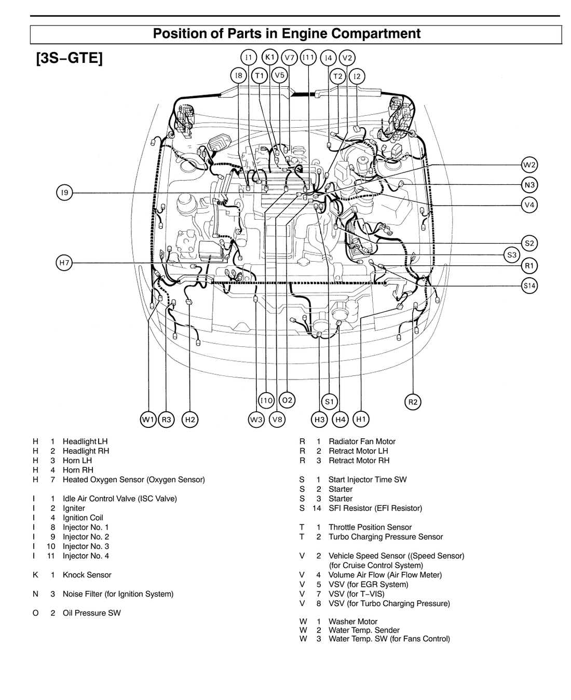

Washer motor W1 1993 p.29

| Part · pin | OEM wire | Which side | Rest of OEM wire | New wire | How · EWD |
|---|---|---|---|---|---|
| **Washer W1 cowl leads** pin **1** | L-R | Cabin end of the cut: the Cowl Wire runs straight through the firewall here (no joint plug), so it is cut at the firewall, cabin side | 🟢 Rest stays: Cabin part stays to the washer switch; the bay part to W1 comes out | **Washer motor switch side** (`w_wash_neg`, 14 AWG Red, EngineRoom-C); other end: Washer motor W1 (RH front corner, low) pin 1 | crimp butt splice into the factory cowl-wire lead to W1 at the firewall (cabin side; its bay run is removed); 1993 p.148 |
| **Washer W1 cowl leads** pin **2** | L | Cabin end of the cut: the Cowl Wire runs straight through the firewall here (no joint plug), so it is cut at the firewall, cabin side | 🟢 Rest stays: Cabin part stays to the washer switch; the bay part to W1 comes out | **Washer motor +12 V** (`w_wash_pos`, 14 AWG Red, EngineRoom-C); other end: Washer motor W1 (RH front corner, low) pin 2 | crimp butt splice into the factory cowl-wire lead to W1 at the firewall (cabin side; its bay run is removed); 1993 p.148 |

## Engine bay and front: 6 in OEM pigtails (rule B9)

**Block:** None (device) · **Where:** Engine bay / front · **Connector:** per device below

Each device keeps its own plug with a 6 in factory pigtail; the new wire solders onto the pigtail and never mates with the plug. Everything else forward of the firewall comes out.

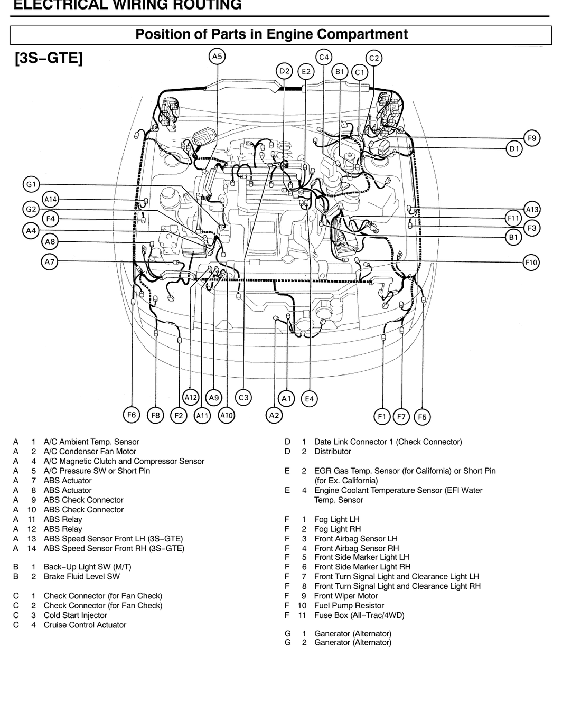

F5-F9, A1 1993 p.28 · H1, H2, R2, R3, W1 1993 p.29

| Part · pin | OEM wire | Which side | Rest of OEM wire | New wire | How · EWD |
|---|---|---|---|---|---|
| **Ambient temp sensor A1** pin **1** | Y | Device side: the 6 in OEM pigtail on the device's own plug (plug stays on the device) | 🔴 Pigtail / stub: Cut to the 6 in pigtail; the rest comes out with the Engine Room Main | **Ambient sensor return** (`w_amb_rtn`, 20 AWG Yellow, EngineRoom-C); other end: A/C sensor common splice | solder splice onto the device's 6 in factory pigtail (B9: the OEM pigtail stays; the new wire never mates with the plug); 1993 p.212 |
| **Ambient temp sensor A1** pin **2** | Y-B | Device side: the 6 in OEM pigtail on the device's own plug (plug stays on the device) | 🔴 Pigtail / stub: Cut to the 6 in pigtail; the rest comes out with the Engine Room Main | **Ambient temp signal** (`w_amb_sig`, 20 AWG Yellow, EngineRoom-C); other end: Auto A/C amplifier A32 pin 6 | solder splice onto the device's 6 in factory pigtail (B9: the OEM pigtail stays; the new wire never mates with the plug); 1993 p.212 |
| **LH side marker F5** pin **1** | G | Device side: the 6 in OEM pigtail on the device's own plug (plug stays on the device) | 🔴 Pigtail / stub: Cut to the 6 in pigtail; the rest comes out with the Engine Room Main | **LH marker +** (`w_clr_f5`, 16 AWG Red, EngineRoom-C); other end: Clearance lamp feed splice | solder splice onto the device's 6 in factory pigtail (B9: the OEM pigtail stays; the new wire never mates with the plug); 1993 p.112; Mitchell 1993 Fig. 1 |
| **LH side marker F5** pin **2** | W-B | Device side: the 6 in OEM pigtail on the device's own plug (plug stays on the device) | 🔴 Pigtail / stub: Cut to the 6 in pigtail; the rest comes out with the Engine Room Main | **LH marker lamp ground** (`w_f5_gnd`, 16 AWG Black, EngineRoom-C); other end: Ground stud EB, LH front fender | solder splice onto the device's 6 in factory pigtail (B9: the OEM pigtail stays; the new wire never mates with the plug); 1993 p.112; Mitchell 1993 Fig. 1 |
| **RH side marker F6** pin **1** | G | Device side: the 6 in OEM pigtail on the device's own plug (plug stays on the device) | 🔴 Pigtail / stub: Cut to the 6 in pigtail; the rest comes out with the Engine Room Main | **RH marker +** (`w_clr_f6`, 16 AWG Red, EngineRoom-C); other end: Clearance lamp feed splice | solder splice onto the device's 6 in factory pigtail (B9: the OEM pigtail stays; the new wire never mates with the plug); 1993 p.112; Mitchell 1993 Fig. 1 |
| **RH side marker F6** pin **2** | W-B | Device side: the 6 in OEM pigtail on the device's own plug (plug stays on the device) | 🔴 Pigtail / stub: Cut to the 6 in pigtail; the rest comes out with the Engine Room Main | **RH marker lamp ground** (`w_f6_gnd`, 16 AWG Black, EngineRoom-C); other end: Ground stud EA, RH front fender | solder splice onto the device's 6 in factory pigtail (B9: the OEM pigtail stays; the new wire never mates with the plug); 1993 p.112; Mitchell 1993 Fig. 1 |
| **LH front turn / clearance F7** pin **1** | G | Device side: the 6 in OEM pigtail on the device's own plug (plug stays on the device) | 🔴 Pigtail / stub: Cut to the 6 in pigtail; the rest comes out with the Engine Room Main | **LH clearance +** (`w_clr_f7`, 16 AWG Red, EngineRoom-C); other end: Clearance lamp feed splice | solder splice onto the device's 6 in factory pigtail (B9: the OEM pigtail stays; the new wire never mates with the plug); 1993 p.112 |
| **LH front turn / clearance F7** pin **2** | W-B | Device side: the 6 in OEM pigtail on the device's own plug (plug stays on the device) | 🔴 Pigtail / stub: Cut to the 6 in pigtail; the rest comes out with the Engine Room Main | **LH front lamp ground** (`w_f7_gnd`, 16 AWG Black, EngineRoom-C); other end: Ground stud EB, LH front fender | solder splice onto the device's 6 in factory pigtail (B9: the OEM pigtail stays; the new wire never mates with the plug); 1993 p.112 / p.130 |
| **LH front turn / clearance F7** pin **3** | G-B | Device side: the 6 in OEM pigtail on the device's own plug (plug stays on the device) | 🔴 Pigtail / stub: Cut to the 6 in pigtail; the rest comes out with the Engine Room Main | **LH turn +12 V to the headlamp** (`w_turn_h1`, 18 AWG Red, EngineRoom-C); other end: LH headlamp H1 pin TURN | solder splice onto the device's 6 in factory pigtail (B9: the OEM pigtail stays; the new wire never mates with the plug); 1993 p.130 |
| **LH front turn / clearance F7** pin **3** | G-B | Device side: the 6 in OEM pigtail on the device's own plug (plug stays on the device) | 🔴 Pigtail / stub: Cut to the 6 in pigtail; the rest comes out with the Engine Room Main | **LH front turn +** (`w_turn_f7`, 18 AWG Red, EngineRoom-C); other end: J/B No.1 (LH kick panel) pin 1H-4 | solder splice onto the device's 6 in factory pigtail (B9: the OEM pigtail stays; the new wire never mates with the plug); 1993 p.130 |
| **RH front turn / clearance F8** pin **1** | G | Device side: the 6 in OEM pigtail on the device's own plug (plug stays on the device) | 🔴 Pigtail / stub: Cut to the 6 in pigtail; the rest comes out with the Engine Room Main | **RH clearance +** (`w_clr_f8`, 16 AWG Red, EngineRoom-C); other end: Clearance lamp feed splice | solder splice onto the device's 6 in factory pigtail (B9: the OEM pigtail stays; the new wire never mates with the plug); 1993 p.112 |
| **RH front turn / clearance F8** pin **2** | W-B | Device side: the 6 in OEM pigtail on the device's own plug (plug stays on the device) | 🔴 Pigtail / stub: Cut to the 6 in pigtail; the rest comes out with the Engine Room Main | **RH front lamp ground** (`w_f8_gnd`, 16 AWG Black, EngineRoom-C); other end: Ground stud EA, RH front fender | solder splice onto the device's 6 in factory pigtail (B9: the OEM pigtail stays; the new wire never mates with the plug); 1993 p.112 / p.130 |
| **RH front turn / clearance F8** pin **3** | G-Y | Device side: the 6 in OEM pigtail on the device's own plug (plug stays on the device) | 🔴 Pigtail / stub: Cut to the 6 in pigtail; the rest comes out with the Engine Room Main | **RH turn +12 V to the headlamp** (`w_turn_h2`, 18 AWG Red, EngineRoom-C); other end: RH headlamp H2 pin TURN | solder splice onto the device's 6 in factory pigtail (B9: the OEM pigtail stays; the new wire never mates with the plug); 1993 p.130 |
| **RH front turn / clearance F8** pin **3** | G-Y | Device side: the 6 in OEM pigtail on the device's own plug (plug stays on the device) | 🔴 Pigtail / stub: Cut to the 6 in pigtail; the rest comes out with the Engine Room Main | **RH front turn +** (`w_turn_f8`, 18 AWG Red, EngineRoom-C); other end: J/B No.1 (LH kick panel) pin 1H-8 | solder splice onto the device's 6 in factory pigtail (B9: the OEM pigtail stays; the new wire never mates with the plug); 1993 p.130 |
| **Wiper motor F9** pin **1** | L-O | Device side: the 6 in OEM pigtail on the device's own plug (plug stays on the device) | 🔴 Pigtail / stub: Cut to the 6 in pigtail; the rest comes out with the Engine Room Main | **Wiper HIGH** (`w_wip_hi`, 14 AWG Red, EngineRoom-C); other end: Cowl plug IE1 (LH kick) pin 20 | solder splice onto the device's 6 in factory pigtail (B9: the OEM pigtail stays; the new wire never mates with the plug); 1993 p.148 |
| **Wiper motor F9** pin **2** | L-B | Device side: the 6 in OEM pigtail on the device's own plug (plug stays on the device) | 🔴 Pigtail / stub: Cut to the 6 in pigtail; the rest comes out with the Engine Room Main | **Wiper LOW** (`w_wip_lo`, 14 AWG Red, EngineRoom-C); other end: Cowl plug IE1 (LH kick) pin 13 | solder splice onto the device's 6 in factory pigtail (B9: the OEM pigtail stays; the new wire never mates with the plug); 1993 p.148 |
| **Wiper motor F9** pin **3** | L-W | Device side: the 6 in OEM pigtail on the device's own plug (plug stays on the device) | 🔴 Pigtail / stub: Cut to the 6 in pigtail; the rest comes out with the Engine Room Main | **Wiper park switch** (`w_wip_park`, 14 AWG Yellow, EngineRoom-C); other end: Cowl plug IE1 (LH kick) pin 6 | solder splice onto the device's 6 in factory pigtail (B9: the OEM pigtail stays; the new wire never mates with the plug); 1993 p.148 |
| **Wiper motor F9** pin **4** | L | Device side: the 6 in OEM pigtail on the device's own plug (plug stays on the device) | 🔴 Pigtail / stub: Cut to the 6 in pigtail; the rest comes out with the Engine Room Main | **Wiper +12 V** (`w_wip_b`, 14 AWG Red, EngineRoom-C); other end: J/B No.1 (LH kick panel) pin 1H-5 | solder splice onto the device's 6 in factory pigtail (B9: the OEM pigtail stays; the new wire never mates with the plug); 1993 p.148 |
| **LH headlamp H1** pin **1** | R-L | Device side: the 6 in OEM pigtail on the device's own plug (plug stays on the device) | 🔴 Pigtail / stub: Cut to the 6 in pigtail; the rest comes out with the Engine Room Main | **Low beam +12 V to LH headlamp** (`w_pmu_hl`, 14 AWG Red, EngineRoom-C); other end: Low-beam output splice | solder splice onto the device's 6 in factory pigtail (B9: the OEM pigtail stays; the new wire never mates with the plug); 1993 p.116 |
| **LH headlamp H1** pin **2** | R-W | Device side: the 6 in OEM pigtail on the device's own plug (plug stays on the device) | 🔴 Pigtail / stub: Cut to the 6 in pigtail; the rest comes out with the Engine Room Main | **High beam +12 V to LH headlamp** (`w_hl_hi_h1`, 14 AWG Red, EngineRoom-C); other end: High-beam output splice | solder splice onto the device's 6 in factory pigtail (B9: the OEM pigtail stays; the new wire never mates with the plug); 1993 p.116 |
| **LH headlamp H1** pin **3** | R | Device side: the 6 in OEM pigtail on the device's own plug (plug stays on the device) | 🔴 Pigtail / stub: Cut to the 6 in pigtail; the rest comes out with the Engine Room Main | **LH headlamp ground** (`w_h1_gnd`, 14 AWG Black, EngineRoom-C); other end: Ground stud EB, LH front fender | solder splice onto the device's 6 in factory pigtail (B9: the OEM pigtail stays; the new wire never mates with the plug); 1993 p.116 |
| **RH headlamp H2** pin **1** | R-L | Device side: the 6 in OEM pigtail on the device's own plug (plug stays on the device) | 🔴 Pigtail / stub: Cut to the 6 in pigtail; the rest comes out with the Engine Room Main | **Low beam +12 V to RH headlamp** (`w_hl_lo_h2`, 14 AWG Red, EngineRoom-C); other end: Low-beam output splice | solder splice onto the device's 6 in factory pigtail (B9: the OEM pigtail stays; the new wire never mates with the plug); 1993 p.116 |
| **RH headlamp H2** pin **2** | R-W | Device side: the 6 in OEM pigtail on the device's own plug (plug stays on the device) | 🔴 Pigtail / stub: Cut to the 6 in pigtail; the rest comes out with the Engine Room Main | **High beam +12 V to RH headlamp** (`w_pmu_hr`, 14 AWG Red, EngineRoom-C); other end: High-beam output splice | solder splice onto the device's 6 in factory pigtail (B9: the OEM pigtail stays; the new wire never mates with the plug); 1993 p.116 |
| **RH headlamp H2** pin **3** | R-Y | Device side: the 6 in OEM pigtail on the device's own plug (plug stays on the device) | 🔴 Pigtail / stub: Cut to the 6 in pigtail; the rest comes out with the Engine Room Main | **RH headlamp ground** (`w_h2_gnd`, 14 AWG Black, EngineRoom-C); other end: Ground stud EA, RH front fender | solder splice onto the device's 6 in factory pigtail (B9: the OEM pigtail stays; the new wire never mates with the plug); 1993 p.116 |
| **LH pop-up motor R2** pin **1** | G-W | Device side: the 6 in OEM pigtail on the device's own plug (plug stays on the device) | 🔴 Pigtail / stub: Cut to the 6 in pigtail; the rest comes out with the Engine Room Main | **LH pop-up up (open) limit switch** (`w_rtr_open_r2`, 18 AWG Yellow, EngineRoom-C); other end: Pop-up open limit splice | solder splice onto the device's 6 in factory pigtail (B9: the OEM pigtail stays; the new wire never mates with the plug); 1993 p.117 |
| **LH pop-up motor R2** pin **2** | G-O | Device side: the 6 in OEM pigtail on the device's own plug (plug stays on the device) | 🔴 Pigtail / stub: Cut to the 6 in pigtail; the rest comes out with the Engine Room Main | **LH pop-up motor drive (relay R8 pin 2 to motor pin 2)** (`w_rtr_r2_2`, 16 AWG Red, EngineRoom-C); other end: Cowl plug IE1 (LH kick) pin 15 | solder splice onto the device's 6 in factory pigtail (B9: the OEM pigtail stays; the new wire never mates with the plug); 1993 p.117 |
| **LH pop-up motor R2** pin **3** | G-Y | Device side: the 6 in OEM pigtail on the device's own plug (plug stays on the device) | 🔴 Pigtail / stub: Cut to the 6 in pigtail; the rest comes out with the Engine Room Main | **LH pop-up down (close) limit switch** (`w_rtr_close_r2`, 18 AWG Yellow, EngineRoom-C); other end: Pop-up close limit splice | solder splice onto the device's 6 in factory pigtail (B9: the OEM pigtail stays; the new wire never mates with the plug); 1993 p.117 |
| **LH pop-up motor R2** pin **4** | G | Device side: the 6 in OEM pigtail on the device's own plug (plug stays on the device) | 🔴 Pigtail / stub: Cut to the 6 in pigtail; the rest comes out with the Engine Room Main | **LH pop-up motor drive (relay R8 pin 1 to motor pin 4)** (`w_rtr_r2_4_p`, 16 AWG Red, EngineRoom-C); other end: LH pop-up motor feed splice | solder splice onto the device's 6 in factory pigtail (B9: the OEM pigtail stays; the new wire never mates with the plug); 1993 p.117 |
| **LH pop-up motor R2** pin **5** | W-B | Device side: the 6 in OEM pigtail on the device's own plug (plug stays on the device) | 🔴 Pigtail / stub: Cut to the 6 in pigtail; the rest comes out with the Engine Room Main | **LH pop-up motor ground** (`w_rtr_gnd_r2`, 16 AWG Black, EngineRoom-C); other end: LH pop-up motor ground splice | solder splice onto the device's 6 in factory pigtail (B9: the OEM pigtail stays; the new wire never mates with the plug); 1993 p.117 |
| **RH pop-up motor R3** pin **1** | G-W | Device side: the 6 in OEM pigtail on the device's own plug (plug stays on the device) | 🔴 Pigtail / stub: Cut to the 6 in pigtail; the rest comes out with the Engine Room Main | **RH pop-up up (open) limit switch** (`w_rtr_open_r3`, 18 AWG Yellow, EngineRoom-C); other end: Pop-up open limit splice | solder splice onto the device's 6 in factory pigtail (B9: the OEM pigtail stays; the new wire never mates with the plug); 1993 p.117 |
| **RH pop-up motor R3** pin **2** | G-B | Device side: the 6 in OEM pigtail on the device's own plug (plug stays on the device) | 🔴 Pigtail / stub: Cut to the 6 in pigtail; the rest comes out with the Engine Room Main | **RH pop-up motor drive (relay R8 pin 5 to motor pin 2)** (`w_rtr_r3_2`, 16 AWG Red, EngineRoom-C); other end: Cowl plug IE1 (LH kick) pin 8 | solder splice onto the device's 6 in factory pigtail (B9: the OEM pigtail stays; the new wire never mates with the plug); 1993 p.117 |
| **RH pop-up motor R3** pin **3** | G-Y | Device side: the 6 in OEM pigtail on the device's own plug (plug stays on the device) | 🔴 Pigtail / stub: Cut to the 6 in pigtail; the rest comes out with the Engine Room Main | **RH pop-up down (close) limit switch** (`w_rtr_close_r3`, 18 AWG Yellow, EngineRoom-C); other end: Pop-up close limit splice | solder splice onto the device's 6 in factory pigtail (B9: the OEM pigtail stays; the new wire never mates with the plug); 1993 p.117 |
| **RH pop-up motor R3** pin **4** | G-Y | Device side: the 6 in OEM pigtail on the device's own plug (plug stays on the device) | 🔴 Pigtail / stub: Cut to the 6 in pigtail; the rest comes out with the Engine Room Main | **RH pop-up motor drive (relay R8 pin 4 to motor pin 4)** (`w_rtr_r3_4_p`, 16 AWG Red, EngineRoom-C); other end: RH pop-up motor feed splice | solder splice onto the device's 6 in factory pigtail (B9: the OEM pigtail stays; the new wire never mates with the plug); 1993 p.117 |
| **RH pop-up motor R3** pin **5** | W-B | Device side: the 6 in OEM pigtail on the device's own plug (plug stays on the device) | 🔴 Pigtail / stub: Cut to the 6 in pigtail; the rest comes out with the Engine Room Main | **RH pop-up motor ground** (`w_rtr_gnd_r3`, 16 AWG Black, EngineRoom-C); other end: RH pop-up motor ground splice | solder splice onto the device's 6 in factory pigtail (B9: the OEM pigtail stays; the new wire never mates with the plug); 1993 p.117 |

---
# Cut list only (no new splices)

## Engine bay joints EB2 and ES2: all out

<b>What comes out here (cut list)</b>

From `docs/harness/circuit-plan.md` (plan file; the master wins). **remove** = dead, out back to its last live point; **keep** = factory wire stays; **re-fed by** = the named new wire takes over.

#### Group 5 - EB2 (Engine <-> Cowl, A/C pressure switch) and ES2 (Engine <-> ER No.2)

Open from the draft: whether the car has an A3 idle-up VSV (p.219 lists it, p.28 does not); TBD: look up in the 1993 EWD / FSM.

| Joint | Pin | Colour | Signal | Kept-side end | EWD | Draft said | Action |
|---|---|---|---|---|---|---|---|
| EB2 | 1 | V-R | R/B4 10 A A/C fuse out to pressure switch A5 pin 1 | cowl I9 -> R/B4 10 A A/C fuse pin 2 (also the V-R bus to the A/C amps) | 1993 p.211 | cut + cap; R/B4 gone so the V-R bus needs a re-feed | remove the EB2 leg; A5 pin 1 re-fed by `w_acp_1` from the kept R/B4 A/C fuse; the cabin V-R bus keeps |
| EB2 | 2 | Y-R | Pressure switch output to the A/C amp | E10 -> IJ1-11 -> A15 pin 13 (and A3 idle-up VSV pin 2) | 1993 p.211 | reuse the cowl side | remove the EB2 leg (goes with the Engine Wire, B9); A5 pin 4 re-fed by new wire `w_ac_psw_in` from the switch's own plug in the bay to cabin splice `SP-AC-PSW`, tied to A15 pin 13 by `w_ac_psw_sw` (D16; DECISIONS B8 "A5 fix") |
| EB2 | 3, 4 | - | no cavity | - | p.37 | none | none |
| ES2 | 1-5 | B, BR, Y-B, G, R | STA, ECT ground, oil pressure SW, STJ, THW | none (ER No.2 removed) | 1993 p.66, 80, 207 | remove | remove with the harness; oil pressure is the Link sensor `OIL-P` (AB-engine) and the oil LED on CSB3 L4 (`w_oil_k`) |

## J/B No.2 and fuse box F11, engine bay: all out

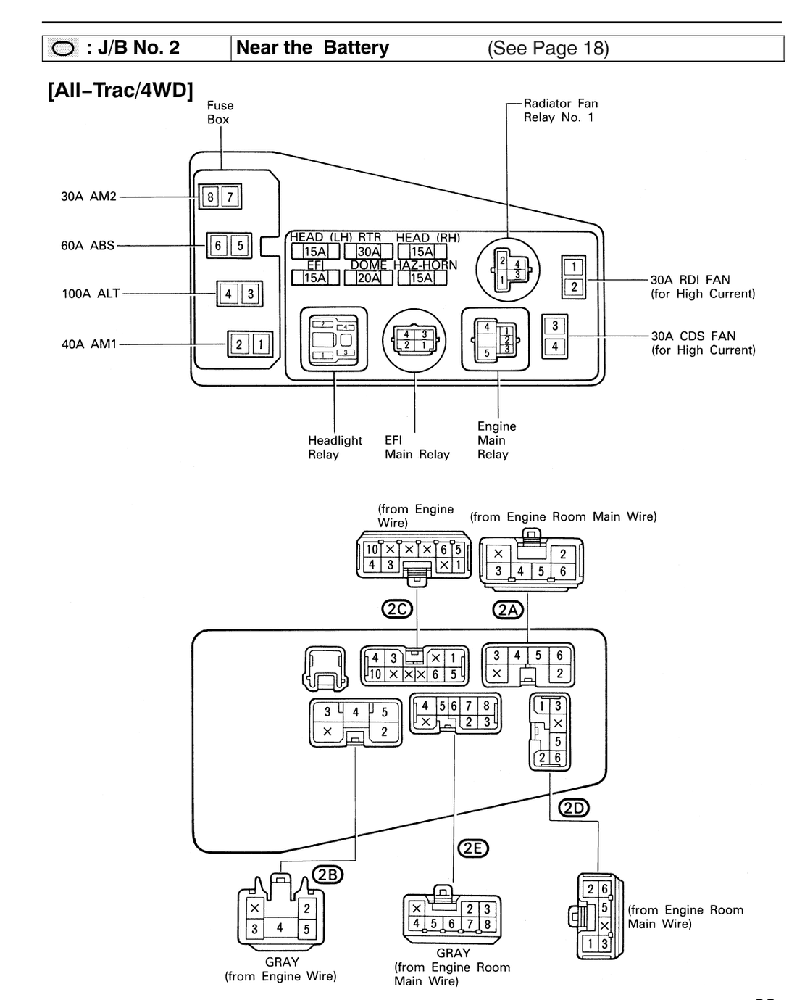
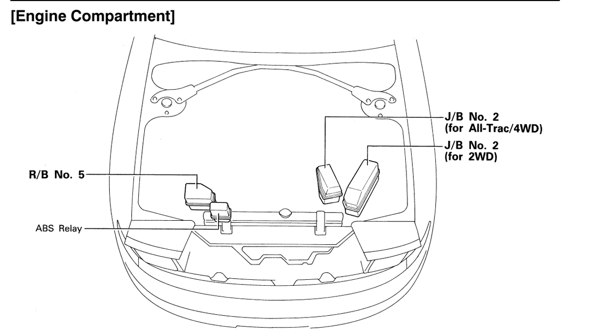

J/B No.2 (All-Trac), 1993 p.23 · Engine bay boxes, 1993 p.18

<b>What comes out here (cut list)</b>

From `docs/harness/circuit-plan.md` (plan file; the master wins). **remove** = dead, out back to its last live point; **keep** = factory wire stays; **re-fed by** = the named new wire takes over.

#### Group 6 - J/B No.2 (with F11) and R/B No.2-5

J/B No.2, F11 and R/B No.5 sit in the engine bay on the ER Main: every lead goes with it (B9). R/B No.2 and No.4 are

cabin boxes and stay (circuits 2, 9, 18). R/B No.3 goes (circuit 17).

#### J/B No.2 and F11 (LH front, 1993 p.23-24)

| Plug | Pin | Colour | Signal | Old load | EWD | Draft said | Action |
|---|---|---|---|---|---|---|---|
| 2A | 2 | L-R | 30 A CDS FAN out | condenser fan A2 pin 2 | p.210 | re-feed POWER FAN2 | remove; re-fed by `w_fan2_pwr` (K-FAN2, new wire to the uprated fan) |
| 2A | 3 | R | 15 A HEAD LH out | headlamp H1 pin 3 | p.116 | splice LOGIC HL onto the old R lead | remove; H1 pin 3 is now the lamp common to ground EB (`w_h1_gnd`); the lamp's +12 V comes on pins 1 / 2 ("Headlamps, DRL and pop-ups") |
| 2A | 4 | B-R | Radiator fan + | radiator fan R1 pin 2 | p.210 | re-feed POWER FAN | remove; re-fed by `w_fan_pwr` (K-FAN); fan ground `w_fan_gnd` to EA |
| 2A | 5 | W-B | Relay / coil ground node | ground EB | p.62, 67, 210 | cut + cap | remove (EB stays as a ground point, new wires only) |
| 2A | 6 | R-Y | 15 A HEAD RH out | headlamp H2 pin 3 | p.116 | splice LOGIC HR onto the old lead | remove; H2 pin 3 is now the lamp common to ground EA (`w_h2_gnd`) |
| 2B | 2, 3, 4, 5 | W, B-R, W, W | AM1 in, AM2 in, J/B2 B+ bus, alternator S | F11 / battery / alternator | p.62, 74, 116 | gone with the Engine Wire | remove; AM1 / AM2 re-fed by `w_pdb_am1` / `w_pdb_am2` at IE1; alternator S by `w_alt_s_c` |
| 2C | 1, 3, 4, 5, 6, 10 | LG-B, W, P, W-B, B-W, B-Y | fan coil, ALT -> engine main relay, EFI BATT, ground, A/C clutch, EFI +B | engine | p.62, 79, 210 | gone | remove (Link owns EFI: `k_efi`) |
| 2D | 1 | B-W | A/C clutch power hop | R/B5 clutch relay pin 3 | p.210 | cut + cap | remove; clutch is `w_acc_clutch` (K-ACC to A4 pin 4) |
| 2D | 2, 3, 5, 6 | B-R, W, LG-B, W | rad-fan +, headlight relay loop, fan coil, HEAD bus in | R/B5 / loop | p.62, 116, 210 | cut | remove |
| 2E | 2 | W | 30 A RTR out | IE1-3 -> retract relay R8 pin 3 | p.116 | re-feed POWER RTR | remove; re-fed by `w_pmu_rtr` at IE1-3 (cowl side) |
| 2E | 3 | W | 15 A HAZ-HORN out | R/B5 horn relay pin 3; IE1-12 -> hazard SW H5-8 | p.130, 185 | re-feed LOGIC HZ + horn relay | remove; hazard re-fed by `w_haz_cp` (LOGIC HZ via `SP-HZ`); horn relay feed `w_horn_30_cp` / `w_horn_86_cp` |
| 2E | 4 | L-Y | 20 A DOME out | J/B1 1H-2 | p.132, 200, 207 | re-feed LOGIC DM | remove; re-fed by `w_pmu_dome` at 1H-2 (owner fix: DECISIONS B8 list) |
| 2E | 5 | W | AM1 out | IE1-10 -> cowl I2 -> ignition SW I13-4 and R/B2 30 A POWER fuse pin 1 | p.62, 66 | re-feed POWER AM1 | remove; re-fed by `w_pdb_am1` at IE1-10. I2 also feeds R/B2, as stock (Dan B17 b) |
| 2E | 6 | B-R | AM2 out | IE1-17 -> I13-10 | p.62, 66 | re-feed POWER AM2 | remove; re-fed by `w_pdb_am2` at IE1-17 |
| 2E | 7 | R-Y | Headlight relay coil | IE1-2 -> I2 -> light control SW C15, retract relay R8-8 | p.116 | re-feed LOGIC head relay coils | remove; re-fed by `w_head_coil_cp` (K-HL coil 85 via `SP-HEAD-COIL`; Dan N89 a) |
| 2E | 8 | B-O | IGN 7.5 A to J/B2 relay coils | ER Main splice E13 / E4 <- J/B1 1H-7 | p.210, 79 | cut + cap at J/B2 and R/B5 | remove; 1H-7 itself keeps (tapped by `w_ig2_in`, `w_ign`, `w_k_on_86_cp`) |
| F11-A | 2, 3, 4, 7 | W, W, B, B-R | AM1, 100 A ALT, FL MAIN in, AM2 | battery, alternator | p.62, 64 | gone | remove (trunk battery and HeavyDC, B11) |
| F11-C | 1 | W-L | 60 A ABS out | ABS relays (ER Main E12) | p.62; 1992 p.192 | cut + cap | remove (ABS gone, circuit 6) |

## R/B No.2, LH kick panel: stays, no new splice

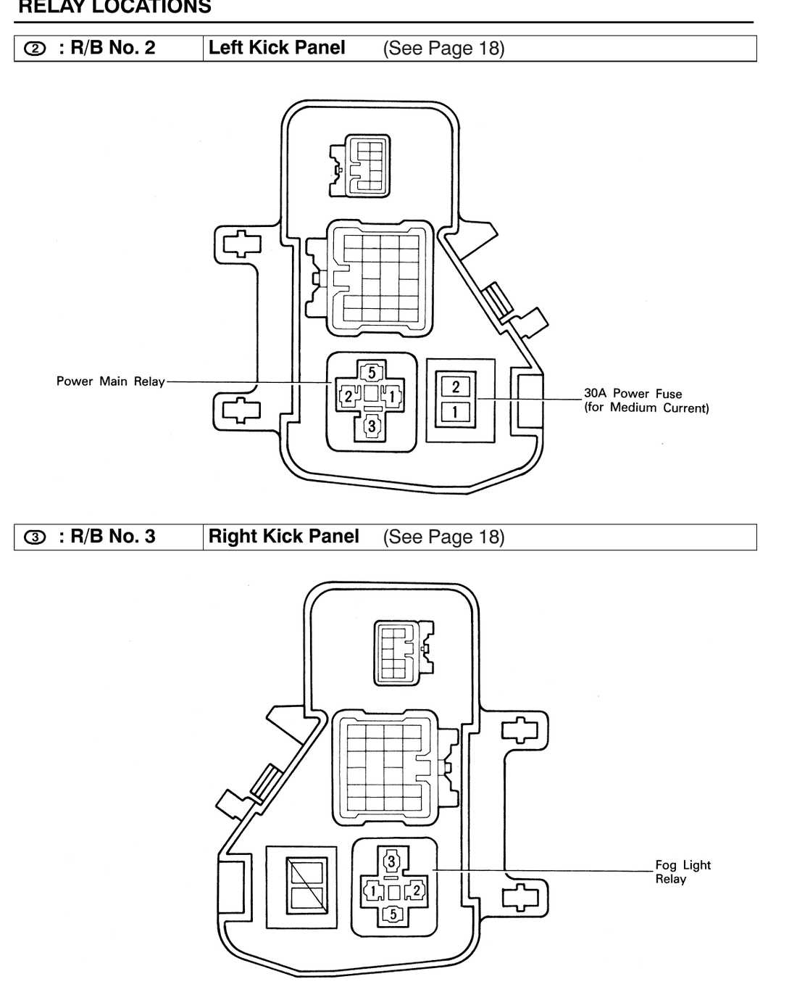

R/B No.2 and No.3, 1993 p.26

<b>What comes out here (cut list)</b>

From `docs/harness/circuit-plan.md` (plan file; the master wins). **remove** = dead, out back to its last live point; **keep** = factory wire stays; **re-fed by** = the named new wire takes over.

#### R/B No.2 (LH kick, cowl) - stays (circuit 18)

R/B No.2 check (2026-11-02, Dan B4 / B17 b): the only feed is the factory W from cowl splice I2 (AM1, IE1-10) into the

30 A POWER fuse pin 1; W-L is that fuse's output, so nothing else may land on it (1993 p.26, p.62, p.136-145; 1990 p.46

and 1992 p.66 agree; US = Canada). Splice codes are per diagram: the "I2" on the 1990 / 1992 cruise pages (IG1-11 BR

ground, group 3) and the fog relay's low-beam "I2" (1992 p.128) may not be the AM1 splice; tell them apart by wire colour

(W = AM1) before removing a leg.

| Terminal | Pin | Colour | Signal | Kept-side end | EWD | Draft said | Action |
|---|---|---|---|---|---|---|---|
| 30 A POWER fuse | 1 | W | AM1 branch in | cowl I2 <- IE1-10 | p.62 | keep | fed by AM1 through the factory I2 branch (`w_pdb_am1` at IE1-10), as stock; `w_rb2_feed` dropped (Dan B17 b) |
| 30 A POWER fuse | 2 | W-L | 30 A POWER out | I1 / I4 -> power main relay 4, door lock ECU, sunroof, seat | p.137 | keep | keep (fed through the kept POWER fuse); `w_rb2_wl` dropped (Dan B17 b) |
| Power main relay | 1 | W-G | window / accessory power out | I1 -> IC1-3, IK1-3 | p.137 | re-feed POWER PWR + `k_pwr` | keep (no `k_pwr`) |
| Power main relay | 2 | L-Y | coil + (GAUGE via key-off diode D6) | I1 / D6 | p.136-137 | reuse as `k_pwr` 86 | keep |
| Power main relay | 3 | W-B | coil ground | ground | p.137 | cut + cap | keep |
| Power main relay | 4 | W-L | contact in | I1 / I4 (POWER fuse out) | p.137 | cut + cap | keep |

## R/B No.3, RH kick panel (fog relay): all out

R/B No.3, 1993 p.26

<b>What comes out here (cut list)</b>

From `docs/harness/circuit-plan.md` (plan file; the master wins). **remove** = dead, out back to its last live point; **keep** = factory wire stays; **re-fed by** = the named new wire takes over.

#### R/B No.3 (RH kick, fog relay) [90/92] - goes (circuit 17)

No 1993 TIS fog page: relay and switch pins from 1992 p.128 and Mitchell 1993 Fig. 1 (grid C2-3); the fuse, switch

illumination and ground ends from 1993 p.62 / p.109 / p.231. USA wiring (Canada differs: 1992 p.122). 1993 p.26 numbers

the relay cavities 1, 2, 3, 5 (pin 4 below may be cavity 5 on the box). Every wire is removed back to its last live

point, never capped (Dan 2026-11-02); each has a master row.

| Terminal | Pin | Colour | Signal | Kept-side end | EWD | Draft said | Action |
|---|---|---|---|---|---|---|---|
| Fog relay | 1 | R-W | fog lamp feed | cowl -> EA1-6 -> ER Main -> fog lamps | 1992 p.128 | open | remove whole (no live end; the bay leg goes with B9), `w_fog_rb3_1` |
| Fog relay | 4 | G-R | contact in (20 A FR FOG) | R/B4 FOG fuse pin 2 | 1992 p.128; p.62 | open | remove whole (the fuse and the relay both come out), `w_fog_rb3_4` |
| Fog relay | 3 | G-B | coil - (fog switch) | fog switch F12 pin 6 | 1992 p.128 | open | remove whole (switch and relay both come out), `w_fog_sw` |
| Fog relay | 2 | R-W | coil + (low-beam line, I2 / IE1-18) | cowl I2 low-beam lead (IE1-18 / C15-12) | 1992 p.128; p.116 | open | remove back to splice I2 (I2 keeps its 2 low-beam legs), `w_fog_rb3_2` |
| Fog switch F12 | 3 | W-B | ground | J/B No.3 3A-1 (ground bus) | p.231; Mitchell 1993 | - | remove back to J/B No.3 3A-1 (the bus stays for the other switches), `w_fog_sw_gnd` |
| Fog switch F12 | 1 | G | illumination + | J/B No.3 3C-14 (TAIL illumination bus) | p.109 | - | remove back to J/B No.3 3C-14, `w_fog_sw_ill` |
| Fog switch F12 | 2 | W-G | illumination - | J/B No.3 3A-10 (ILL- bus to rheostat R10) | p.109 | - | remove back to J/B No.3 3A-10, `w_fog_sw_ill_rtn` |
| Fog switch F12 | 4, 5 | - | not used; no fog indicator in the switch or the meter | - | Mitchell 1993; p.206-207 | - | none |

## R/B No.5, engine bay RH front: all out

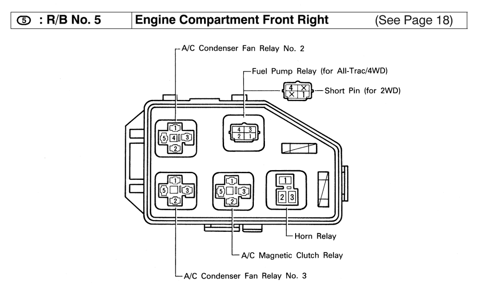

R/B No.5, 1993 p.27 · Location, 1993 p.18

<b>What comes out here (cut list)</b>

From `docs/harness/circuit-plan.md` (plan file; the master wins). **remove** = dead, out back to its last live point; **keep** = factory wire stays; **re-fed by** = the named new wire takes over.

#### R/B No.5 (RH front, ER Main) - goes

Open from the draft: R/B No.2 / No.4 also carry multi-pin plugs (1993 p.26-27) whose cavity pinout is not in the 1993

pulls; the terminals above are what the system pages show. TBD: look up in the 1993 EWD / FSM.

| Relay | Pin | Colour | Signal | Old load | EWD | Draft said | Action |
|---|---|---|---|---|---|---|---|
| Horn relay | 3 | W | HAZ-HORN feed | J/B2 2E-3 | p.185 | cut + cap | remove; K-HORN (LOGIC M3) fed by `w_horn_30_cp` / `w_horn_86_cp` |
| Horn relay | 2 | G | coil - to horn SW | IE1-19 -> horn SW C15-10 | p.185 | reuse | remove the ER Main leg; re-fed by `w_horn_85_cp` (K-HORN 85 at IE1-19, cowl side) |
| Horn relay | 1 | G-R | horn + | horns H3-1, H4-1 | p.185 | splice the LOGIC horn relay onto the G-R lead | remove; re-fed by `w_pmu_horn_cp` -> `SP-HORN` -> `w_horn_lh` / `w_horn_rh` (new wire to each horn) |
| A/C mag clutch relay | 1, 5 | R-L | coil + / contact in (GAUGE) | J/B1 1H-1 | p.210 | cut + cap | remove |
| A/C mag clutch relay | 2 | L-Y | coil - (A/C amp MGC) | EA1-3 -> IJ1-1 -> A15 pin 8 | p.210-211 | maybe reuse into `k_acc` | remove the ER Main leg; A15 pin 8 re-fed by `w_acc_trig` (to K-ACC 85, D16) |
| A/C mag clutch relay | 3 | B-W | clutch power out | E2 -> 2D-1 | p.210 | cut + cap | remove; clutch is `w_acc_clutch` |
| Condenser fan relay No.2 | 1-5 | B-O, LG-B, B, W-B, B-R | coil IGN, coil -, series link, NC ground, rad fan + | ER Main | p.210 | cut + cap | remove; fans are K-FAN / K-FAN2 on Link outputs (`w_fan85`, `w_fan285`) |
| Condenser fan relay No.3 | 5 | B-W | condenser fan motor (-) | A2 pin 1 | p.210 | re-ground A2-1 to EA | remove; new fan grounded by `w_fan2_gnd` to EA |
| Condenser fan relay No.3 | 1, 2, 3 | B-W, W-B, B | coil +, coil -, series link | ER Main | p.210 | cut + cap | remove |
| Fuel pump relay | 1-4 | L-O, L-W, G-R, L-B | contact common, low / high speed out, coil (ECU FPR) | C9, F10, IE2-18 / 19 / 20 | p.78-79 | cut + cap | remove; fuel pump is K-FP in the trunk (`w_fpump_r`, coil `w_fp85`) |

## Removed parts that sit on kept harnesses

<b>What comes out here (cut list)</b>

From `docs/harness/circuit-plan.md` (plan file; the master wins). **remove** = dead, out back to its last live point; **keep** = factory wire stays; **re-fed by** = the named new wire takes over.

#### Group 7 - removed parts that sit on kept harnesses

Every lead below is dead and comes out back to its last live point (splice, plug or box), unless the action names a

master wire. Meter plug codes are the 1993 codes C12 (A) / C13 (B) / C14 (C), in the master too (N14 a, 2026-11-05).

Open from the draft: the ABS ECU ground pin labels in Mitchell Fig.13 are partly illegible, and the front airbag sensor

leads are taken to be Cowl Wire (no joint drawn). TBD: look up in the 1993 EWD / FSM.

| Part / plug | Pins | Kept-side ends | EWD | Draft said | Action |
|---|---|---|---|---|---|
| OEM ECU plug A (E9, Cowl Wire) | 1 BATT, 2 ELS, 5 W, 6 FPR, 9 SPD, 10 AC, 11 STA, 12 / 13 +B, 14 FC | IG2-7, J/B1 1D-6, I6 / meter C12-3, IE2-20, J2 (meter C13-6), IG1-4, I6, I6, IG2-5 / C9-4 | 1993 p.79-81 | cut + cap | remove |
| OEM ECU plug A (E9) | 4 STP (G-W) | J2 <- stop light SW S9 | 1993 p.79 | cut + cap | remove the E9 leg; S9 pin 1 keeps, tapped by `w_sw6` (CSB3 opto IN1) |
| OEM ECU plug A (E9) | 7 ATS (L-Y) | IG2-1 -> IH1-1 -> A15-2 | 1993 p.79 | open (see IH1-1) | remove; A15 pin 2 grounded by `w_ac_cool_gnd` (group 4) |
| OEM ECU plug A (E9) | 21 ACT (LG-B) | IJ1-3 (G-Y) -> A15 pin 11 | 1993 p.79 | maybe carry ACT to the Link | remove the E9 leg; A15 pin 11 re-fed by `w_ac_kill` (Link ACT kill, D16) |
| Circuit opening relay C9 (cowl) | 1, 2, 3, 4, 6 | IE2-18, I6, I6, IG2-5, J/B3 3B-2 -> ground ID | 1993 p.78 | cut + cap | remove (J/B3 and ID keep) |
| SRS centre airbag sensor | 1, 6, 7, 8, 9, 12, 13, 14 | J/B1 1C-3 / 1C-1 / 1C-4 / 1C-2, I4 (meter C12-7 / -8), ground IE / IG, IG2-3, IG2-12 | Mitchell 1993 Fig.12; 1992 p.200 | cut + cap | remove (circuit 5) |
| SRS front sensors F3 / F4, squib leads | 2-5, 10-11 | cowl runs along each fender; spiral cable | Fig.12; 1993 p.28 | remove back to the cowl trunk | remove |
| ABS ECU (26-pin and 16-pin), actuator A7 / A8, relays A11 / A12, check conn A9 / A10 | all | ID1, IF1, J/B1 1F-8 / 1F-11 / 1F-13, J2, decel sensor, IF1-16 -> IG2-17 | Mitchell 1993 Fig.13; 1992 p.192 | cut + cap; remove the ID1 leads | remove (circuit 6); J/B1 1F-8 park brake keeps its other loads |
| Wheel speed sensors (A13, A14, rears) | 1 / 2 | ER Main / Cowl / Floor leads | 1992 p.192 | cut at the sensor plugs | sensors keep; OEM leads removed; re-fed by WheelSpeed-Front / -Rear (`WSS-FL`, `WSS-FR`, `WSS-RL`, `WSS-RR`) |
| Cruise ECU plug A / B (motor type) | all but the stalk leads | J3, stop SW, J2, C17, park brake SW, IG1-6 / 7 / 17 / 18 / 2 / 8, meter C12-2, IG2-6 | Mitchell 1993 Fig.12; [90/92] 1990 p.118-119 | cut + cap, keep the stalk leads | remove (circuit 4) |
| Cruise control switch in the combination switch, plug C16 (B) | its 3 pins (master; Always 1993, README) | stalk switch | 1993 EWD grid 59 (Mitchell Fig. 15); 1993 TIS p.HdlitUSA (C16 = combination SW (B)); 1990 p.116 / 1992 p.180 same | keep for the CSB3 | keep; tapped by `w_an2`, `w_sw2`, `w_cru_gnd` (Dash) |
| Cruise clutch switch C17 | 2 (B) | was cruise ECU N&C | Mitchell 1993 Fig.12; 1993 p.32 | not in the draft | keep; tapped by `w_sw5` (CSB3 cavity 5, board S6, the one clutch input) |
| Meter C12 (A) (1993) | 1, 2, 3, 5, 6, 7, 8, 9, 10 | rheostat, cruise PI, I6, IG2-14, IG1-13, I4, I4, IF1-9, IF1-12 | 1993 p.206-207 | cut + cap | remove (old meter gone, circuit 7) |
| Meter C13 (B) | 2 G-B turn LH, 11 G-Y turn RH, 12 R-L high beam | J3 / IE1-11 | 1993 p.206 | reuse per Dash | keep; pins 2 / 11 tapped by `w_tl_a`, `w_tr_a` (Dash); pin 12 R-L leg removed back to I2 (`w_rl_c13_cut`, A2 b) |
| Meter C13 (B) (1993) | 1, 3, 4, 5, 6, 7, 10 | J/B3 3B-6, IF1-14, IG1-15, J6, J2, 3B-9, IG2-20 | 1993 p.206 | cut + cap | remove |
| Meter C14 (C) | 9 B-O IGN, 8 Y charge, 1 R-G brake / park brake | 1D-5, I5 / IG2-16, J6 | 1993 p.206-207 | reuse per Dash | keep; tapped by `w_ig_tap`, `w_chg_k`, `w_pk_k` (Dash) |
| Meter C14 (C) (1993) | 3, 4, 5, 6 oil (Y-B), 10, tacho | 3B-10, J1, integration relay, IG1-12, 3B-16, IG1-14 | 1993 p.206-207 | cut + cap | remove; oil warning is the LED on CSB3 L4 (`w_oil_a` / `w_oil_k`) |
| Rear wiper motor and relay, rear washer outlet W1 pin 3 [90/92] | 1-3; W1-3 | back door wire -> J/B1 1F-10, rear wiper switch (1993 code TBD) | 1992 p.150 | cut + cap | remove (R54); front washer W1 pins 1 / 2 re-fed by `w_wash_neg` / `w_wash_pos`. TBD: look up in the 1993 EWD / FSM whether the pump has a pin 3 |
| Igniter, ECU plugs B / C, DLC1, cruise actuator, compressor clutch lead, back-up SW lead | all | only through IG1 / IG2 / IH1 / EB1 / EB2 | - | leave with the Engine Wire | remove; back-up SW wires re-fed by `w_rev_feed_c` / `w_rev_lamps` at the IG2-4 / IG2-13 pigtails (circuit 11) |

## Engine Room Main wire branches: all out

<b>What comes out here (cut list)</b>

From `docs/harness/circuit-plan.md` (plan file; the master wins). **remove** = dead, out back to its last live point; **keep** = factory wire stays; **re-fed by** = the named new wire takes over.

#### Group 8 - Engine Room Main Wire branches

The draft chopped only the branches into the engine area and kept the outer loop. Under B9 the whole ER Main goes.

Every row is **remove**; the new wire that takes over each load is listed.

The cabin-side stubs these land on stay: J/B1 1H-2 / 4 / 5 / 6 / 7 / 8 and 1I-1, IE1 (cowl side). They are ER Main

plugs at J/B1 (1993 p.63), so they are 6 in stubs of a removed wire; they are not yet on B9's kept-pigtail list (fault C6,

carried in OPEN-ITEMS row 183: this list is the one to add). Open from the draft: walk the car for anything else taped into the ER Main trunk near J/B2.

| Branch | Colour | Old job | EWD | Draft said | Action |
|---|---|---|---|---|---|
| ER Main -> ET1 lead (J/B1 1I-1) | B | J/B1 main B+ | p.62 | chop at ET1, re-feed | remove, keeping a 6 in 1I-1 stub at J/B1; re-fed by `w_pdb_jb1` (JB1 60 A, 6 AWG) |
| ER Main -> J/B2 (2A / 2D / 2E) | various | headlamps, fans, RTR, HAZ-HORN, DOME, AM1 / AM2, IGN, ground | p.23, 62, 116, 210 | chop at J/B2, splice new feeds onto the kept leads | remove; re-feeds as group 6 |
| ER Main -> F11-C | W-L | 60 A ABS | p.62 | chop | remove |
| ER Main -> R/B5 (RH front) | various | fan relays, clutch relay, horn relay, FP relay | p.27, 78, 185, 210 | chop at R/B5, re-feed horns, re-ground A2-1 | remove; re-feeds as group 6 (R/B No.5) |
| ER Main -> fuel pump resistor F10 + splice E3 | L-B / L-W | FP low / high speed | p.78 | chop, remove F10 | remove |
| ER Main -> ABS actuator / relays / check conn | various | ABS | 1992 p.192 | chop | remove |
| ER Main splice E13 / E4 IGN branch | B-O | IGN to J/B2 2E-8 and R/B5 relay No.2 | p.210 | chop both ends | remove; J/B1 1H-7 keeps |
| ER Main ground lead 2A-5 -> EB | W-B | relay / coil ground | p.62 | remove or cap | remove |
| ER Main outer loop: headlamps H1 / H2 | R, R-Y, R-L, R-W | lamp feed and returns | p.116 | kept (outer loop) | remove to the 6 in pigtails; re-fed from K-HL / K-HR (`w_pmu_hl`, `w_hl_lo_h2`, `w_hl_hi_h1`, `w_pmu_hr`), commons to EB / EA (`w_h1_gnd`, `w_h2_gnd`); IE1-11 is now the removal row `w_rl_ie1_cut` (A2 b; the high-beam LED is fed by `w_hb_feed` from `SP-HR-HI`), IE1-18 a cabin wire (`w_hl_low` K-HR coil) |
| ER Main outer loop: front turn / clearance / markers F5-F8 | G-B, G-Y, G | turn and TAIL | p.112, 130 | kept | remove to the pigtails; re-fed by `w_turn_f7` (1H-4), `w_turn_f8` (1H-8), `w_clr` (1H-6) via `SP-CLR` |
| ER Main outer loop: pop-up motors R2 / R3 | G, G-O, G-Y, G-B, G-W | retract feed and limits | p.117 | kept | remove to the pigtails; re-fed by the `w_rtr_*` wires from IE1-7 / 8 / 9 / 14 / 15 / 16 |
| ER Main / cowl: wiper F9 and washer W1 | L, L-B, L-O, L-R | wiper +B, LO, HI, park; washer | p.148 | kept | remove to the pigtails; re-fed by `w_wip_b` (1H-5), `w_wip_lo` (IE1-13), `w_wip_hi` (IE1-20), `w_wip_park` (IE1-6), `w_wash_neg` / `w_wash_pos` |
| ER Main fog branch (EA1-6 -> splice E1 -> fog lamps F1 / F2 -> E2 -> EA) | R-W, W-B | fog lamps | 1992 p.128 | kept / open | remove with the ER Main (circuit 17); its cabin leg R/B3-1 -> EA1-6 is `w_fog_rb3_1` |

## Cut-list groups 1-8

| Group | Joint | Status |
|---|---|---|
| 1 | EB1 Engine <-> Cowl (rear of RH fender) | Decided 2026-10-20 / 2026-10-26: dead. If the ignition-switch black-orange wire is at the engine plug (EB1-1), remove it. J/B No.1 fed from POWER JB1 60 A, 6 AWG for our 60 A load, spliced to a 6 in stub of the old 1I lead |
| 2 | ET1 ER Main <-> Engine (near J/B2) | Decided 2026-10-20 |
| 3 | IG1 / IG2 Engine <-> Cowl (under the ECU) | Decided 2026-10-21: table below |
| Boxes | the 7 OEM boxes + ABS relay box | Decided 2026-10-21: J/B1, J/B3, R/B2, R/B4 stay; J/B2, R/B3, R/B5, ABS relay box go |
| 4 | IH1 Engine <-> A/C No.1 | Decided 2026-10-25 / 2026-10-26: A15 pin 8 drives `k_acc`; Ign 8 tacho to pin 18; same tacho through 4.7 kΩ to pin 9 (N61); pin 2 hard-grounded; IH1-4/5 engine lock-sensor wires unused. Table below |
| 5 | EB2 / ES2 | Decided 2026-10-25: A5 pin 1 from R/B No.4 10 A A/C; pressure switch already on the master; ER No.2 gone. Table below |
| 6 | Box plugs (J/B2, R/B2-5) | Decided 2026-10-25: R/B2 and R/B4 re-fed; fog removed (Dan 2026-11-02, was cut and cap); starter / heater / A/C fuse stay on R/B4. Table below (R/B2 rows pending Dan's B4 check) |
| 7 | Removed parts on kept harnesses | Decided 2026-10-25: OEM ECU / C9 / SRS / ABS / cruise ECU / meter extras are dead; the Dash taps (was ClusterLED and CSB3) stay. Table below |
| 8 | ER Main branches | Decided 2026-10-25: the whole ER Main goes (B9); re-feeds are new wire on the master. Table below |

## Factory parts with no splice

New wire goes to the device's own mating plug, or to the new LED headlamp's own leads.

| Part · pin | Device | End | New wire |
|---|---|---|---|
| A4 4 | A/C compressor A4 | New wire to the device's own mating plug | **A/C clutch +12 V** (`w_acc_clutch`, EngineRoom-C) |
| A5 1 | A/C pressure switch A5 (engine bay) | New wire to the device's own mating plug | **+12 V to A/C pressure switch** (`w_acp_1`, EngineRoom-C) |
| A5 4 | A/C pressure switch A5 (engine bay) | New wire to the device's own mating plug | **A/C pressure switch signal** (`w_ac_psw_in`, EngineRoom-C) |
| H1 DRL | LH headlamp H1 | Lamp's own white DRL lead (new LED lamp) | **DRL +12 V to LH headlamp** (`w_drl_h1`, EngineRoom-C) |
| H1 TURN | LH headlamp H1 | Lamp's own yellow turn lead (new LED lamp) | **LH turn +12 V to the headlamp** (`w_turn_h1`, EngineRoom-C) |
| H2 DRL | RH headlamp H2 | Lamp's own white DRL lead (new LED lamp) | **DRL +12 V to RH headlamp** (`w_drl_h2`, EngineRoom-C) |
| H2 TURN | RH headlamp H2 | Lamp's own yellow turn lead (new LED lamp) | **RH turn +12 V to the headlamp** (`w_turn_h2`, EngineRoom-C) |
| W1 1 | Washer motor W1 (RH front corner, low) | New wire to the device's own mating plug | **Washer motor switch side** (`w_wash_neg`, EngineRoom-C) |
| W1 2 | Washer motor W1 (RH front corner, low) | New wire to the device's own mating plug | **Washer motor +12 V** (`w_wash_pos`, EngineRoom-C) |

## Factory wires that only come out (removal rows in the master)

| Row | From → to | OEM wire | How · EWD |
|---|---|---|---|
| `w_rl_ie1_cut` (CabinPower) | Cowl plug IE1 (LH kick) 11 → Cowl splice I2 on the low-beam R-L lead (IE1 11, combination switch C15 (A) 3, meter C13 (B) 12)  | R-L | remove whole: no live end (A2 b); de-pin IE1 cavity 11 cowl side and unsplice at I2; no cut-and-cap; 1993 p.116 |
| `w_rl_c13_cut` (Dash) | Cowl splice I2 on the low-beam R-L lead (IE1 11, combination switch C15 (A) 3, meter C13 (B) 12)  → Cluster plug C13 (B) 12 | R-L | remove whole: no live end (A2 b); unsplice at I2 and de-pin C13 (B) cavity 12; no cut-and-cap; 1993 p.116 |
| `w_rl_c15_cut` (Dash) | Cowl splice I2 on the low-beam R-L lead (IE1 11, combination switch C15 (A) 3, meter C13 (B) 12)  → Combination switch plug C15 (A) 3 | R-L | remove whole: no live end (A2 b); unsplice at I2 and de-pin C15 (A) cavity 3; the switch stays; no cut-and-cap; 1993 p.116 |
| `w_cru_gnd_cut` (Dash) | Ground point IE, instrument panel brace LH (through the factory BR ground splice)  → Combination switch plug C16 (B), cruise switch 17 | BR | remove the C16 (B) pin 17 BR leg back to its ground splice (unsplice it from the IE ground path); a 6 in pigtail stays at C16 for w_cru_gnd; no cut-and-cap; 1993 TIS EWD Ground Points p.3 (CRUISE CONTROL SW [COMB. SW] BR to IE) and p.5 (IE = instrument panel brace LH) |
| `w_fog_rb3_1` (CabinPower) | R/B No.3 (RH kick) 1 → Cowl plug EA1, cowl lead (firewall, cabin side) 6 | R-W | remove whole: no live end (the R/B No.3 relay comes out; the leg forward of the firewall goes with the cowl legs, B9); no cut-and-cap; 1992 p.128 / Mitchell 1993 Fig. 1 |
| `w_fog_rb3_2` (CabinPower) | R/B No.3 (RH kick) 2 → Cowl splice I2 on the high-beam R-W lead (IE1 18 to combination switch C15 pin 12)  | R-W | remove back to cowl splice I2 (unsplice the R/B No.3 leg); no cut-and-cap; 1992 p.128 / 1993 p.116 / Mitchell 1993 Fig. 1 |
| `w_fog_rb3_4` (CabinPower) | R/B No.3 (RH kick) 4 → R/B No.4 (RH kick) FOG-2 | G-R | remove whole: both ends come out (the 20 A FR FOG fuse, its R/B No.4 seat stays empty, and the R/B No.3 relay); no cut-and-cap; 1993 p.62 / 1992 p.128 / Mitchell 1993 Fig. 1 |
| `w_fog_fuse_in` (CabinPower) | R/B No.4 (RH kick) FOG-1 → Cowl splice I9  | W | remove back to cowl splice I9 (unsplice the FOG leg); the fuse comes out and its R/B No.4 seat stays empty; no cut-and-cap; 1993 p.62 |
| `w_fog_sw` (CabinPower) | R/B No.3 (RH kick) 3 → Fog light switch F12 (instrument panel) 6 | G-B | remove whole: both ends come out (switch F12 and the R/B No.3 relay); no cut-and-cap; 1992 p.128 / Mitchell 1993 Fig. 1 |
| `w_fog_sw_gnd` (CabinPower) | J/B No.3 (behind the combination meter) 3A-1 → Fog light switch F12 (instrument panel) 3 | W-B | remove back to J/B No.3 plug 3A cavity 1 (de-pin); J/B No.3 stays; no cut-and-cap; 1993 p.231 / Mitchell 1993 Fig. 1 |
| `w_fog_sw_ill` (CabinPower) | J/B No.3 (behind the combination meter) 3C-14 → Fog light switch F12 (instrument panel) 1 | G | remove back to J/B No.3 plug 3C cavity 14 (de-pin); J/B No.3 stays; no cut-and-cap; 1993 p.109 / Mitchell 1993 Fig. 1 |
| `w_fog_sw_ill_rtn` (CabinPower) | J/B No.3 (behind the combination meter) 3A-10 → Fog light switch F12 (instrument panel) 2 | W-G | remove back to J/B No.3 plug 3A cavity 10 (de-pin); J/B No.3 stays; no cut-and-cap; 1993 p.109 / Mitchell 1993 Fig. 1 |

## Flags found while building this

- J/B No.1 1H / 1I stubs are still not on B9's kept-pigtail list (fault C6, OPEN-ITEMS row 183).
- R/B No.4 HTR-1: past the tap the W lead only reaches dead splice I9 (1993 p.62); row 183 still lists "splice I9" for you.
- 11 dead leftover pieces past a tap (A15 pins 2, 8, 9, 11, 13, 18; A32 pin 6; C16 pins 5, 15; C17 pin 2; R/B No.4 ST-4, HTR-1) have no removal row in the master (B5 "no row, no cut").
- Proposed, not decided: splice at the old joint plugs IH1 (A15 pins 2, 9, 18), IJ1 (A15 pins 8, 11, 13) and IQ2 (A32 pin 6) on 6 in pigtails, like IE1 / IG2. That would remove 7 of those 11 leftovers.
- R/B No.4 plug-A cavity numbers are not in the 1993 pulls: those four taps are found by wire colour.
- IE1 and IG2: the master method text still says "crimp butt splice into the factory cowl-side lead"; this page follows Dan A4 a (2026-11-20, splice onto the old plug half's 6 in pigtails). The master text needs the matching fix.
- IG2-4 and IG2-13 colours still cite 1992 / Mitchell pages, not a 1993 TIS page (row 156).

---
Source of truth: the master wire list. This page restates it for the install; if they disagree, the master wins.
